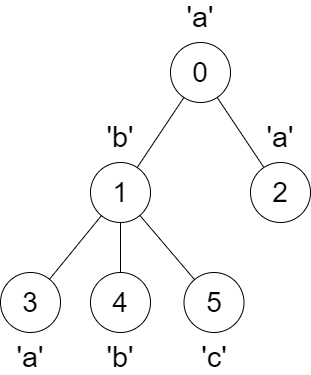
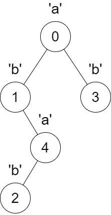

# 两种方法：两次 DFS / 一次 DFS（Python/Java/C++/Go）

> **[3331. 修改后子树的大小](https://leetcode.cn/problems/find-subtree-sizes-after-changes/solutions/2966800/liang-ci-dfszi-ding-xiang-xia-zi-di-xian-k4zj/) · Medium · 难度分 2046**

> **所属题单**
> - [链表、二叉树与回溯 · 三、一般树](../../../刷题路径/灵神原版题单/链表、二叉树与回溯/三、一般树.md) · §3.4 有递有归

> **题目描述**
> 给你一棵 `n` 个节点且根节点为编号 0 的树，节点编号为 `0` 到 `n - 1` 。这棵树用一个长度为 `n` 的数组 `parent` 表示，其中 `parent[i]` 是第 `i` 个节点的父亲节点的编号。由于节点 0 是根，`parent[0] == -1` 。
>
> 给你一个长度为 `n` 的字符串 `s` ，其中 `s[i]` 是节点 `i` 对应的字符。
>
> 对于节点编号从 `1` 到 `n - 1` 的每个节点 `x` ，我们 **同时** 执行以下操作 **一次** ：
>
> - 找到距离节点 `x` **最近** 的祖先节点 `y` ，且 `s[x] == s[y]` 。
>
> - 如果节点 `y` 不存在，那么不做任何修改。
>
> - 否则，将节点 `x` 与它父亲节点之间的边 **删除** ，在 `x` 与 `y` 之间连接一条边，使 `y` 变为 `x` 新的父节点。
>
> 请你返回一个长度为 `n` 的数组 `answer` ，其中 `answer[i]` 是 **最终** 树中，节点 `i` 为根的 子树 的 **大小** 。
>
> **示例 1：**
>
> **输入：**`parent = [-1,0,0,1,1,1], s = "abaabc"`
>
> **输出：**`[6,3,1,1,1,1]`
>
> **解释：**
>
> 
>
> 节点 3 的父节点从节点 1 变为节点 0 。
>
> **示例 2：**
>
> **输入：**`parent = [-1,0,4,0,1], s = "abbba"`
>
> **输出：**`[5,2,1,1,1]`
>
> **解释：**
>
> 
>
> 以下变化会同时发生：
>
> - 节点 4 的父节点从节点 1 变为节点 0 。
>
> - 节点 2 的父节点从节点 4 变为节点 1 。
>
> **提示：**
>
> - `n == parent.length == s.length`
>
> - `1 <= n <= 10⁵`
>
> - 对于所有的 `i >= 1` ，都有 `0 <= parent[i] <= n - 1` 。
>
> - `parent[0] == -1`
>
> - `parent` 表示一棵合法的树。
>
> - `s` 只包含小写英文字母。

> **题解**
> ## 方法一：两次 DFS
>
> 不了解递归的同学请先看[【基础算法精讲 09】](https://www.bilibili.com/video/BV1UD4y1Y769/)。
>
> ### 第一次 DFS
>
> 写一个自顶向下的 DFS，同时维护路径上的每个字母对应的最深节点 $\textit{ancestor}$，初始化成一个全为 $-1$ 的数组（或者哈希表）。递归到节点 $x$ 时，更新 $\textit{ancestor}[s[x]]=x$。
>
> 例如示例 1，递归到节点 $1$ 时，有 $\textit{ancestor}[\texttt{a}]=0,\ \textit{ancestor}[\texttt{b}]=1$。
>
> 对于节点 $x$ 及其儿子 $y$，如果 $\textit{ancestor}[s[y]]\ne -1$，则把 $y$ 加到 $\textit{ancestor}[s[y]]$ 的子节点列表中，同时把 $x$ 的儿子 $y$ 改成 $-1$，在第二次 DFS 中，不去递归等于 $-1$ 的儿子。
>
> 注意要写 [回溯](https://www.bilibili.com/video/BV1mG4y1A7Gu/)，递归返回前，要恢复 $\textit{ancestor}[s[x]]$ 的原始值（递归到 $x$ 之前的值）。
>
> ### 第二次 DFS
>
> 写一个自底向上的 DFS，返回子树大小。
>
> 当前子树大小为 $1$（自己）加上所有儿子子树的大小之和。
>
> ⚠**注意**：在遍历列表的同时，往列表中加入数据，会导致我们遍历到新加入列表的数据。可以考虑固定遍历次数为 $x$ 的子节点列表的长度。
>
> > Go 语言不用考虑这个问题。
>
> ```python
> class Solution:
>     def findSubtreeSizes(self, parent: List[int], s: str) -> List[int]:
>         n = len(parent)
>         g = [[] for _ in range(n)]
>         for i in range(1, n):
>             g[parent[i]].append(i)
>
>         ancestor = defaultdict(lambda: -1)
>         def rebuild(x: int) -> None:
>             old = ancestor[s[x]]
>             ancestor[s[x]] = x
>             for i in range(len(g[x])):
>                 y = g[x][i]
>                 if (anc := ancestor[s[y]]) != -1:
>                     g[anc].append(y)
>                     g[x][i] = -1  # -1 表示删除 y
>                 rebuild(y)
>             ancestor[s[x]] = old  # 恢复现场
>         rebuild(0)
>
>         size = [1] * n  # 注意这里已经把 1 算进去了
>         def dfs(x: int) -> None:
>             for y in g[x]:
>                 if y != -1:  # y 没被删除
>                     dfs(y)
>                     size[x] += size[y]
>         dfs(0)
>         return size
> ```
>
>
> #### 复杂度分析
>
> - 时间复杂度：$\mathcal{O}(n+|\Sigma|)$，其中 $n$ 是 $s$ 的长度，$|\Sigma|=26$ 是字符集合的大小。
> - 空间复杂度：$\mathcal{O}(n)$。
>
> ## 方法二：一次 DFS
>
> 把两个 DFS 结合起来。在 $\textit{dfs}(y)$ 结束后，分类讨论：
>
> - 如果 $y$ 没有对应的祖先，把 $\textit{size}[x]$ 增加 $\textit{size}[y]$。
> - 如果 $y$ 有对应的祖先 $\textit{anc}$，把 $\textit{size}[\textit{anc}]$ 增加 $\textit{size}[y]$。
>
> 具体请看 [视频讲解](https://www.bilibili.com/video/BV13J1MYwEGM/)，欢迎点赞关注~
>
> ```python
> class Solution:
>     def findSubtreeSizes(self, parent: List[int], s: str) -> List[int]:
>         n = len(parent)
>         g = [[] for _ in range(n)]
>         for i in range(1, n):
>             g[parent[i]].append(i)
>
>         size = [1] * n
>         ancestor = defaultdict(lambda: -1)
>         def dfs(x: int) -> None:
>             old = ancestor[s[x]]
>             ancestor[s[x]] = x
>             for y in g[x]:
>                 dfs(y)
>                 anc = ancestor[s[y]]
>                 size[x if anc < 0 else anc] += size[y]
>             ancestor[s[x]] = old  # 恢复现场
>         dfs(0)
>         return size
> ```
>
>
> #### 复杂度分析
>
> - 时间复杂度：$\mathcal{O}(n+|\Sigma|)$，其中 $n$ 是 $s$ 的长度，$|\Sigma|=26$ 是字符集合的大小。
> - 空间复杂度：$\mathcal{O}(n)$。
>
> 更多相似题目，见 [链表、二叉树与一般树](https://leetcode.cn/circle/discuss/K0n2gO/) 中的「**§2.2 自顶向下 DFS**」和「**§2.3 自底向上 DFS**」。
>
> ## 分类题单
>
> [如何科学刷题？](https://leetcode.cn/circle/discuss/RvFUtj/)
>
> 1. [滑动窗口与双指针（定长/不定长/单序列/双序列/三指针）](https://leetcode.cn/circle/discuss/0viNMK/)
> 2. [二分算法（二分答案/最小化最大值/最大化最小值/第K小）](https://leetcode.cn/circle/discuss/SqopEo/)
> 3. [单调栈（基础/矩形面积/贡献法/最小字典序）](https://leetcode.cn/circle/discuss/9oZFK9/)
> 4. [网格图（DFS/BFS/综合应用）](https://leetcode.cn/circle/discuss/YiXPXW/)
> 5. [位运算（基础/性质/拆位/试填/恒等式/思维）](https://leetcode.cn/circle/discuss/dHn9Vk/)
> 6. [图论算法（DFS/BFS/拓扑排序/最短路/最小生成树/二分图/基环树/欧拉路径）](https://leetcode.cn/circle/discuss/01LUak/)
> 7. [动态规划（入门/背包/状态机/划分/区间/状压/数位/数据结构优化/树形/博弈/概率期望）](https://leetcode.cn/circle/discuss/tXLS3i/)
> 8. [常用数据结构（前缀和/差分/栈/队列/堆/字典树/并查集/树状数组/线段树）](https://leetcode.cn/circle/discuss/mOr1u6/)
> 9. [数学算法（数论/组合/概率期望/博弈/计算几何/随机算法）](https://leetcode.cn/circle/discuss/IYT3ss/)
> 10. [贪心与思维（基本贪心策略/反悔/区间/字典序/数学/思维/脑筋急转弯/构造）](https://leetcode.cn/circle/discuss/g6KTKL/)
> 11. [链表、二叉树与一般树（前后指针/快慢指针/DFS/BFS/直径/LCA）](https://leetcode.cn/circle/discuss/K0n2gO/)
> 12. [字符串（KMP/Z函数/Manacher/字符串哈希/AC自动机/后缀数组/子序列自动机）](https://leetcode.cn/circle/discuss/SJFwQI/)
>
> [我的题解精选（已分类）](https://github.com/EndlessCheng/codeforces-go/blob/master/leetcode/SOLUTIONS.md)
