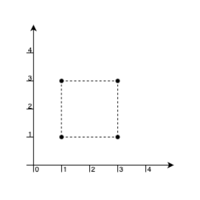
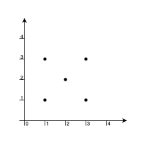
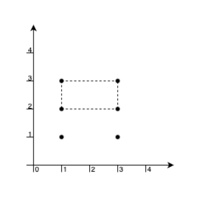

# 非暴力做法：离线询问+离散化+树状数组（Python/Java/C++/Go）

> **[3380. 用点构造面积最大的矩形 I](https://leetcode.cn/problems/maximum-area-rectangle-with-point-constraints-i/solutions/3013913/fei-bao-li-zuo-fa-chi-xian-xun-wen-chi-s-pmnz/) · Medium**

> **题目描述**
> 给你一个数组 `points`，其中 `points[i] = [x_i, y_i]` 表示无限平面上一点的坐标。
>
> 你的任务是找出满足以下条件的矩形可能的 **最大** 面积：
>
> - 矩形的四个顶点必须是数组中的 **四个** 点。
>
> - 矩形的内部或边界上 **不能** 包含任何其他点。
>
> - 矩形的边与坐标轴 **平行** 。
>
> 返回可以获得的 **最大面积** ，如果无法形成这样的矩形，则返回 -1。
>
> **示例 1：**
>
> **输入：** `points = [[1,1],[1,3],[3,1],[3,3]]`
>
> **输出：**4
>
> **解释：**
>
> 
>
> 我们可以用这 4 个点作为顶点构成一个矩形，并且矩形内部或边界上没有其他点。因此，最大面积为 4 。
>
> **示例 2：**
>
> **输入：** `points = [[1,1],[1,3],[3,1],[3,3],[2,2]]`
>
> **输出：**-1
>
> **解释：**
>
> 
>
> 唯一一组可能构成矩形的点为 `[1,1], [1,3], [3,1]` 和 `[3,3]`，但点 `[2,2]` 总是位于矩形内部。因此，返回 -1 。
>
> **示例 3：**
>
> **输入：** `points = [[1,1],[1,3],[3,1],[3,3],[1,2],[3,2]]`
>
> **输出：**2
>
> **解释：**
>
> 
>
> 点 `[1,3], [1,2], [3,2], [3,3]` 可以构成面积最大的矩形，面积为 2。此外，点 `[1,1], [1,2], [3,1], [3,2]` 也可以构成一个符合题目要求的矩形，面积相同。
>
> **提示：**
>
> - `1 <= points.length <= 10`
>
> - `points[i].length == 2`
>
> - `0 <= x_i, y_i <= 100`
>
> - 给定的所有点都是 **唯一** 的。

> **题解**
> 本题和周赛第四题是一样的，请看 [我的题解](../3382%20用点构造面积最大的矩形%20II/灵茶山艾府.md)。
