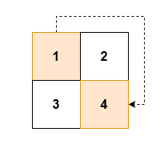
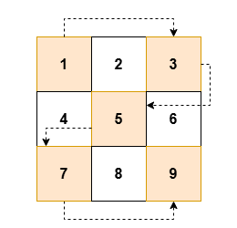

# 3417. 跳过交替单元格的之字形遍历

Easy · [力扣原题](https://leetcode.cn/problems/zigzag-grid-traversal-with-skip/)

| 作者 | 题解 | 动画讲解 |
|---|---|---|
| 灵茶山艾府 | [📄 题解](灵茶山艾府.md) | [▶︎ 3417 跳过交替单元格的之字形遍历 · 灵茶山艾府.mp4](3417%20跳过交替单元格的之字形遍历%20·%20灵茶山艾府.mp4) |
| yiduobo | [📄 题解](yiduobo.md) | [▶︎ 3417 跳过交替单元格的之字形遍历 · yiduobo.mp4](3417%20跳过交替单元格的之字形遍历%20·%20yiduobo.mp4) |

## 题目描述

给你一个 `m x n` 的二维数组 `grid`，数组由 **正整数** 组成。

你的任务是以 **之字形** 遍历 `grid`，同时跳过每个 **交替** 的单元格。

之字形遍历的定义如下：

- 从左上角的单元格 `(0, 0)` 开始。

- 在当前行中向 **右** 移动，直到到达该行的末尾。

- 下移到下一行，然后在该行中向 **左** 移动，直到到达该行的开头。

- 继续在行间交替向右和向左移动，直到所有行都被遍历完。

**注意：**在遍历过程中，必须跳过每个 **交替** 的单元格。

返回一个整数数组 `result`，其中包含按 **顺序** 记录的、且跳过交替单元格后的之字形遍历中访问到的单元格值。

**示例 1：**

**输入：** `grid = [[1,2],[3,4]]`

**输出：** `[1,4]`

**解释：**

**示例 2：**

**输入：** `grid = [[2,1],[2,1],[2,1]]`

**输出：** `[2,1,2]`

**解释：**

**示例 3：**

**输入：** `grid = [[1,2,3],[4,5,6],[7,8,9]]`

**输出：** `[1,3,5,7,9]`

**解释：**

**提示：**

- `2 <= n == grid.length <= 50`

- `2 <= m == grid[i].length <= 50`

- `1 <= grid[i][j] <= 2500`

---
[↑ 返回 3400-3499](../README.md) · [总索引](../../../索引.md) · [仓库首页](../../../README.md)
