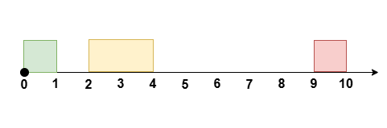

# 转化成定长滑动窗口（Python/Java/C++/Go）

> **[3439. 重新安排会议得到最多空余时间 I](https://leetcode.cn/problems/reschedule-meetings-for-maximum-free-time-i/solutions/3061619/zhuan-huan-cheng-ding-chang-hua-dong-chu-1kg1/) · Medium · 难度分 1729**

> **所属题单**
> - [滑动窗口与双指针 · 一、定长滑动窗口](../../../刷题路径/灵神原版题单/滑动窗口与双指针/一、定长滑动窗口.md) · §1.2 进阶（选做）

> **题目描述**
> 给你一个整数 `eventTime` 表示一个活动的总时长，这个活动开始于 `t = 0` ，结束于 `t = eventTime` 。
>
> 同时给你两个长度为 `n` 的整数数组 `startTime` 和 `endTime` 。它们表示这次活动中 `n` 个时间 **没有重叠** 的会议，其中第 `i` 个会议的时间为 `[startTime[i], endTime[i]]` 。
>
> 你可以重新安排 **至多** `k` 个会议，安排的规则是将会议时间平移，且保持原来的 **会议时长** ，你的目的是移动会议后 **最大化** 相邻两个会议之间的 **最长** 连续空余时间。
>
> 移动前后所有会议之间的 **相对** 顺序需要保持不变，而且会议时间也需要保持互不重叠。
>
> 请你返回重新安排会议以后，可以得到的 **最大** 空余时间。
>
> **注意**，会议 **不能** 安排到整个活动的时间以外。
>
> **示例 1：**
>
> **输入：**`eventTime = 5, k = 1, startTime = [1,3], endTime = [2,5]`
>
> **输出：**`2`
>
> **解释：**
>
> 
>
> 将 `[1, 2]` 的会议安排到 `[2, 3]` ，得到空余时间 `[0, 2]` 。
>
> **示例 2：**
>
> **输入：**`eventTime = 10, k = 1, startTime = [0,2,9], endTime = [1,4,10]`
>
> **输出：**`6`
>
> **解释：**
>
> 
>
> 将 `[2, 4]` 的会议安排到 `[1, 3]` ，得到空余时间 `[3, 9]` 。
>
> **示例 3：**
>
> **输入：**`eventTime = 5, k = 2, startTime = [0,1,2,3,4], endTime = [1,2,3,4,5]`
>
> **输出：**`0`
>
> **解释：**
>
> 活动中的所有时间都被会议安排满了。
>
> **提示：**
>
> - `1 <= eventTime <= 10⁹`
>
> - `n == startTime.length == endTime.length`
>
> - `2 <= n <= 10⁵`
>
> - `1 <= k <= n`
>
> - `0 <= startTime[i] < endTime[i] <= eventTime`
>
> - `endTime[i] <= startTime[i + 1]` 其中 `i` 在范围 `[0, n - 2]` 之间。

> **题解**
> 
>
> 看示例 1：
>
> - 如果把会议区间 $[1,2]$ 向左移动到 $[0,1]$，会产生空余时间段 $[1,3]$。
> - 如果把会议区间 $[1,2]$ 向右移动到 $[2,3]$，会产生空余时间段 $[0,2]$。
>
> 这两种情况，都相当于把两个**相邻**的长为 $1$ 空余时间段 $[0,1]$ 和 $[2,3]$ **合并**成一个更长的长为 $1+1=2$ 的空余时间段。
>
> 如果 $k=1$，那么我们可以合并 $2$ 个相邻的空余时间段。
>
> 如果 $k=2$，为了让答案尽量大，合并连续 $3$ 个空余时间段，相比其他方案是最优的。（注意题目要求会议之间的相对顺序必须保持不变）
>
> 一般地，最优做法是合并连续 $k+1$ 个空余时间段。
>
> 现在问题变成：
>
> - 给你 $n+1$ 个空余时间段，合并其中连续 $k+1$ 个空余时间段，得到的最大长度是多少？
>
> > **注 1**：最左边和最右边各有一个空余时间段，中间有 $n-1$ 个空余时间段夹在两个相邻会议之间，所以有 $n+1$ 个空余时间段。
> > 
> > **注 2**：空余时间段的长度可以是 $0$。
>
> 这可以用**定长滑动窗口**解决，窗口大小为 $k+1$。原理见[【套路】教你解决定长滑窗！适用于所有定长滑窗题目！](../../1400-1499/1456%20定长子串中元音的最大数目/灵茶山艾府.md)
>
> [本题视频讲解](https://www.bilibili.com/video/BV1eUF6eaERQ/?t=38s)，欢迎点赞关注~
>
> ## 写法一
>
> 创建一个长为 $n+1$ 的数组，保存所有空余时间段的长度：
>
> - 最左边的空余时间段：长为 $\textit{startTime}[0]$。
> - 中间的空余时间段：长为 $\textit{startTime}[i] - \textit{endTime}[i-1]$。
> - 最右边的空余时间段：长为 $\textit{eventTime} - \textit{endTime}[n-1]$。
>
> 示例 1 的数组为 $[1, 1, 0]$。
>
> 示例 2 的数组为 $[0, 1, 5, 0]$。
>
> 示例 3 的数组为 $[0, 0, 0, 0, 0, 0]$。
>
> ```python
> class Solution:
>     def maxFreeTime(self, eventTime: int, k: int, startTime: List[int], endTime: List[int]) -> int:
>         n = len(startTime)
>         free = [0] * (n + 1)
>         free[0] = startTime[0]  # 最左边的空余时间段
>         for i in range(1, n):
>             free[i] = startTime[i] - endTime[i - 1]  # 中间的空余时间段
>         free[n] = eventTime - endTime[-1]  # 最右边的空余时间段
>
>         # 套定长滑窗模板（窗口长为 k+1）
>         ans = s = 0
>         for i, f in enumerate(free):
>             s += f
>             if i < k:
>                 continue
>             ans = max(ans, s)
>             s -= free[i - k]
>         return ans
> ```
>
> > [!example]- Python3 精简写法
> > ```python
> > class Solution:
> >     def maxFreeTime(self, eventTime: int, k: int, startTime: List[int], endTime: List[int]) -> int:
> >         free = [startTime[0]] + [s - e for s, e in zip(startTime[1:], endTime)] + [eventTime - endTime[-1]]
> >         ans = s = 0
> >         for i, f in enumerate(free):
> >             s += f
> >             if i < k:
> >                 continue
> >             ans = max(ans, s)
> >             s -= free[i - k]
> >         return ans
> > ```
>
>
> #### 复杂度分析
>
> - 时间复杂度：$\mathcal{O}(n)$，其中 $n$ 是 $\textit{startTime}$ 的长度。
> - 空间复杂度：$\mathcal{O}(n)$。
>
> ## 写法二：空间优化
>
> 改用一个函数计算第 $i$ 个空余时间段的长度，从而省去 $\textit{free}$ 数组。
>
> ```python
> class Solution:
>     def maxFreeTime(self, eventTime: int, k: int, startTime: List[int], endTime: List[int]) -> int:
>         def get(i: int) -> int:
>             if i == 0:
>                 return startTime[0]  # 最左边的空余时间段
>             if i == n:
>                 return eventTime - endTime[-1]  # 最右边的空余时间段
>             return startTime[i] - endTime[i - 1]  # 中间的空余时间段
>
>         n = len(startTime)
>         ans = s = 0
>         for i in range(n + 1):
>             s += get(i)
>             if i < k:
>                 continue
>             ans = max(ans, s)
>             s -= get(i - k)
>         return ans
> ```
>
>
> #### 复杂度分析
>
> - 时间复杂度：$\mathcal{O}(n)$，其中 $n$ 是 $\textit{startTime}$ 的长度。
> - 空间复杂度：$\mathcal{O}(1)$。
>
> ## 分类题单
>
> [如何科学刷题？](https://leetcode.cn/circle/discuss/RvFUtj/)
>
> 1. [滑动窗口与双指针（定长/不定长/单序列/双序列/三指针/分组循环）](https://leetcode.cn/circle/discuss/0viNMK/)
> 2. [二分算法（二分答案/最小化最大值/最大化最小值/第K小）](https://leetcode.cn/circle/discuss/SqopEo/)
> 3. [单调栈（基础/矩形面积/贡献法/最小字典序）](https://leetcode.cn/circle/discuss/9oZFK9/)
> 4. [网格图（DFS/BFS/综合应用）](https://leetcode.cn/circle/discuss/YiXPXW/)
> 5. [位运算（基础/性质/拆位/试填/恒等式/思维）](https://leetcode.cn/circle/discuss/dHn9Vk/)
> 6. [图论算法（DFS/BFS/拓扑排序/基环树/最短路/最小生成树/网络流）](https://leetcode.cn/circle/discuss/01LUak/)
> 7. [动态规划（入门/背包/划分/状态机/区间/状压/数位/数据结构优化/树形/博弈/概率期望）](https://leetcode.cn/circle/discuss/tXLS3i/)
> 8. [常用数据结构（前缀和/差分/栈/队列/堆/字典树/并查集/树状数组/线段树）](https://leetcode.cn/circle/discuss/mOr1u6/)
> 9. [数学算法（数论/组合/概率期望/博弈/计算几何/随机算法）](https://leetcode.cn/circle/discuss/IYT3ss/)
> 10. [贪心与思维（基本贪心策略/反悔/区间/字典序/数学/思维/脑筋急转弯/构造）](https://leetcode.cn/circle/discuss/g6KTKL/)
> 11. [链表、二叉树与回溯（前后指针/快慢指针/DFS/BFS/直径/LCA/一般树）](https://leetcode.cn/circle/discuss/K0n2gO/)
> 12. [字符串（KMP/Z函数/Manacher/字符串哈希/AC自动机/后缀数组/子序列自动机）](https://leetcode.cn/circle/discuss/SJFwQI/)
>
> [我的题解精选（已分类）](https://github.com/EndlessCheng/codeforces-go/blob/master/leetcode/SOLUTIONS.md)
>
> 欢迎关注 [B站@灵茶山艾府](https://space.bilibili.com/206214)
