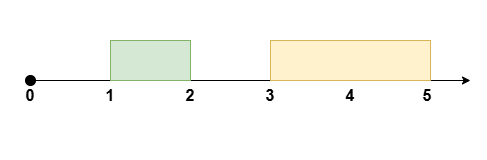
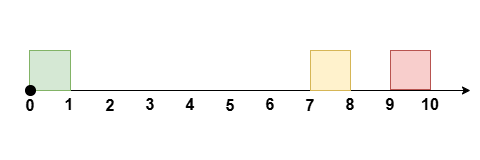
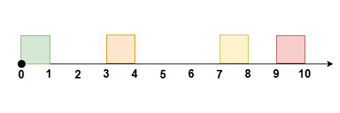

# 维护前三大的空位+枚举+分类讨论（Python/Java/C++/Go）

> **[3440. 重新安排会议得到最多空余时间 II](https://leetcode.cn/problems/reschedule-meetings-for-maximum-free-time-ii/solutions/3061629/wei-hu-qian-san-da-de-kong-wei-mei-ju-fe-xm2f/) · Medium · 难度分 1998**

> **所属题单**
> - [贪心算法 · 五、思维题](../../../刷题路径/灵神原版题单/贪心算法/五、思维题.md) · §5.8 分类讨论

> **题目描述**
> 给你一个整数 `eventTime` 表示一个活动的总时长，这个活动开始于 `t = 0` ，结束于 `t = eventTime` 。
>
> 同时给你两个长度为 `n` 的整数数组 `startTime` 和 `endTime` 。它们表示这次活动中 `n` 个时间 **没有重叠** 的会议，其中第 `i` 个会议的时间为 `[startTime[i], endTime[i]]` 。
>
> 你可以重新安排 **至多** 一个会议，安排的规则是将会议时间平移，且保持原来的 **会议时长** ，你的目的是移动会议后 **最大化** **最长** 连续空余时间。
>
> 请你返回重新安排会议以后，可以得到的 **最大** 空余时间。
>
> **注意**，会议 **不能** 安排到整个活动的时间以外，且会议之间需要保持互不重叠。
>
> **注意：**重新安排会议以后，会议之间的顺序可以发生改变。
>
> **示例 1：**
>
> **输入：**`eventTime = 5, startTime = [1,3], endTime = [2,5]`
>
> **输出：**`2`
>
> **解释：**
>
> 
>
> 将 `[1, 2]` 的会议安排到 `[2, 3]` ，得到空余时间 `[0, 2]` 。
>
> **示例 2：**
>
> **输入：**`eventTime = 10, startTime = [0,7,9], endTime = [1,8,10]`
>
> **输出：**`7`
>
> **解释：**
>
> 
>
> 将 `[0, 1]` 的会议安排到 `[8, 9]` ，得到空余时间 `[0, 7]` 。
>
> **示例 3：**
>
> **输入：**`eventTime = 10, startTime = [0,3,7,9], endTime = [1,4,8,10]`
>
> **输出：**6
>
> **解释：**
>
> 
>
> 将 `[3, 4]` 的会议安排到 `[8, 9]` ，得到空余时间 `[1, 7]` 。
>
> **示例 4：**
>
> **输入：**`eventTime = 5, startTime = [0,1,2,3,4], endTime = [1,2,3,4,5]`
>
> **输出：**`0`
>
> **解释：**
>
> 活动中的所有时间都被会议安排满了。
>
> **提示：**
>
> - `1 <= eventTime <= 10⁹`
>
> - `n == startTime.length == endTime.length`
>
> - `2 <= n <= 10⁵`
>
> - `0 <= startTime[i] < endTime[i] <= eventTime`
>
> - `endTime[i] <= startTime[i + 1]` 其中 `i` 在范围 `[0, n - 2]` 之间。

> **题解**
> 把会议区间视作**桌子**，空余时间视作**空位**，我们要把一个桌子移到别的空位中。
>
> 初步想法是**枚举桌子**，找一个长度大于等于桌子长度的空位移过去。看上去，找一个长度最长的空位就好了。
>
> 但万一最长空位与桌子相邻呢？这并没有把桌子彻底移出去。
>
> 找次长的空位？万一最长空位和次长空位都与桌子相邻呢？
>
> 那就再找第三长的。不可能有三个空位都与同一个桌子相邻。
>
> **核心思路**：计算长度最长的三个空位在哪，其中一定有一个空位不在移出去的桌子的左右两侧。如果空位长度大于等于桌子的长度，我们把桌子移到这个空位中。
>
> 设最大的三个空位所在的位置（下标）分别是 $a,b,c$。
>
> 枚举桌子，分类讨论：
>
> - 如果桌子左右两侧的空位没有 $a$，那么把桌子移到 $a$。
> - 否则，如果桌子左右两侧的空位没有 $b$，那么把桌子移到 $b$。
> - 否则，桌子左右两侧的空位一定是 $a$ 和 $b$，桌子只能移到 $c$。
>
> 继续分类讨论：
>
> - 如果能移（有足够长的空位），新的空位长度 = 桌子长度 + 桌子左右两侧的空位长度。
> - 如果不能移，那么只能移到左右相邻的桌子旁边，新的空位长度 = 桌子左右两侧的空位长度。
>
> 具体请看 [视频讲解](https://www.bilibili.com/video/BV1eUF6eaERQ/?t=4m28s)，欢迎点赞关注~
>
> ```python
> class Solution:
>     def maxFreeTime(self, eventTime: int, startTime: List[int], endTime: List[int]) -> int:
>         n = len(startTime)
>
>         # 计算空位长度
>         def get(i: int) -> int:
>             if i == 0:
>                 return startTime[0]
>             if i == n:
>                 return eventTime - endTime[n - 1]
>             return startTime[i] - endTime[i - 1]
>
>         # 有 n+1 个空位，计算前三大的空位在哪
>         a, b, c = 0, -1, -1
>         for i in range(1, n + 1):
>             sz = get(i)
>             if sz > get(a):
>                 a, b, c = i, a, b
>             elif b < 0 or sz > get(b):
>                 b, c = i, b
>             elif c < 0 or sz > get(c):
>                 c = i
>
>         ans = 0
>         # 枚举桌子
>         for i, (s, e) in enumerate(zip(startTime, endTime)):
>             sz = e - s
>             if i != a and i + 1 != a and sz <= get(a) or \
>                i != b and i + 1 != b and sz <= get(b) or \
>                sz <= get(c):  # 可以移出去
>                 ans = max(ans, get(i) + sz + get(i + 1))
>             else:
>                 ans = max(ans, get(i) + get(i + 1))
>         return ans
> ```
>
> > [!example]- Python3 写法二
> > ```python
> > class Solution:
> >     def maxFreeTime(self, eventTime: int, startTime: List[int], endTime: List[int]) -> int:
> >         free = [startTime[0]] + [s - e for s, e in zip(startTime[1:], endTime)] + [eventTime - endTime[-1]]
> >
> >         a = b = c = -1
> >         for i, sz in enumerate(free):
> >             if a < 0 or sz > free[a]:
> >                 a, b, c = i, a, b
> >             elif b < 0 or sz > free[b]:
> >                 b, c = i, b
> >             elif c < 0 or sz > free[c]:
> >                 c = i
> >
> >         ans = 0
> >         for i, (s, e) in enumerate(zip(startTime, endTime)):
> >             sz = e - s
> >             if i != a and i + 1 != a and sz <= free[a] or \
> >                i != b and i + 1 != b and sz <= free[b] or \
> >                sz <= free[c]:
> >                 ans = max(ans, free[i] + sz + free[i + 1])
> >             else:
> >                 ans = max(ans, free[i] + free[i + 1])
> >         return ans
> > ```
>
>
> #### 复杂度分析
>
> - 时间复杂度：$\mathcal{O}(n)$，其中 $n$ 是 $\textit{startTime}$ 的长度。
> - 空间复杂度：$\mathcal{O}(1)$。
>
> ## 分类题单
>
> [如何科学刷题？](https://leetcode.cn/circle/discuss/RvFUtj/)
>
> 1. [滑动窗口与双指针（定长/不定长/单序列/双序列/三指针/分组循环）](https://leetcode.cn/circle/discuss/0viNMK/)
> 2. [二分算法（二分答案/最小化最大值/最大化最小值/第K小）](https://leetcode.cn/circle/discuss/SqopEo/)
> 3. [单调栈（基础/矩形面积/贡献法/最小字典序）](https://leetcode.cn/circle/discuss/9oZFK9/)
> 4. [网格图（DFS/BFS/综合应用）](https://leetcode.cn/circle/discuss/YiXPXW/)
> 5. [位运算（基础/性质/拆位/试填/恒等式/思维）](https://leetcode.cn/circle/discuss/dHn9Vk/)
> 6. [图论算法（DFS/BFS/拓扑排序/基环树/最短路/最小生成树/网络流）](https://leetcode.cn/circle/discuss/01LUak/)
> 7. [动态规划（入门/背包/划分/状态机/区间/状压/数位/数据结构优化/树形/博弈/概率期望）](https://leetcode.cn/circle/discuss/tXLS3i/)
> 8. [常用数据结构（前缀和/差分/栈/队列/堆/字典树/并查集/树状数组/线段树）](https://leetcode.cn/circle/discuss/mOr1u6/)
> 9. [数学算法（数论/组合/概率期望/博弈/计算几何/随机算法）](https://leetcode.cn/circle/discuss/IYT3ss/)
> 10. [贪心与思维（基本贪心策略/反悔/区间/字典序/数学/思维/脑筋急转弯/构造）](https://leetcode.cn/circle/discuss/g6KTKL/)
> 11. [链表、二叉树与回溯（前后指针/快慢指针/DFS/BFS/直径/LCA/一般树）](https://leetcode.cn/circle/discuss/K0n2gO/)
> 12. [字符串（KMP/Z函数/Manacher/字符串哈希/AC自动机/后缀数组/子序列自动机）](https://leetcode.cn/circle/discuss/SJFwQI/)
>
> [我的题解精选（已分类）](https://github.com/EndlessCheng/codeforces-go/blob/master/leetcode/SOLUTIONS.md)
>
> 欢迎关注 [B站@灵茶山艾府](https://space.bilibili.com/206214)
