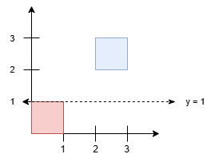
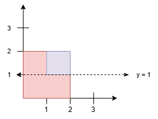

# 3454. 分割正方形 II

Hard · 难度分 2671 · [力扣原题](https://leetcode.cn/problems/separate-squares-ii/)

所在刷题路径：灵神题单·常用数据结构

| 作者 | 题解 | 动画讲解 |
|---|---|---|
| 灵茶山艾府 | [📄 题解](灵茶山艾府.md) | [▶︎ 3454 分割正方形 II · 灵茶山艾府.mp4](3454%20分割正方形%20II%20·%20灵茶山艾府.mp4) |
| yiduobo | [📄 题解](yiduobo.md) | [▶︎ 3454 分割正方形 II · yiduobo.mp4](3454%20分割正方形%20II%20·%20yiduobo.mp4) |

## 题目描述

给你一个二维整数数组 `squares` ，其中 `squares[i] = [x_i, y_i, l_i]` 表示一个与 x 轴平行的正方形的左下角坐标和正方形的边长。

找到一个**最小的** y 坐标，它对应一条水平线，该线需要满足它以上正方形的总面积 **等于** 该线以下正方形的总面积。

答案如果与实际答案的误差在 `10⁻⁵` 以内，将视为正确答案。

**注意**：正方形 **可能会** 重叠。重叠区域只 **统计一次** 。

**示例 1：**

**输入：** `squares = [[0,0,1],[2,2,1]]`

**输出：** `1.00000`

**解释：**

任何在 `y = 1` 和 `y = 2` 之间的水平线都会有 1 平方单位的面积在其上方，1 平方单位的面积在其下方。最小的 y 坐标是 1。

**示例 2：**

**输入：** `squares = [[0,0,2],[1,1,1]]`

**输出：** `1.00000`

**解释：**

由于蓝色正方形和红色正方形有重叠区域且重叠区域只统计一次。所以直线 `y = 1` 将正方形分割成两部分且面积相等。

**提示：**

- `1 <= squares.length <= 5 * 10⁴`

- `squares[i] = [x_i, y_i, l_i]`

- `squares[i].length == 3`

- `0 <= x_i, y_i <= 10⁹`

- `1 <= l_i <= 10⁹`

- 所有正方形的总面积不超过 `10¹⁵`。

---
[↑ 返回 3400-3499](../README.md) · [总索引](../../../索引.md) · [仓库首页](../../../README.md)
