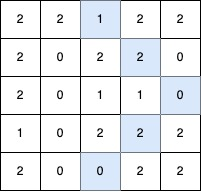
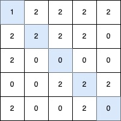

# 3459. 最长 V 形对角线段的长度

Hard · 难度分 2337 · [力扣原题](https://leetcode.cn/problems/length-of-longest-v-shaped-diagonal-segment/)

所在刷题路径：灵神题单·动态规划

| 作者 | 题解 | 动画讲解 |
|---|---|---|
| 灵茶山艾府 | [📄 题解](灵茶山艾府.md) | [▶︎ 3459 最长 V 形对角线段的长度 · 灵茶山艾府.mp4](3459%20最长%20V%20形对角线段的长度%20·%20灵茶山艾府.mp4) |
| yiduobo | [📄 题解](yiduobo.md) | [▶︎ 3459 最长 V 形对角线段的长度 · yiduobo.mp4](3459%20最长%20V%20形对角线段的长度%20·%20yiduobo.mp4) |

## 题目描述

给你一个大小为 `n x m` 的二维整数矩阵 `grid`，其中每个元素的值为 `0`、`1` 或 `2`。

**V 形对角线段** 定义如下：

- 线段从 `1` 开始。

- 后续元素按照以下无限序列的模式排列：`2, 0, 2, 0, ...`。

- 该线段：

    - 起始于某个对角方向（左上到右下、右下到左上、右上到左下或左下到右上）。

    - 沿着相同的对角方向继续，保持 **序列模式** 。

    - 在保持 **序列模式** 的前提下，最多允许 **一次顺时针 90 度转向** 另一个对角方向。

返回最长的 **V 形对角线段** 的 **长度** 。如果不存在有效的线段，则返回 0。

**示例 1：**

**输入：** `grid = [[2,2,1,2,2],[2,0,2,2,0],[2,0,1,1,0],[1,0,2,2,2],[2,0,0,2,2]]`

**输出：** `5`

**解释：**

最长的 V 形对角线段长度为 5，路径如下：`(0,2) → (1,3) → (2,4)`，在 `(2,4)` 处进行 **顺时针 90 度转向** ，继续路径为 `(3,3) → (4,2)`。

**示例 2：**

**输入：** `grid = [[2,2,2,2,2],[2,0,2,2,0],[2,0,1,1,0],[1,0,2,2,2],[2,0,0,2,2]]`

**输出：** `4`

**解释：**

最长的 V 形对角线段长度为 4，路径如下：`(2,3) → (3,2)`，在 `(3,2)` 处进行 **顺时针 90 度转向** ，继续路径为 `(2,1) → (1,0)`。

**示例 3：**

**输入：** `grid = [[1,2,2,2,2],[2,2,2,2,0],[2,0,0,0,0],[0,0,2,2,2],[2,0,0,2,0]]`

**输出：** `5`

**解释：**

最长的 V 形对角线段长度为 5，路径如下：`(0,0) → (1,1) → (2,2) → (3,3) → (4,4)`。

**示例 4：**

**输入：** `grid = [[1]]`

**输出：** `1`

**解释：**

最长的 V 形对角线段长度为 1，路径如下：`(0,0)`。

**提示：**

- `n == grid.length`

- `m == grid[i].length`

- `1 <= n, m <= 500`

- `grid[i][j]` 的值为 `0`、`1` 或 `2`。

---
[↑ 返回 3400-3499](../README.md) · [总索引](../../../索引.md) · [仓库首页](../../../README.md)
