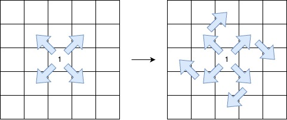

# 记忆化搜索+最优性剪枝（Python/Java/C++/Go）

> **[3459. 最长 V 形对角线段的长度](https://leetcode.cn/problems/length-of-longest-v-shaped-diagonal-segment/solutions/3076747/ji-yi-hua-sou-suo-pythonjavacgo-by-endle-jrjj/) · Hard · 难度分 2337**

> **所属题单**
> - [动态规划 · 二、网格图 DP](../../../刷题路径/灵神原版题单/动态规划/二、网格图%20DP.md) · §2.2 进阶

> **题目描述**
> 给你一个大小为 `n x m` 的二维整数矩阵 `grid`，其中每个元素的值为 `0`、`1` 或 `2`。
>
> **V 形对角线段** 定义如下：
>
> - 线段从 `1` 开始。
>
> - 后续元素按照以下无限序列的模式排列：`2, 0, 2, 0, ...`。
>
> - 该线段：
>
>     - 起始于某个对角方向（左上到右下、右下到左上、右上到左下或左下到右上）。
>
>     - 沿着相同的对角方向继续，保持 **序列模式** 。
>
>     - 在保持 **序列模式** 的前提下，最多允许 **一次顺时针 90 度转向** 另一个对角方向。
>
> 
>
> 返回最长的 **V 形对角线段** 的 **长度** 。如果不存在有效的线段，则返回 0。
>
> **示例 1：**
>
> **输入：** `grid = [[2,2,1,2,2],[2,0,2,2,0],[2,0,1,1,0],[1,0,2,2,2],[2,0,0,2,2]]`
>
> **输出：** `5`
>
> **解释：**
>
> 
>
> 最长的 V 形对角线段长度为 5，路径如下：`(0,2) → (1,3) → (2,4)`，在 `(2,4)` 处进行 **顺时针 90 度转向** ，继续路径为 `(3,3) → (4,2)`。
>
> **示例 2：**
>
> **输入：** `grid = [[2,2,2,2,2],[2,0,2,2,0],[2,0,1,1,0],[1,0,2,2,2],[2,0,0,2,2]]`
>
> **输出：** `4`
>
> **解释：**
>
> 
>
> 最长的 V 形对角线段长度为 4，路径如下：`(2,3) → (3,2)`，在 `(3,2)` 处进行 **顺时针 90 度转向** ，继续路径为 `(2,1) → (1,0)`。
>
> **示例 3：**
>
> **输入：** `grid = [[1,2,2,2,2],[2,2,2,2,0],[2,0,0,0,0],[0,0,2,2,2],[2,0,0,2,0]]`
>
> **输出：** `5`
>
> **解释：**
>
> 
>
> 最长的 V 形对角线段长度为 5，路径如下：`(0,0) → (1,1) → (2,2) → (3,3) → (4,4)`。
>
> **示例 4：**
>
> **输入：** `grid = [[1]]`
>
> **输出：** `1`
>
> **解释：**
>
> 最长的 V 形对角线段长度为 1，路径如下：`(0,0)`。
>
> **提示：**
>
> - `n == grid.length`
>
> - `m == grid[i].length`
>
> - `1 <= n, m <= 500`
>
> - `grid[i][j]` 的值为 `0`、`1` 或 `2`。

> **题解**
> 想象有一个人在网格图上移动，按照题目要求，移动经过的值必须为 $1,2,0,2,0,\dots$
>
> 由于至多转弯一次，所以移动路径不会形成环，可以写一个记忆化搜索，模拟人在网格图上的移动。
>
> 定义 $\textit{dfs}(i,j,k,\textit{canTurn},\textit{target})$ 表示在如下约束下的最长移动步数。
>
> - **上一步**的位置在 $(i,j)$。（定义成上一步，方便编程实现）
> - 移动方向为 $\textit{DIRS}[k]$，其中 $\textit{DIRS}$ 是一个长为 $4$ 的方向数组。
> - 是否可以右转，用布尔值 $\textit{canTurn}$ 表示。
> - 当前位置的目标值必须等于 $\textit{target}$。
>
> **转移**：
>
> - 设 $(i',j')$ 是从 $(i,j)$ 向 $\textit{DIRS}[k]$ 方向移动一步后的位置。
> - 直行：递归到 $\textit{dfs}(i',j',k,\textit{canTurn}, 2-\textit{target})$。这里用 $2-\textit{target}$ 来实现 $2$ 和 $0$ 的切换。也可以写成 $\textit{target}\oplus 2$。 
> - 右转：如果 $\textit{canTurn} = \texttt{true}$，那么递归到 $\textit{dfs}(i',j',(k+1)\bmod 4, \texttt{false}, 2-\textit{target})$。其中 $(k+1)\bmod 4$ 表示环形数组 $\textit{DIRS}$ 的下一个元素的下标。如果 $k<3$，那么 $k$ 更新为 $k+1$；否则 $k$ 更新为 $0$。
> - 返回二者加一后的最大值。其中加一表示走了一步。
>
> **递归边界**：
>
> - 出界，返回 $0$。
> - 如果 $\textit{grid}[i'][j']\ne \textit{target}$，返回 $0$。
>
> **递归入口**：
>
> - 如果 $\textit{grid}[i][j]=1$，那么枚举 $k=0,1,2,3$，递归 $\textit{dfs}(i,j,k,\texttt{true},2)$。其中 $2$ 是因为下一步的值必须是 $2$。
>
> 计算所有 $\textit{dfs}(i,j,k,\texttt{true},2)+1$ 的最大值，即为答案。
>
> ⚠**注意**：$\textit{target}$ 无需记忆化，因为知道 $(i,j,k)$ 就间接知道 $\textit{target}$ 是多少，代码只是为了方便实现，额外传入了 $\textit{target}$。
>
> 关于记忆化搜索的原理，请看 [动态规划入门：从记忆化搜索到递推【基础算法精讲 17】](https://www.bilibili.com/video/BV1Xj411K7oF/)。
>
> [本题视频讲解](https://www.bilibili.com/video/BV1pmAGegEcw/?t=35m09s)，欢迎点赞关注~
>
> ## 优化前
>
> ```python
> class Solution:
>     def lenOfVDiagonal(self, grid: List[List[int]]) -> int:
>         DIRS = (1, 1), (1, -1), (-1, -1), (-1, 1)
>         m, n = len(grid), len(grid[0])
>
>         # 上一步在 (i,j)，移动方向为 DIRS[k]，是否可以右转，当前位置目标值
>         @cache  # 缓存装饰器，避免重复计算 dfs 的结果（一行代码实现记忆化）
>         def dfs(i: int, j: int, k: int, can_turn: bool, target: int) -> int:
>             i += DIRS[k][0]
>             j += DIRS[k][1]
>             if not (0 <= i < m and 0 <= j < n) or grid[i][j] != target:
>                 return 0
>             res = dfs(i, j, k, can_turn, 2 - target) + 1  # 直行
>             if can_turn:
>                 res = max(res, dfs(i, j, (k + 1) % 4, False, 2 - target) + 1)  # 右转
>             return res
>
>         ans = 0
>         for i, row in enumerate(grid):
>             for j, x in enumerate(row):
>                 if x == 1:
>                     # 枚举起始方向
>                     for k in range(4):
>                         ans = max(ans, dfs(i, j, k, True, 2) + 1)
>         return ans
> ```
>
>
> ## 最优性剪枝
>
> #### 优化一
>
> 在递归之前，如果发现即使走到底，能访问的格子数也不会比目前算出的 $\textit{ans}$ 更大，那么不递归。
>
> 
>
> 看图，设当前在 $(i,j)$：
>
> - 如果一开始往右下走，无论是否右转，**每一步都在往下走**，所以至多访问 $m-i$ 个格子。
> - 如果一开始往左下走，无论是否右转，**每一步都在往左走**，所以至多访问 $j+1$ 个格子。
> - 如果一开始往左上走，无论是否右转，**每一步都在往上走**，所以至多访问 $i+1$ 个格子。
> - 如果一开始往右上走，无论是否右转，**每一步都在往右走**，所以至多访问 $n-j$ 个格子。
>
> 如果理论最大值 $\textit{mx}$ 大于 $\textit{ans}$，那么递归，否则不递归。
>
> #### 优化二
>
> 同理，在递归中，如果要右转，可以先判断右转后继续走的理论最大值是否大于 $\textit{res}$，如果大于则递归，否则不递归。
>
> 以右下走为例，如果 $(i,j)$ 离网格图下边缘更近，那么至多访问 $m-i$ 个格子；如果 $(i,j)$ 离网格图右边缘更近，那么至多访问 $n-j$ 个格子。二者的最小值 $\min(m-i,n-j)$ 就是还能访问的格子数的理论最大值。
>
> ```python
> class Solution:
>     def lenOfVDiagonal(self, grid: List[List[int]]) -> int:
>         DIRS = (1, 1), (1, -1), (-1, -1), (-1, 1)
>         m, n = len(grid), len(grid[0])
>
>         @cache
>         def dfs(i: int, j: int, k: int, can_turn: bool, target: int) -> int:
>             i += DIRS[k][0]
>             j += DIRS[k][1]
>             if not (0 <= i < m and 0 <= j < n) or grid[i][j] != target:
>                 return 0
>             res = dfs(i, j, k, can_turn, 2 - target) + 1
>             if can_turn:
>                 maxs = (m - i, j + 1, i + 1, n - j)  # 理论最大值（走到底）
>                 k = (k + 1) % 4
>                 # 优化二：如果理论最大值没有超过 res，那么不递归
>                 if min(maxs[k], maxs[k - 1]) > res:
>                     res = max(res, dfs(i, j, k, False, 2 - target) + 1)
>             return res
>
>         ans = 0
>         for i, row in enumerate(grid):
>             for j, x in enumerate(row):
>                 if x != 1:
>                     continue
>                 maxs = (m - i, j + 1, i + 1, n - j)  # 理论最大值（走到底）
>                 for k, mx in enumerate(maxs):  # 枚举起始方向
>                     # 优化一：如果理论最大值没有超过 ans，那么不递归
>                     if mx > ans:
>                         ans = max(ans, dfs(i, j, k, True, 2) + 1)
>         return ans
> ```
>
>
> ## 空间优化
>
> 从一个 $1$ 出发，在不拐弯的情况下，我们不可能与另一条从 $1$ 出发且没有拐弯的路径重合（否则路径上就有两个 $1$ 了）。
>
> 所以 $\textit{canTurn} = \texttt{true}$ 的状态不会重复访问到，也就无需记忆化了。换言之，类似数位 DP，只需在 $\textit{canTurn} = \texttt{false}$ 时记忆化。
>
> > Python 用户可以忽略这个优化，仍然用方便的 `@cache` 装饰器。
>
>
> #### 复杂度分析
>
> - 时间复杂度：$\mathcal{O}(mn)$，其中 $m$ 和 $n$ 分别为 $\textit{grid}$ 的行数和列数。由于每个状态只会计算一次，动态规划的时间复杂度 $=$ 状态个数 $\times$ 单个状态的计算时间。本题状态个数等于 $\mathcal{O}(mn)$，单个状态的计算时间为 $\mathcal{O}(1)$，所以总的时间复杂度为 $\mathcal{O}(mn)$。
> - 空间复杂度：$\mathcal{O}(mn)$。保存多少状态，就需要多少空间。
>
> ## 相似题目
>
> - [329. 矩阵中的最长递增路径](https://leetcode.cn/problems/longest-increasing-path-in-a-matrix/)
> - [2328. 网格图中递增路径的数目](https://leetcode.cn/problems/number-of-increasing-paths-in-a-grid/)
>
> 更多相似题目，见下面动态规划题单的「**二、网格图 DP**」。
>
> ## 分类题单
>
> [如何科学刷题？](https://leetcode.cn/circle/discuss/RvFUtj/)
>
> 1. [滑动窗口与双指针（定长/不定长/单序列/双序列/三指针/分组循环）](https://leetcode.cn/circle/discuss/0viNMK/)
> 2. [二分算法（二分答案/最小化最大值/最大化最小值/第K小）](https://leetcode.cn/circle/discuss/SqopEo/)
> 3. [单调栈（基础/矩形面积/贡献法/最小字典序）](https://leetcode.cn/circle/discuss/9oZFK9/)
> 4. [网格图（DFS/BFS/综合应用）](https://leetcode.cn/circle/discuss/YiXPXW/)
> 5. [位运算（基础/性质/拆位/试填/恒等式/思维）](https://leetcode.cn/circle/discuss/dHn9Vk/)
> 6. [图论算法（DFS/BFS/拓扑排序/基环树/最短路/最小生成树/网络流）](https://leetcode.cn/circle/discuss/01LUak/)
> 7. [动态规划（入门/背包/划分/状态机/区间/状压/数位/数据结构优化/树形/博弈/概率期望）](https://leetcode.cn/circle/discuss/tXLS3i/)
> 8. [常用数据结构（前缀和/差分/栈/队列/堆/字典树/并查集/树状数组/线段树）](https://leetcode.cn/circle/discuss/mOr1u6/)
> 9. [数学算法（数论/组合/概率期望/博弈/计算几何/随机算法）](https://leetcode.cn/circle/discuss/IYT3ss/)
> 10. [贪心与思维（基本贪心策略/反悔/区间/字典序/数学/思维/脑筋急转弯/构造）](https://leetcode.cn/circle/discuss/g6KTKL/)
> 11. [链表、二叉树与回溯（前后指针/快慢指针/DFS/BFS/直径/LCA/一般树）](https://leetcode.cn/circle/discuss/K0n2gO/)
> 12. [字符串（KMP/Z函数/Manacher/字符串哈希/AC自动机/后缀数组/子序列自动机）](https://leetcode.cn/circle/discuss/SJFwQI/)
>
> [我的题解精选（已分类）](https://github.com/EndlessCheng/codeforces-go/blob/master/leetcode/SOLUTIONS.md)
>
> 欢迎关注 [B站@灵茶山艾府](https://space.bilibili.com/206214)
