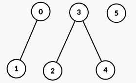
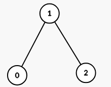

# 【模板】并查集（Python/Java/C++/Go）

> **[3493. 属性图](https://leetcode.cn/problems/properties-graph/solutions/3624345/bing-cha-ji-pythonjavacgo-by-endlesschen-xi0d/) · Medium · 难度分 1565**

> **所属题单**
> - [常用数据结构 · 七、并查集](../../../刷题路径/灵神原版题单/常用数据结构/七、并查集.md) · §7.1 基础

> **题目描述**
> 给你一个二维整数数组 `properties`，其维度为 `n x m`，以及一个整数 `k`。
>
> 定义一个函数 `intersect(a, b)`，它返回数组 `a` 和 `b` 中 **共有的不同整数的数量** 。
>
> 构造一个 **无向图**，其中每个索引 `i` 对应 `properties[i]`。如果且仅当 `intersect(properties[i], properties[j]) >= k`（其中 `i` 和 `j` 的范围为 `[0, n - 1]` 且 `i != j`），节点 `i` 和节点 `j` 之间有一条边。
>
> 返回结果图中 **连通分量** 的数量。
>
> **示例 1：**
>
> **输入：** `properties = [[1,2],[1,1],[3,4],[4,5],[5,6],[7,7]], k = 1`
>
> **输出：** `3`
>
> **解释：**
>
> 生成的图有 3 个连通分量：
>
> 
>
> **示例 2：**
>
> **输入：** `properties = [[1,2,3],[2,3,4],[4,3,5]], k = 2`
>
> **输出：** `1`
>
> **解释：**
>
> 生成的图有 1 个连通分量：
>
> 
>
> **示例 3：**
>
> **输入：** `properties = [[1,1],[1,1]], k = 2`
>
> **输出：** `2`
>
> **解释：**
>
> `intersect(properties[0], properties[1]) = 1`，小于 `k`。因此在图中 `properties[0]` 和 `properties[1]` 之间没有边。
>
> **提示：**
>
> - `1 <= n == properties.length <= 100`
>
> - `1 <= m == properties[i].length <= 100`
>
> - `1 <= properties[i][j] <= 100`
>
> - `1 <= k <= m`

> **题解**
> 暴力枚举所有 $\textit{properties}[i]$ 和 $\textit{properties}[j]$，如果交集大小 $\ge k$，那么用并查集合并 $i$ 和 $j$。
>
> 初始连通块个数 $\textit{cc}=n$，每成功合并一次，就把 $\textit{cc}$ 减一。
>
> 完整的并查集模板，见 [数据结构题单](https://leetcode.cn/circle/discuss/mOr1u6/)。
>
> [本题视频讲解](https://www.bilibili.com/video/BV12eXYYVE5H/?t=2m21s)，欢迎点赞关注~
>
> ```python
> class UnionFind:
>     def __init__(self, n: int):
>         # 一开始有 n 个集合 {0}, {1}, ..., {n-1}
>         # 集合 i 的代表元是自己
>         self._fa = list(range(n))  # 代表元
>         self.cc = n  # 连通块个数
>
>     # 返回 x 所在集合的代表元
>     # 同时做路径压缩，也就是把 x 所在集合中的所有元素的 fa 都改成代表元
>     def find(self, x: int) -> int:
>         # 如果 fa[x] == x，则表示 x 是代表元
>         if self._fa[x] != x:
>             self._fa[x] = self.find(self._fa[x])  # fa 改成代表元
>         return self._fa[x]
>
>     # 把 from 所在集合合并到 to 所在集合中
>     def merge(self, from_: int, to: int) -> None:
>         x, y = self.find(from_), self.find(to)
>         if x == y:  # from 和 to 在同一个集合，不做合并
>             return
>         self._fa[x] = y  # 合并集合。修改后就可以认为 from 和 to 在同一个集合了
>         self.cc -= 1  # 合并后，连通块个数减少了 1
>
> class Solution:
>     def numberOfComponents(self, properties: List[List[int]], k: int) -> int:
>         sets = list(map(set, properties))
>         uf = UnionFind(len(properties))
>         for i, a in enumerate(sets):
>             for j, b in enumerate(sets[:i]):
>                 if len(a & b) >= k:
>                     uf.merge(j, i)
>         return uf.cc
> ```
>
> > [!example]- Python3 位运算
> > ```python
> > class UnionFind:
> >     def __init__(self, n: int):
> >         # 一开始有 n 个集合 {0}, {1}, ..., {n-1}
> >         # 集合 i 的代表元是自己
> >         self._fa = list(range(n))  # 代表元
> >         self.cc = n  # 连通块个数
> >
> >     # 返回 x 所在集合的代表元
> >     # 同时做路径压缩，也就是把 x 所在集合中的所有元素的 fa 都改成代表元
> >     def find(self, x: int) -> int:
> >         # 如果 fa[x] == x，则表示 x 是代表元
> >         if self._fa[x] != x:
> >             self._fa[x] = self.find(self._fa[x])  # fa 改成代表元
> >         return self._fa[x]
> >
> >     # 把 from 所在集合合并到 to 所在集合中
> >     def merge(self, from_: int, to: int) -> None:
> >         x, y = self.find(from_), self.find(to)
> >         if x == y:  # from 和 to 在同一个集合，不做合并
> >             return
> >         self._fa[x] = y  # 合并集合。修改后就可以认为 from 和 to 在同一个集合了
> >         self.cc -= 1  # 合并后，连通块个数减少了 1
> >
> > class Solution:
> >     def numberOfComponents(self, properties: List[List[int]], k: int) -> int:
> >         sets = [reduce(or_, (1 << x for x in a)) for a in properties]
> >         uf = UnionFind(len(properties))
> >         for i, a in enumerate(sets):
> >             for j, b in enumerate(sets[:i]):
> >                 if (a & b).bit_count() >= k:
> >                     uf.merge(j, i)
> >         return uf.cc
> > ```
>
>
> #### 复杂度分析
>
> - 时间复杂度：$\mathcal{O}(n^2m)$ 或者 $\mathcal{O}(n^2m/w)$，其中 $n$ 是 $\textit{properties}$ 的长度，$m$ 是 $\textit{properties}[i]$ 的长度，$w$ 等于 $32$ 或 $64$。
> - 空间复杂度：$\mathcal{O}(nm)$ 或者 $\mathcal{O}(nm/w)$。
>
> 更多相似题目，见下面数据结构题单中的「**并查集**」。
>
> ## 分类题单
>
> [如何科学刷题？](https://leetcode.cn/circle/discuss/RvFUtj/)
>
> 1. [滑动窗口与双指针（定长/不定长/单序列/双序列/三指针/分组循环）](https://leetcode.cn/circle/discuss/0viNMK/)
> 2. [二分算法（二分答案/最小化最大值/最大化最小值/第K小）](https://leetcode.cn/circle/discuss/SqopEo/)
> 3. [单调栈（基础/矩形面积/贡献法/最小字典序）](https://leetcode.cn/circle/discuss/9oZFK9/)
> 4. [网格图（DFS/BFS/综合应用）](https://leetcode.cn/circle/discuss/YiXPXW/)
> 5. [位运算（基础/性质/拆位/试填/恒等式/思维）](https://leetcode.cn/circle/discuss/dHn9Vk/)
> 6. [图论算法（DFS/BFS/拓扑排序/最短路/最小生成树/二分图/基环树/欧拉路径）](https://leetcode.cn/circle/discuss/01LUak/)
> 7. [动态规划（入门/背包/状态机/划分/区间/状压/数位/数据结构优化/树形/博弈/概率期望）](https://leetcode.cn/circle/discuss/tXLS3i/)
> 8. 【本题相关】[常用数据结构（前缀和/差分/栈/队列/堆/字典树/并查集/树状数组/线段树）](https://leetcode.cn/circle/discuss/mOr1u6/)
> 9. [数学算法（数论/组合/概率期望/博弈/计算几何/随机算法）](https://leetcode.cn/circle/discuss/IYT3ss/)
> 10. [贪心与思维（基本贪心策略/反悔/区间/字典序/数学/思维/脑筋急转弯/构造）](https://leetcode.cn/circle/discuss/g6KTKL/)
> 11. [链表、二叉树与回溯（前后指针/快慢指针/DFS/BFS/直径/LCA/一般树）](https://leetcode.cn/circle/discuss/K0n2gO/)
> 12. [字符串（KMP/Z函数/Manacher/字符串哈希/AC自动机/后缀数组/子序列自动机）](https://leetcode.cn/circle/discuss/SJFwQI/)
>
> [我的题解精选（已分类）](https://github.com/EndlessCheng/codeforces-go/blob/master/leetcode/SOLUTIONS.md)
