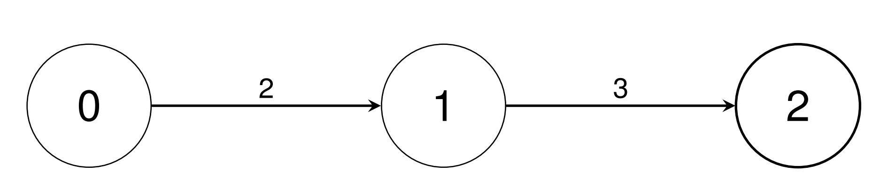

# 自顶向下 DFS（Python/Java/C++/Go）

> **[3528. 单位转换 I](https://leetcode.cn/problems/unit-conversion-i/solutions/3663077/zi-ding-xiang-xia-dfspythonjavacgo-by-en-muwq/) · Medium · 难度分 1580**

> **所属题单**
> - [链表、二叉树与回溯 · 三、一般树](../../../刷题路径/灵神原版题单/链表、二叉树与回溯/三、一般树.md) · §3.2 自顶向下 DFS

> **题目描述**
> 有 `n` 种单位，编号从 `0` 到 `n - 1`。给你一个二维整数数组 `conversions`，长度为 `n - 1`，其中 `conversions[i] = [sourceUnit_i, targetUnit_i, conversionFactor_i]` ，表示一个 `sourceUnit_i` 类型的单位等于 `conversionFactor_i` 个 `targetUnit_i` 类型的单位。
>
> 请你返回一个长度为 `n` 的数组 `baseUnitConversion`，其中 `baseUnitConversion[i]` 表示 **一个** 0 类型单位等于多少个 i 类型单位。由于结果可能很大，请返回每个 `baseUnitConversion[i]` 对 `10⁹ + 7` 取模后的值。
>
> **示例 1：**
>
> **输入：** `conversions = [[0,1,2],[1,2,3]]`
>
> **输出：** `[1,2,6]`
>
> **解释：**
>
> - 使用 `conversions[0]`：将一个 0 类型单位转换为 2 个 1 类型单位。
>
> - 使用 `conversions[0]` 和 `conversions[1]` 将一个 0 类型单位转换为 6 个 2 类型单位。
>
> 
>
> **示例 2：**
>
> **输入：** `conversions = [[0,1,2],[0,2,3],[1,3,4],[1,4,5],[2,5,2],[4,6,3],[5,7,4]]`
>
> **输出：** `[1,2,3,8,10,6,30,24]`
>
> **解释：**
>
> - 使用 `conversions[0]` 将一个 0 类型单位转换为 2 个 1 类型单位。
>
> - 使用 `conversions[1]` 将一个 0 类型单位转换为 3 个 2 类型单位。
>
> - 使用 `conversions[0]` 和 `conversions[2]` 将一个 0 类型单位转换为 8 个 3 类型单位。
>
> - 使用 `conversions[0]` 和 `conversions[3]` 将一个 0 类型单位转换为 10 个 4 类型单位。
>
> - 使用 `conversions[1]` 和 `conversions[4]` 将一个 0 类型单位转换为 6 个 5 类型单位。
>
> - 使用 `conversions[0]`、`conversions[3]` 和 `conversions[5]` 将一个 0 类型单位转换为 30 个 6 类型单位。
>
> - 使用 `conversions[1]`、`conversions[4]` 和 `conversions[6]` 将一个 0 类型单位转换为 24 个 7 类型单位。
>
> **提示：**
>
> - `2 <= n <= 10⁵`
>
> - `conversions.length == n - 1`
>
> - `0 <= sourceUnit_i, targetUnit_i < n`
>
> - `1 <= conversionFactor_i <= 10⁹`
>
> - 保证单位 0 可以通过 **唯一** 的转换路径（不需要反向转换）转换为任何其他单位。

> **题解**
> 注意题目的这句话：保证单位 $0$ 可以通过唯一的转换路径（不需要反向转换）转换为**任何**其他单位。
>
> 这意味着输入的是 $n$ 个点和 $n-1$ 条边的**连通图**，说明输入的是一棵**树**。
>
> 建树。然后从 $0$ 开始 DFS 这棵树，同时把从 $0$ 到 $i$ 的边权乘起来，即为 $\textit{ans}[i]$。
>
> 为了计算乘积，递归的过程中额外传入参数 $\textit{mul}$。
>
> 注意取模。关于模运算的知识点，见 [模运算的世界：当加减乘除遇上取模](https://leetcode.cn/circle/discuss/mDfnkW/)。
>
> 具体请看 [视频讲解](https://www.bilibili.com/video/BV1J2jAziENo/?t=2m21s)，欢迎点赞关注~
>
> ```python
> class Solution:
>     def baseUnitConversions(self, conversions: List[List[int]]) -> List[int]:
>         MOD = 1_000_000_007
>         n = len(conversions) + 1
>         g = [[] for _ in range(n)]
>         for x, y, weight in conversions:
>             g[x].append((y, weight))
>
>         ans = [0] * n
>         def dfs(x: int, mul: int) -> None:
>             ans[x] = mul
>             for y, weight in g[x]:
>                 dfs(y, mul * weight % MOD)
>         dfs(0, 1)
>         return ans
> ```
>
>
> #### 复杂度分析
>
> - 时间复杂度：$\mathcal{O}(n)$，其中 $n$ 是 $\textit{conversions}$ 的长度。树中每个节点恰好访问一次。
> - 空间复杂度：$\mathcal{O}(n)$。
>
> 更多相似题目，见下面一般树题单的「**§3.2 自顶向下 DFS**」。
>
> ## 分类题单
>
> [如何科学刷题？](https://leetcode.cn/circle/discuss/RvFUtj/)
>
> 1. [滑动窗口与双指针（定长/不定长/单序列/双序列/三指针/分组循环）](https://leetcode.cn/circle/discuss/0viNMK/)
> 2. [二分算法（二分答案/最小化最大值/最大化最小值/第K小）](https://leetcode.cn/circle/discuss/SqopEo/)
> 3. [单调栈（基础/矩形面积/贡献法/最小字典序）](https://leetcode.cn/circle/discuss/9oZFK9/)
> 4. [网格图（DFS/BFS/综合应用）](https://leetcode.cn/circle/discuss/YiXPXW/)
> 5. [位运算（基础/性质/拆位/试填/恒等式/思维）](https://leetcode.cn/circle/discuss/dHn9Vk/)
> 6. [图论算法（DFS/BFS/拓扑排序/基环树/最短路/最小生成树/网络流）](https://leetcode.cn/circle/discuss/01LUak/)
> 7. [动态规划（入门/背包/划分/状态机/区间/状压/数位/数据结构优化/树形/博弈/概率期望）](https://leetcode.cn/circle/discuss/tXLS3i/)
> 8. [常用数据结构（前缀和/差分/栈/队列/堆/字典树/并查集/树状数组/线段树）](https://leetcode.cn/circle/discuss/mOr1u6/)
> 9. [数学算法（数论/组合/概率期望/博弈/计算几何/随机算法）](https://leetcode.cn/circle/discuss/IYT3ss/)
> 10. [贪心与思维（基本贪心策略/反悔/区间/字典序/数学/思维/脑筋急转弯/构造）](https://leetcode.cn/circle/discuss/g6KTKL/)
> 11. 【本题相关】[链表、二叉树与回溯（前后指针/快慢指针/DFS/BFS/直径/LCA/一般树）](https://leetcode.cn/circle/discuss/K0n2gO/)
> 12. [字符串（KMP/Z函数/Manacher/字符串哈希/AC自动机/后缀数组/子序列自动机）](https://leetcode.cn/circle/discuss/SJFwQI/)
>
> [我的题解精选（已分类）](https://github.com/EndlessCheng/codeforces-go/blob/master/leetcode/SOLUTIONS.md)
