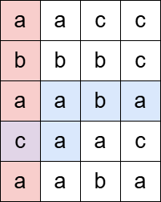
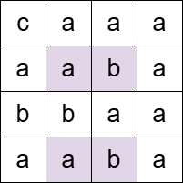

# 3529. 统计水平子串和垂直子串重叠格子的数目

Medium · 难度分 2105 · [力扣原题](https://leetcode.cn/problems/count-cells-in-overlapping-horizontal-and-vertical-substrings/)

所在刷题路径：灵神题单·常用数据结构、灵神题单·字符串

| 作者 | 题解 | 动画讲解 |
|---|---|---|
| 灵茶山艾府 | [📄 题解](灵茶山艾府.md) | [▶︎ 动画（GIF）](3529%20统计水平子串和垂直子串重叠格子的数目%20·%20灵茶山艾府.gif) · [mp4 文件](3529%20统计水平子串和垂直子串重叠格子的数目%20·%20灵茶山艾府.mp4) |
| yiduobo | [📄 题解](yiduobo.md) | [▶︎ 动画（GIF）](3529%20统计水平子串和垂直子串重叠格子的数目%20·%20yiduobo.gif) · [mp4 文件](3529%20统计水平子串和垂直子串重叠格子的数目%20·%20yiduobo.mp4) |

## 动画讲解

> 动图会循环播放；想暂停、拖进度条请下载上面表格里的 mp4 文件。

### 灵茶山艾府

### yiduobo

## 题目描述

给你一个由字符组成的 `m x n` 矩阵 `grid` 和一个字符串 `pattern`。

**水平子串** 是从左到右的一段连续字符序列。如果子串到达了某行的末尾，它将换行并从下一行的第一个字符继续。**不会** 从最后一行回到第一行。

**垂直子串** 是从上到下的一段连续字符序列。如果子串到达了某列的底部，它将换列并从下一列的第一个字符继续。**不会** 从最后一列回到第一列。

请统计矩阵中满足以下条件的单元格数量：

- 该单元格必须属于 **至少** 一个等于 `pattern` 的水平子串，且属于 **至少** 一个等于 `pattern` 的垂直子串。

返回满足条件的单元格数量。

**示例 1：**

**输入：** `grid = [["a","a","c","c"],["b","b","b","c"],["a","a","b","a"],["c","a","a","c"],["a","a","b","a"]], pattern = "abaca"`

**输出：** `1`

**解释：**

`"abaca"` 作为一个水平子串（蓝色）和一个垂直子串（红色）各出现一次，并在一个单元格（紫色）处相交。

**示例 2：**

**输入：** `grid = [["c","a","a","a"],["a","a","b","a"],["b","b","a","a"],["a","a","b","a"]], pattern = "aba"`

**输出：** `4`

**解释：**

上述被标记的单元格都同时属于至少一个 `"aba"` 的水平和垂直子串。

**示例 3：**

**输入：** `grid = [["a"]], pattern = "a"`

**输出：** 1

**提示：**

- `m == grid.length`

- `n == grid[i].length`

- `1 <= m, n <= 1000`

- `1 <= m * n <= 10⁵`

- `1 <= pattern.length <= m * n`

- `grid` 和 `pattern` 仅由小写英文字母组成。

---
[↑ 返回 3500-3599](../README.md) · [总索引](../../../索引.md) · [仓库首页](../../../README.md)
