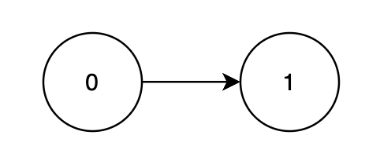
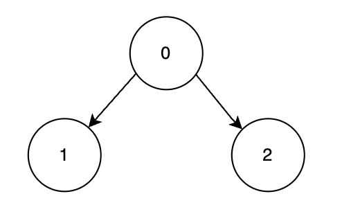

# 排列型状压 DP：从记忆化搜索到递推（Python/Java/C++/Go）

> **[3530. 有向无环图中合法拓扑排序的最大利润](https://leetcode.cn/problems/maximum-profit-from-valid-topological-order-in-dag/solutions/3663054/pai-lie-xing-zhuang-ya-dpcong-ji-yi-hua-z67rp/) · Hard · 难度分 2353**

> **所属题单**
> - [动态规划 · 九、状态压缩 DP（状压 DP）](../../../刷题路径/灵神原版题单/动态规划/九、状态压缩%20DP（状压%20DP）.md) · §9.1 排列型状压 DP ① 相邻无关

> **题目描述**
> 给你一个由 `n` 个节点组成的**有向无环图（DAG）**，节点编号从 `0` 到 `n - 1`，通过二维数组 `edges` 表示，其中 `edges[i] = [u_i, v_i]` 表示一条从节点 `u_i` 指向节点 `v_i` 的有向边。每个节点都有一个对应的 **得分** ，由数组 `score` 给出，其中 `score[i]` 表示节点 `i` 的得分。
>
> 你需要以 **有效的拓扑排序** 顺序处理这些节点。每个节点在处理顺序中被分配一个编号从 **1** 开始的位置。
>
> 将每个节点的得分乘以其在拓扑排序中的位置，然后求和，得到的值称为 **利润**。
>
> 请返回在所有合法拓扑排序中可获得的 **最大利润** 。
>
> **拓扑排序** 是一个对 DAG 中所有节点的线性排序，使得每条有向边 `u → v` 中，节点 `u` 都出现在 `v` 之前。
>
> **示例 1：**
>
> **输入：** `n = 2, edges = [[0,1]], score = [2,3]`
>
> **输出：** `8`
>
> **解释：**
>
> 
>
> 节点 1 依赖于节点 0，因此一个合法顺序是 `[0, 1]`。
>
> 			节点
> 			处理顺序
> 			得分
> 			乘数
> 			利润计算
>
> 			0
> 			第 1 个
> 			2
> 			1
> 			2 × 1 = 2
>
> 			1
> 			第 2 个
> 			3
> 			2
> 			3 × 2 = 6
>
> 所有合法拓扑排序中可获得的最大总利润是 `2 + 6 = 8`。
>
> **示例 2：**
>
> **输入：** `n = 3, edges = [[0,1],[0,2]], score = [1,6,3]`
>
> **输出：** `25`
>
> **解释：**
>
> 
>
> 节点 1 和 2 都依赖于节点 0，因此最优的合法顺序是 `[0, 2, 1]`。
>
> 			节点
> 			处理顺序
> 			得分
> 			乘数
> 			利润计算
>
> 			0
> 			第 1 个
> 			1
> 			1
> 			1 × 1 = 1
>
> 			2
> 			第 2 个
> 			3
> 			2
> 			3 × 2 = 6
>
> 			1
> 			第 3 个
> 			6
> 			3
> 			6 × 3 = 18
>
> 所有合法拓扑排序中可获得的最大总利润是 `1 + 6 + 18 = 25`。
>
> **提示：**
>
> - `1 <= n == score.length <= 22`
>
> - `1 <= score[i] <= 10⁵`
>
> - `0 <= edges.length <= n * (n - 1) / 2`
>
> - `edges[i] == [u_i, v_i]` 表示一条从 `u_i` 到 `v_i` 的有向边。
>
> - `0 <= u_i, v_i < n`
>
> - `u_i != v_i`
>
> - 输入图 **保证** 是一个 **DAG**。
>
> - 不存在重复的边。

> **题解**
> 如果你没做过状压 DP，请先完成 [526. 优美的排列](https://leetcode.cn/problems/beautiful-arrangement/)，并阅读我的题解 [教你一步步思考状压 DP：从记忆化搜索到递推](../../0500-0599/0526%20优美的排列/灵茶山艾府.md)。
>
> **关键思路**：把拓扑序理解为先修课关系，在学习课程 $j$ 之前，$j$ 的所有先修课（直接前驱）必须全部学完。
>
> 定义 $\textit{dfs}(S)$ 表示在已学课程集合为 $S$ 的情况下，学完**剩余未学课程**可以获得的最大利润。
>
> 考虑下一门课程学哪个：
>
> - 枚举下一门要学习的课程为 $j=0,1,2,\ldots,n-1$，要求满足 $j\notin S$ 且 $\textit{pre}[j] \subseteq S$。其中 $\textit{pre}[j]$ 表示 $j$ 的先修课集合。
> - 要解决的问题变成：在已学课程集合为 $S \cup \{j\}$ 的情况下，学完剩余未学课程可以获得的最大利润，即 $\textit{dfs}(S \cup \{j\})$。
>
> 取最大值，得
>
> $$
> \textit{dfs}(S) = \max_{j=0}^{n-1} \textit{dfs}(S \cup \{j\}) + \textit{score}[j] \cdot (|S|+1)
> $$
>
> 其中 $j\notin S$ 且 $\textit{pre}[j] \subseteq S$，$|S|$ 表示集合 $S$ 的大小。
>
> 递归边界：$\textit{dfs}(U)=0$，其中全集 $U=\{0,1,2,\ldots,n-1\}$。递归到 $S=U$ 的状态，表示所有课程全部学完，没有剩余未学课程，可以获得的最大利润为 $0$。
>
> 递归入口：$\textit{dfs}(\varnothing)$，也就是答案。其中 $\varnothing$ 表示空集，因为一开始什么课程也没有学。
>
> **代码实现时，用二进制表示集合，用位运算实现集合操作，具体请看** [从集合论到位运算，常见位运算技巧分类总结](https://leetcode.cn/circle/discuss/CaOJ45/)。
>
> **优化**：如果 $\textit{edges}$ 是空的（没有边），那么根据 [排序不等式](https://baike.baidu.com/item/%E6%8E%92%E5%BA%8F%E4%B8%8D%E7%AD%89%E5%BC%8F/7775728)，按照 $\textit{score}$ 从小到大选课是最优的。所以把 $\textit{score}$ 从小到大排序后，累加 $\textit{score}[i]\cdot(i+1)$，即为答案。
>
> [本题视频讲解](https://www.bilibili.com/video/BV1J2jAziENo/?t=15m46s)，欢迎点赞关注~
>
> ## 写法一：记忆化搜索
>
> ```python
> class Solution:
>     def maxProfit(self, n: int, edges: List[List[int]], score: List[int]) -> int:
>         if not edges:
>             score.sort()
>             return sum(s * i for i, s in enumerate(score, 1))
>
>         # 记录每个节点的先修课（直接前驱）
>         pre = [0] * n
>         for x, y in edges:
>             pre[y] |= 1 << x
>
>         @cache  # 缓存装饰器，避免重复计算 dfs（一行代码实现记忆化）
>         def dfs(s: int) -> int:
>             res = 0
>             i = s.bit_count() + 1  # 已学课程数加一
>             # 枚举还没学过的课程 j，且 j 的所有先修课都学完了
>             for j, p in enumerate(pre):
>                 if (s >> j & 1) == 0 and (s | p) == s:
>                     r = dfs(s | 1 << j) + score[j] * i
>                     if r > res:  # 手写 max
>                         res = r
>             return res
>
>         return dfs(0)
> ```
>
>
> #### 复杂度分析
>
> - 时间复杂度：$\mathcal{O}(m + n2^n)$，其中 $m$ 是 $\textit{edges}$ 的长度。由于每个状态只会计算一次，动态规划的时间复杂度 $=$ 状态个数 $\times$ 单个状态的计算时间。本题状态个数等于 $\mathcal{O}(2^n)$，单个状态的计算时间为 $\mathcal{O}(n)$，所以记忆化搜索的时间复杂度为 $\mathcal{O}(n2^n)$。
> - 空间复杂度：$\mathcal{O}(2^n)$。保存多少状态，就需要多少空间。
>
> ## 写法二：记忆化搜索 1:1 翻译成递推（倒序）
>
> 我们可以去掉递归中的「递」，只保留「归」的部分，即自底向上计算。
>
> 具体来说，$f[S]$ 的定义和 $\textit{dfs}(S)$ 的定义是完全一样的，都表示在已学课程集合为 $S$ 的情况下，学完**剩余未学课程**可以获得的最大利润。
>
> 相应的递推式（状态转移方程）也和 $\textit{dfs}$ 一样：
>
> $$
> f[S] = \max_{j=0}^{n-1} f[S \cup \{j\}] + \textit{score}[j] \cdot (|S|+1)
> $$
>
> 初始值 $f[U]=0$，翻译自递归边界 $\textit{dfs}(U)=0$。
>
> 答案为 $f[\varnothing]$，翻译自递归入口 $\textit{dfs}(\varnothing)$。
>
> ⚠**注意**：下面的写法可能会超时，请看后面的写法三。
>
> ```python
> # 超时了！请看写法三！
> class Solution:
>     def maxProfit(self, n: int, edges: List[List[int]], score: List[int]) -> int:
>         if not edges:
>             score.sort()
>             return sum(s * i for i, s in enumerate(score, 1))
>
>         # 记录每个节点的先修课（直接前驱）
>         pre = [0] * n
>         for x, y in edges:
>             pre[y] |= 1 << x
>
>         f = [0] * (1 << n)
>         for s in range((1 << n) - 2, -1, -1):
>             res = 0
>             i = s.bit_count() + 1  # 已学课程数加一
>             # 枚举还没学过的课程 j，且 j 的所有先修课都学完了
>             for j, p in enumerate(pre):
>                 if (s >> j & 1) == 0 and (s | p) == s:
>                     r = f[s | 1 << j] + score[j] * i
>                     if r > res:  # 手写 max
>                         res = r
>             f[s] = res
>         return f[0]
> ```
>
>
> #### 复杂度分析
>
> - 时间复杂度：$\mathcal{O}(m + n2^n)$，其中 $m$ 是 $\textit{edges}$ 的长度。
> - 空间复杂度：$\mathcal{O}(2^n)$。
>
> ## 写法三：刷表法（正序）
>
> > **注**：在动态规划中，用转移来源更新当前状态叫**查表法**（写法二），用当前状态更新其他状态叫**刷表法**（写法三）。
>
> 定义 $f[S]$ 表示已学课程集合为 $S$ 时，从**已学课程**中可以获得的最大利润。
>
> 枚举不在 $S$ 中的课程 $j$，如果 $\textit{pre}[j] \subseteq S$ 用 $f[S] + \textit{score}[j]\cdot (|S|+1)$ 更新 $f[S\cup\{j\}]$ 的最大值。
>
> 这样写的好处是，如果一个状态从未被更新过，说明这个状态不合法（比如已经学完后面的课程，但前面的课程还没学），无需执行内层循环。
>
> ```python
> class Solution:
>     def maxProfit(self, n: int, edges: List[List[int]], score: List[int]) -> int:
>         if not edges:
>             score.sort()
>             return sum(s * i for i, s in enumerate(score, 1))
>
>         # 记录每个节点的先修课（直接前驱）
>         pre = [0] * n
>         for x, y in edges:
>             pre[y] |= 1 << x
>
>         f = [-1] * (1 << n)
>         f[0] = 0
>         for s, fs in enumerate(f):
>             if fs < 0:  # 不合法状态，比如已经学完后面的课程，但前面的课程还没学
>                 continue
>             i = s.bit_count() + 1  # 已学课程数加一
>             # 枚举还没学过的课程 j，且 j 的所有先修课都学完了
>             for j, p in enumerate(pre):
>                 if (s >> j & 1) == 0 and (s | p) == s:
>                     new_s = s | 1 << j
>                     r = f[s] + score[j] * i
>                     if r > f[new_s]:  # 手写 max
>                         f[new_s] = r
>         return f[-1]
> ```
>
>
> #### 复杂度分析
>
> - 时间复杂度：$\mathcal{O}(m + n2^n)$，其中 $m$ 是 $\textit{edges}$ 的长度。
> - 空间复杂度：$\mathcal{O}(2^n)$。
>
> 更多相似题目，见 [动态规划题单](https://leetcode.cn/circle/discuss/tXLS3i/) 的「**§9.1 排列型 ① 相邻无关**」。
>
> ## 分类题单
>
> [如何科学刷题？](https://leetcode.cn/circle/discuss/RvFUtj/)
>
> 1. [滑动窗口与双指针（定长/不定长/单序列/双序列/三指针/分组循环）](https://leetcode.cn/circle/discuss/0viNMK/)
> 2. [二分算法（二分答案/最小化最大值/最大化最小值/第K小）](https://leetcode.cn/circle/discuss/SqopEo/)
> 3. [单调栈（基础/矩形面积/贡献法/最小字典序）](https://leetcode.cn/circle/discuss/9oZFK9/)
> 4. [网格图（DFS/BFS/综合应用）](https://leetcode.cn/circle/discuss/YiXPXW/)
> 5. [位运算（基础/性质/拆位/试填/恒等式/思维）](https://leetcode.cn/circle/discuss/dHn9Vk/)
> 6. [图论算法（DFS/BFS/拓扑排序/最短路/最小生成树/二分图/基环树/欧拉路径）](https://leetcode.cn/circle/discuss/01LUak/)
> 7. [动态规划（入门/背包/状态机/划分/区间/状压/数位/数据结构优化/树形/博弈/概率期望）](https://leetcode.cn/circle/discuss/tXLS3i/)
> 8. [常用数据结构（前缀和/差分/栈/队列/堆/字典树/并查集/树状数组/线段树）](https://leetcode.cn/circle/discuss/mOr1u6/)
> 9. [数学算法（数论/组合/概率期望/博弈/计算几何/随机算法）](https://leetcode.cn/circle/discuss/IYT3ss/)
> 10. [贪心与思维（基本贪心策略/反悔/区间/字典序/数学/思维/脑筋急转弯/构造）](https://leetcode.cn/circle/discuss/g6KTKL/)
> 11. [链表、二叉树与回溯（前后指针/快慢指针/DFS/BFS/直径/LCA/一般树）](https://leetcode.cn/circle/discuss/K0n2gO/)
> 12. [字符串（KMP/Z函数/Manacher/字符串哈希/AC自动机/后缀数组/子序列自动机）](https://leetcode.cn/circle/discuss/SJFwQI/)
>
> [我的题解精选（已分类）](https://github.com/EndlessCheng/codeforces-go/blob/master/leetcode/SOLUTIONS.md)
>
> 欢迎关注 [B站@灵茶山艾府](https://space.bilibili.com/206214)
