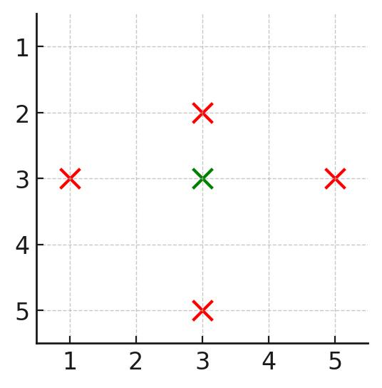

# 统计行列的最小值和最大值（Python/Java/C++/Go）

> **[3531. 统计被覆盖的建筑](https://leetcode.cn/problems/count-covered-buildings/solutions/3663296/pai-xu-er-fen-cha-zhao-pythonjavacgo-by-z2c5d/) · Medium**

> **题目描述**
> 给你一个正整数 `n`，表示一个 `n x n` 的城市，同时给定一个二维数组 `buildings`，其中 `buildings[i] = [x, y]` 表示位于坐标 `[x, y]` 的一个 **唯一** 建筑。
>
> 如果一个建筑在四个方向（左、右、上、下）中每个方向上都至少存在一个建筑，则称该建筑 **被覆盖** 。
>
> 返回 **被覆盖** 的建筑数量。
>
> **示例 1：**
>
> 
>
> **输入:** `n = 3, buildings = [[1,2],[2,2],[3,2],[2,1],[2,3]]`
>
> **输出:** `1`
>
> **解释:**
>
> - 只有建筑 `[2,2]` 被覆盖，因为它在每个方向上都至少存在一个建筑：
>
>     - 上方 (`[1,2]`)
>
>     - 下方 (`[3,2]`)
>
>     - 左方 (`[2,1]`)
>
>     - 右方 (`[2,3]`)
>
> - 因此，被覆盖的建筑数量是 1。
>
> **示例 2：**
>
> 
>
> **输入:** `n = 3, buildings = [[1,1],[1,2],[2,1],[2,2]]`
>
> **输出:** `0`
>
> **解释:**
>
> - 没有任何一个建筑在每个方向上都有至少一个建筑。
>
> **示例 3：**
>
> 
>
> **输入:** `n = 5, buildings = [[1,3],[3,2],[3,3],[3,5],[5,3]]`
>
> **输出:** `1`
>
> **解释:**
>
> - 只有建筑 `[3,3]` 被覆盖，因为它在每个方向上至少存在一个建筑：
>
>     - 上方 (`[1,3]`)
>
>     - 下方 (`[5,3]`)
>
>     - 左方 (`[3,2]`)
>
>     - 右方 (`[3,5]`)
>
> - 因此，被覆盖的建筑数量是 1。
>
> **提示：**
>
> - `2 <= n <= 10⁵`
>
> - `1 <= buildings.length <= 10⁵`
>
> - `buildings[i] = [x, y]`
>
> - `1 <= x, y <= n`
>
> - `buildings` 中所有坐标均 **唯一** 。

> **题解**
> ## 分析
>
> 如果一个点在同一行的最左边，那么它左边没有点；如果一个点在同一行的最右边，那么它右边没有点。
>
> 如果一个点在同一列的最上边，那么它上边没有点；如果一个点在同一列的最下边，那么它下边没有点。
>
> 反之，如果一个点不在同一行的最左边也不在最右边，那么这个点左右都有点；如果一个点不在同一列的最上边也不在最下边，那么这个点上下都有点。
>
> ## 算法
>
> 记录同一行的最小横坐标和最大横坐标，同一列的最小纵坐标和最大纵坐标。
>
> 对于每个建筑 $(x,y)$，如果 $x$ 在这一行的最小值和最大值之间（不能相等），$y$ 在这一列的最小值和最大值之间（不能相等），那么答案加一。
>
> [本题视频讲解](https://www.bilibili.com/video/BV1BgjAzcE7k/)，欢迎点赞关注~
>
> ```python
> class Solution:
>     def countCoveredBuildings(self, n: int, buildings: List[List[int]]) -> int:
>         row_min = [n + 1] * (n + 1)
>         row_max = [0] * (n + 1)
>         col_min = [n + 1] * (n + 1)
>         col_max = [0] * (n + 1)
>
>         for x, y in buildings:
>             # 手写 min max 更快
>             if x < row_min[y]: row_min[y] = x
>             if x > row_max[y]: row_max[y] = x
>             if y < col_min[x]: col_min[x] = y
>             if y > col_max[x]: col_max[x] = y
>
>         ans = 0
>         for x, y in buildings:
>             if row_min[y] < x < row_max[y] and col_min[x] < y < col_max[x]:
>                 ans += 1
>         return ans
> ```
>
>
> #### 复杂度分析
>
> - 时间复杂度：$\mathcal{O}(n+m)$，其中 $m$ 是 $\textit{buildings}$ 的长度。
> - 空间复杂度：$\mathcal{O}(n)$。
>
> ## 分类题单
>
> [如何科学刷题？](https://leetcode.cn/circle/discuss/RvFUtj/)
>
> 1. [滑动窗口与双指针（定长/不定长/单序列/双序列/三指针/分组循环）](https://leetcode.cn/circle/discuss/0viNMK/)
> 2. [二分算法（二分答案/最小化最大值/最大化最小值/第K小）](https://leetcode.cn/circle/discuss/SqopEo/)
> 3. [单调栈（基础/矩形面积/贡献法/最小字典序）](https://leetcode.cn/circle/discuss/9oZFK9/)
> 4. [网格图（DFS/BFS/综合应用）](https://leetcode.cn/circle/discuss/YiXPXW/)
> 5. [位运算（基础/性质/拆位/试填/恒等式/思维）](https://leetcode.cn/circle/discuss/dHn9Vk/)
> 6. [图论算法（DFS/BFS/拓扑排序/基环树/最短路/最小生成树/网络流）](https://leetcode.cn/circle/discuss/01LUak/)
> 7. [动态规划（入门/背包/划分/状态机/区间/状压/数位/数据结构优化/树形/博弈/概率期望）](https://leetcode.cn/circle/discuss/tXLS3i/)
> 8. [常用数据结构（前缀和/差分/栈/队列/堆/字典树/并查集/树状数组/线段树）](https://leetcode.cn/circle/discuss/mOr1u6/)
> 9. [数学算法（数论/组合/概率期望/博弈/计算几何/随机算法）](https://leetcode.cn/circle/discuss/IYT3ss/)
> 10. [贪心与思维（基本贪心策略/反悔/区间/字典序/数学/思维/脑筋急转弯/构造）](https://leetcode.cn/circle/discuss/g6KTKL/)
> 11. [链表、树与回溯（前后指针/快慢指针/DFS/BFS/直径/LCA）](https://leetcode.cn/circle/discuss/K0n2gO/)
> 12. [字符串（KMP/Z函数/Manacher/字符串哈希/AC自动机/后缀数组/子序列自动机）](https://leetcode.cn/circle/discuss/SJFwQI/)
>
> [我的题解精选（已分类）](https://github.com/EndlessCheng/codeforces-go/blob/master/leetcode/SOLUTIONS.md)
>
> 欢迎关注 [B站@灵茶山艾府](https://space.bilibili.com/206214)
