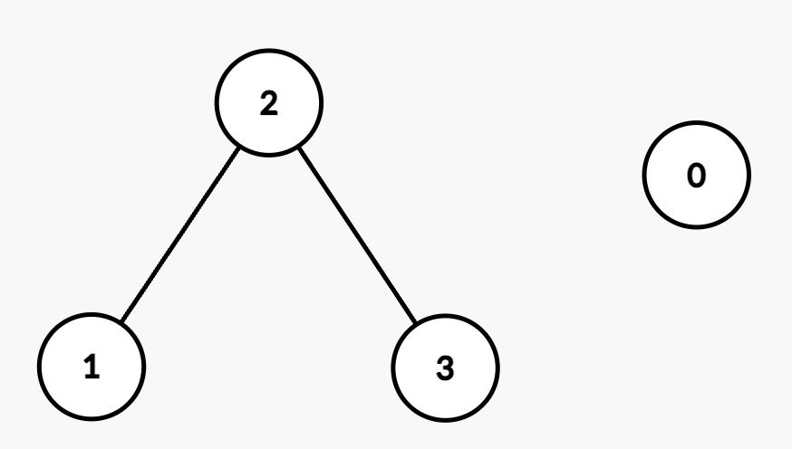

# 两种方法：二分 / 连通块编号（Python/Java/C++/Go）

> **[3532. 针对图的路径存在性查询 I](https://leetcode.cn/problems/path-existence-queries-in-a-graph-i/solutions/3663278/er-fen-cha-zhao-jian-ji-xie-fa-pythonjav-0he5/) · Medium**

> **所属题单**
> - [常用数据结构 · 七、并查集](../../../刷题路径/灵神原版题单/常用数据结构/七、并查集.md) · §7.1 基础

> **题目描述**
> 给你一个整数 `n`，表示图中的节点数量，这些节点按从 `0` 到 `n - 1` 编号。
>
> 同时给你一个长度为 `n` 的整数数组 `nums`，该数组按 **非递减** 顺序排序，以及一个整数 `maxDiff`。
>
> 如果满足 `|nums[i] - nums[j]| <= maxDiff`（即 `nums[i]` 和 `nums[j]` 的 **绝对差** 至多为 `maxDiff`），则节点 `i` 和节点 `j` 之间存在一条 **无向边** 。
>
> 此外，给你一个二维整数数组 `queries`。对于每个 `queries[i] = [u_i, v_i]`，需要判断节点 `u_i` 和 `v_i` 之间是否存在路径。
>
> 返回一个布尔数组 `answer`，其中 `answer[i]` 等于 `true` 表示在第 `i` 个查询中节点 `u_i` 和 `v_i` 之间存在路径，否则为 `false`。
>
> **示例 1：**
>
> **输入:** `n = 2, nums = [1,3], maxDiff = 1, queries = [[0,0],[0,1]]`
>
> **输出:** `[true,false]`
>
> **解释:**
>
> - 查询 `[0,0]`：节点 0 有一条到自己的显然路径。
>
> - 查询 `[0,1]`：节点 0 和节点 1 之间没有边，因为 `|nums[0] - nums[1]| = |1 - 3| = 2`，大于 `maxDiff`。
>
> - 因此，在处理完所有查询后，最终答案为 `[true, false]`。
>
> **示例 2：**
>
> **输入:** `n = 4, nums = [2,5,6,8], maxDiff = 2, queries = [[0,1],[0,2],[1,3],[2,3]]`
>
> **输出:** `[false,false,true,true]`
>
> **解释:**
>
> 生成的图如下：
>
> 
>
> - 查询 `[0,1]`：节点 0 和节点 1 之间没有边，因为 `|nums[0] - nums[1]| = |2 - 5| = 3`，大于 `maxDiff`。
>
> - 查询 `[0,2]`：节点 0 和节点 2 之间没有边，因为 `|nums[0] - nums[2]| = |2 - 6| = 4`，大于 `maxDiff`。
>
> - 查询 `[1,3]`：节点 1 和节点 3 之间存在路径通过节点 2，因为 `|nums[1] - nums[2]| = |5 - 6| = 1` 和 `|nums[2] - nums[3]| = |6 - 8| = 2`，都小于等于 `maxDiff`。
>
> - 查询 `[2,3]`：节点 2 和节点 3 之间有一条边，因为 `|nums[2] - nums[3]| = |6 - 8| = 2`，等于 `maxDiff`。
>
> - 因此，在处理完所有查询后，最终答案为 `[false, false, true, true]`。
>
> **提示：**
>
> - `1 <= n == nums.length <= 10⁵`
>
> - `0 <= nums[i] <= 10⁵`
>
> - `nums` 按 **非递减** 顺序排序。
>
> - `0 <= maxDiff <= 10⁵`
>
> - `1 <= queries.length <= 10⁵`
>
> - `queries[i] == [u_i, v_i]`
>
> - `0 <= u_i, v_i < n`

> **题解**
> ## 方法一：间断点 + 二分查找
>
> 由于 $\textit{nums}$ 是有序的，如果 $\textit{nums}[i+1]-\textit{nums}[i] > \textit{maxDiff}$，那么编号 $\le i$ 的节点无法跳到编号 $\ge i+1$ 的节点。我把这样的 $i$ 叫做「间断点」。
>
> 遍历 $\textit{nums}$，把所有间断点记录在 $\textit{idx}$ 中。
>
> 对于询问 $[u,v]$，我们在 $\textit{idx}$ 中**二分查找** $\ge u$ 的第一个间断点，以及 $\ge v$ 的第一个间断点。如果这两个间断点相同，则可以从 $u$ 到达 $v$，否则不能。
>
> 关于二分查找的原理，见 [二分查找 红蓝染色法【基础算法精讲 04】](https://www.bilibili.com/video/BV1AP41137w7/)。
>
> [本题视频讲解](https://www.bilibili.com/video/BV1BgjAzcE7k/?t=3m12s)，欢迎点赞关注~
>
> ```python
> class Solution:
>     def pathExistenceQueries(self, n: int, nums: List[int], maxDiff: int, queries: List[List[int]]) -> List[bool]:
>         idx = [i for i, (x, y) in enumerate(pairwise(nums)) if y - x > maxDiff]
>         return [bisect_left(idx, u) == bisect_left(idx, v) for u, v in queries]
> ```
>
>
> #### 复杂度分析
>
> - 时间复杂度：$\mathcal{O}(n + q\log n)$，其中 $n$ 是 $\textit{nums}$ 的长度，$q$ 是 $\textit{queries}$ 的长度。
> - 空间复杂度：$\mathcal{O}(n)$。返回值不计入。
>
> ## 方法二：记录连通块的编号
>
> 遍历 $\textit{nums}$，计算每个节点所在连通块的编号，从 $0$ 开始。
>
> 如果 $\textit{nums}[i]-\textit{nums}[i-1] > \textit{maxDiff}$，那么 $i$ 在一个新的连通块中，编号加一。否则编号不变。
>
> 设 $i$ 所在连通块的编号为 $\textit{id}[i]$，我们有
>
> $$
> \textit{id}[i] =
> \begin{cases}
> 0, & i = 0 \\ 
> \textit{id}[i-1], & \textit{nums}[i]-\textit{nums}[i-1] \le \textit{maxDiff}     \\
> \textit{id}[i-1] + 1, & \textit{nums}[i]-\textit{nums}[i-1] > \textit{maxDiff}     \\
> \end{cases}
> $$
>
> ```python
> class Solution:
>     def pathExistenceQueries(self, n: int, nums: List[int], maxDiff: int, queries: List[List[int]]) -> List[bool]:
>         id = [0] * n  # 每个节点所在连通块的编号
>         for i in range(1, n):
>             id[i] = id[i - 1]
>             if nums[i] - nums[i - 1] > maxDiff:
>                 id[i] += 1  # 找到了一个新的连通块
>
>         return [id[u] == id[v] for u, v in queries]
> ```
>
> > [!example]- Python3 写法二
> > ```python
> > class Solution:
> >     def pathExistenceQueries(self, n: int, nums: List[int], maxDiff: int, queries: List[List[int]]) -> List[bool]:
> >         id = list(accumulate((y - x > maxDiff for x, y in pairwise(nums)), initial=0))
> >         return [id[u] == id[v] for u, v in queries]
> > ```
>
>
> #### 复杂度分析
>
> - 时间复杂度：$\mathcal{O}(n + q)$，其中 $n$ 是 $\textit{nums}$ 的长度，$q$ 是 $\textit{queries}$ 的长度。
> - 空间复杂度：$\mathcal{O}(n)$。返回值不计入。
>
> ## 分类题单
>
> [如何科学刷题？](https://leetcode.cn/circle/discuss/RvFUtj/)
>
> 1. [滑动窗口与双指针（定长/不定长/单序列/双序列/三指针/分组循环）](https://leetcode.cn/circle/discuss/0viNMK/)
> 2. [二分算法（二分答案/最小化最大值/最大化最小值/第K小）](https://leetcode.cn/circle/discuss/SqopEo/)
> 3. [单调栈（基础/矩形面积/贡献法/最小字典序）](https://leetcode.cn/circle/discuss/9oZFK9/)
> 4. [网格图（DFS/BFS/综合应用）](https://leetcode.cn/circle/discuss/YiXPXW/)
> 5. [位运算（基础/性质/拆位/试填/恒等式/思维）](https://leetcode.cn/circle/discuss/dHn9Vk/)
> 6. [图论算法（DFS/BFS/拓扑排序/基环树/最短路/最小生成树/网络流）](https://leetcode.cn/circle/discuss/01LUak/)
> 7. [动态规划（入门/背包/划分/状态机/区间/状压/数位/数据结构优化/树形/博弈/概率期望）](https://leetcode.cn/circle/discuss/tXLS3i/)
> 8. [常用数据结构（前缀和/差分/栈/队列/堆/字典树/并查集/树状数组/线段树）](https://leetcode.cn/circle/discuss/mOr1u6/)
> 9. [数学算法（数论/组合/概率期望/博弈/计算几何/随机算法）](https://leetcode.cn/circle/discuss/IYT3ss/)
> 10. [贪心与思维（基本贪心策略/反悔/区间/字典序/数学/思维/脑筋急转弯/构造）](https://leetcode.cn/circle/discuss/g6KTKL/)
> 11. [链表、二叉树与回溯（前后指针/快慢指针/DFS/BFS/直径/LCA/一般树）](https://leetcode.cn/circle/discuss/K0n2gO/)
> 12. [字符串（KMP/Z函数/Manacher/字符串哈希/AC自动机/后缀数组/子序列自动机）](https://leetcode.cn/circle/discuss/SJFwQI/)
>
> [我的题解精选（已分类）](https://github.com/EndlessCheng/codeforces-go/blob/master/leetcode/SOLUTIONS.md)
