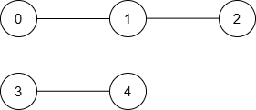

# 排序+双指针+倍增（Python/Java/C++/Go）

> **[3534. 针对图的路径存在性查询 II](https://leetcode.cn/problems/path-existence-queries-in-a-graph-ii/solutions/3663266/pai-xu-shuang-zhi-zhen-bei-zeng-pythonja-ckht/) · Hard · 难度分 2507**

> **所属题单**
> - [链表、二叉树与回溯 · 三、一般树](../../../刷题路径/灵神原版题单/链表、二叉树与回溯/三、一般树.md) · §3.8 最近公共祖先（LCA）、倍增算法

> **题目描述**
> 给你一个整数 `n`，表示图中的节点数量，这些节点按从 `0` 到 `n - 1` 编号。
>
> 同时给你一个长度为 `n` 的整数数组 `nums`，以及一个整数 `maxDiff`。
>
> 如果满足 `|nums[i] - nums[j]| <= maxDiff`（即 `nums[i]` 和 `nums[j]` 的 **绝对差** 至多为 `maxDiff`），则节点 `i` 和节点 `j` 之间存在一条 **无向边** 。
>
> 此外，给你一个二维整数数组 `queries`。对于每个 `queries[i] = [u_i, v_i]`，找到节点 `u_i` 和节点 `v_i` 之间的 **最短距离** 。如果两节点之间不存在路径，则返回 -1。
>
> 返回一个数组 `answer`，其中 `answer[i]` 是第 `i` 个查询的结果。
>
> **注意：**节点之间的边是无权重（unweighted）的。
>
> **示例 1：**
>
> **输入:** `n = 5, nums = [1,8,3,4,2], maxDiff = 3, queries = [[0,3],[2,4]]`
>
> **输出:** `[1,1]`
>
> **解释:**
>
> 生成的图如下：
>
> 
>
> 			查询
> 			最短路径
> 			最短距离
>
> 			[0, 3]
> 			0 → 3
> 			1
>
> 			[2, 4]
> 			2 → 4
> 			1
>
> 因此，输出为 `[1, 1]`。
>
> **示例 2：**
>
> **输入:** `n = 5, nums = [5,3,1,9,10], maxDiff = 2, queries = [[0,1],[0,2],[2,3],[4,3]]`
>
> **输出:** `[1,2,-1,1]`
>
> **解释:**
>
> 生成的图如下：
>
> 
>
> 			查询
> 			最短路径
> 			最短距离
>
> 			[0, 1]
> 			0 → 1
> 			1
>
> 			[0, 2]
> 			0 → 1 → 2
> 			2
>
> 			[2, 3]
> 			无
> 			-1
>
> 			[4, 3]
> 			3 → 4
> 			1
>
> 因此，输出为 `[1, 2, -1, 1]`。
>
> **示例 3：**
>
> **输入:** `n = 3, nums = [3,6,1], maxDiff = 1, queries = [[0,0],[0,1],[1,2]]`
>
> **输出:** `[0,-1,-1]`
>
> **解释:**
>
> 由于以下原因，任意两个节点之间都不存在边：
>
> - 节点 0 和节点 1：`|nums[0] - nums[1]| = |3 - 6| = 3 > 1`
>
> - 节点 0 和节点 2：`|nums[0] - nums[2]| = |3 - 1| = 2 > 1`
>
> - 节点 1 和节点 2：`|nums[1] - nums[2]| = |6 - 1| = 5 > 1`
>
> 因此，不存在任何可以到达其他节点的节点，输出为 `[0, -1, -1]`。
>
> **提示：**
>
> - `1 <= n == nums.length <= 10⁵`
>
> - `0 <= nums[i] <= 10⁵`
>
> - `0 <= maxDiff <= 10⁵`
>
> - `1 <= queries.length <= 10⁵`
>
> - `queries[i] == [u_i, v_i]`
>
> - `0 <= u_i, v_i < n`

> **题解**
> ## 核心思路
>
> 把 $\textit{nums}$ 当作 $n$ 个点，画在一维数轴上。
>
> 如果 $\textit{nums}[u]$ 与 $\textit{nums}[v]$ 的绝对差（距离）超过 $\textit{maxDiff}$，无法一步到达，我们可以从 $\textit{nums}[v]$ 开始，向 $\textit{nums}[u]$ 的方向跳，但每一步的跳跃距离不能超过 $\textit{maxDiff}$，且必须跳到点上，也就是跳到 $\textit{nums}$ 中的数上。
>
> 只跳一步，最多可以跳多远？可以排序后用 [双指针](https://www.bilibili.com/video/BV1hd4y1r7Gq/) 计算。
>
> 最少要跳多少步？可以用 [倍增](../../1400-1499/1483%20树节点的第%20K%20个祖先/灵茶山艾府.md) 计算。
>
> ## 思路
>
> 本题 $\textit{nums}$ 不是有序的，我们需要做一个**映射**，把询问的节点编号映射成一个有序数组的下标，这样就方便处理了。可以理解成，我们把 $\textit{nums}$ 当作 $n$ 个点，画在一维数轴上，然后从左到右**重新编号**，比如 $\textit{nums}[0]$ 是从左到右的第三个点，那么把节点 $0$ 映射为编号 $2$（编号从 $0$ 开始）。
>
> 创建一个下标数组 $\textit{idx}=[0,1,2,\ldots,n-1]$，然后按照 $\textit{nums}[\textit{idx}[i]]$ 从小到大排序。
>
> 定义 $\textit{rank}[i]$ 表示节点 $i$ 在 $\textit{idx}$ 中的下标，即节点 $i$ 映射为编号 $\textit{rank}[i]$。
>
> 下文的「编号」均指映射后的编号。
>
> 排序后，用**双指针**计算每个编号一步可以向左跳到哪里。如果 $\textit{nums}[\textit{idx}[i]] - \textit{nums}[\textit{idx}[\textit{left}]]\le \textit{maxDiff}$，那么从编号 $i$ 可以一步跳到编号 $\textit{left},\textit{left}+1,\ldots, i-1$。
>
> **关键思路**：如果我们能向左跳到编号 $\textit{left}$，那么也能少跳点，所以**每一步都尽量远地向左跳就行**。
>
> 设编号 $l = \textit{rank}[u]$，$r = \textit{rank}[v]$。不失一般性，假设 $l\le r$。
>
> - 如果 $l=r$，不用跳，答案是 $0$。
> - 否则，从 $r$ 开始向左跳，每一步都跳尽量远。设从 $r$ 向左跳到最远能跳到的编号为 $p$，我们更新 $r=p$。重复这个过程，直到 $r\le l$ 为止。最短路即为跳跃的步数。
> - 如果无法跳到 $l$，答案是 $-1$。
>
> 暴力跳是 $\mathcal{O}(n)$ 的，会超时，可以用 [倍增](../../1400-1499/1483%20树节点的第%20K%20个祖先/灵茶山艾府.md) 优化到 $\mathcal{O}(\log n)$。
>
> 具体请看 [视频讲解](https://www.bilibili.com/video/BV1BgjAzcE7k/?t=33m45s)，欢迎点赞关注~
>
> ```python
> class Solution:
>     def pathExistenceQueries(self, n: int, nums: List[int], maxDiff: int, queries: List[List[int]]) -> List[int]:
>         idx = sorted(range(n), key=lambda i: nums[i])
>
>         # rank[i] 表示 nums[i] 是 nums 中的第几小，或者说节点 i 在 idx 中的下标
>         rank = [0] * n
>         for i, j in enumerate(idx):
>             rank[j] = i
>
>         # 双指针，从第 i 小的数开始，向左一步，最远能跳到第 left 小的数
>         mx = n.bit_length()
>         pa = [[0] * mx for _ in range(n)]
>         left = 0
>         for i, j in enumerate(idx):
>             while nums[j] - nums[idx[left]] > maxDiff:
>                 left += 1
>             pa[i][0] = left
>
>         # 倍增
>         for i in range(mx - 1):
>             for x in range(n):
>                 p = pa[x][i]
>                 pa[x][i + 1] = pa[p][i]
>
>         ans = []
>         for l, r in queries:
>             if l == r:  # 不用跳
>                 ans.append(0)
>                 continue
>             l, r = rank[l], rank[r]
>             if l > r:  # 保证 l 在 r 左边
>                 l, r = r, l
>             # 从 r 开始，向左跳到 l
>             res = 0
>             for k in range(mx - 1, -1, -1):
>                 if pa[r][k] > l:
>                     res |= 1 << k
>                     r = pa[r][k]
>             ans.append(-1 if pa[r][0] > l else res + 1)  # 再跳一步就能到 l
>         return ans
> ```
>
>
> #### 复杂度分析
>
> - 时间复杂度：$\mathcal{O}((n+q)\log n)$，其中 $n$ 是 $\textit{nums}$ 的长度，$q$ 是 $\textit{queries}$ 的长度。
> - 空间复杂度：$\mathcal{O}(n\log n)$。返回值不计入。
>
> ## 分类题单
>
> [如何科学刷题？](https://leetcode.cn/circle/discuss/RvFUtj/)
>
> 1. [滑动窗口与双指针（定长/不定长/单序列/双序列/三指针/分组循环）](https://leetcode.cn/circle/discuss/0viNMK/)
> 2. [二分算法（二分答案/最小化最大值/最大化最小值/第K小）](https://leetcode.cn/circle/discuss/SqopEo/)
> 3. [单调栈（基础/矩形面积/贡献法/最小字典序）](https://leetcode.cn/circle/discuss/9oZFK9/)
> 4. [网格图（DFS/BFS/综合应用）](https://leetcode.cn/circle/discuss/YiXPXW/)
> 5. [位运算（基础/性质/拆位/试填/恒等式/思维）](https://leetcode.cn/circle/discuss/dHn9Vk/)
> 6. [图论算法（DFS/BFS/拓扑排序/基环树/最短路/最小生成树/网络流）](https://leetcode.cn/circle/discuss/01LUak/)
> 7. [动态规划（入门/背包/划分/状态机/区间/状压/数位/数据结构优化/树形/博弈/概率期望）](https://leetcode.cn/circle/discuss/tXLS3i/)
> 8. [常用数据结构（前缀和/差分/栈/队列/堆/字典树/并查集/树状数组/线段树）](https://leetcode.cn/circle/discuss/mOr1u6/)
> 9. [数学算法（数论/组合/概率期望/博弈/计算几何/随机算法）](https://leetcode.cn/circle/discuss/IYT3ss/)
> 10. [贪心与思维（基本贪心策略/反悔/区间/字典序/数学/思维/脑筋急转弯/构造）](https://leetcode.cn/circle/discuss/g6KTKL/)
> 11. [链表、二叉树与回溯（前后指针/快慢指针/DFS/BFS/直径/LCA/一般树）](https://leetcode.cn/circle/discuss/K0n2gO/)
> 12. [字符串（KMP/Z函数/Manacher/字符串哈希/AC自动机/后缀数组/子序列自动机）](https://leetcode.cn/circle/discuss/SJFwQI/)
>
> [我的题解精选（已分类）](https://github.com/EndlessCheng/codeforces-go/blob/master/leetcode/SOLUTIONS.md)
