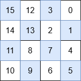

# 3537. 填充特殊网格

Medium · 难度分 1542 · [力扣原题](https://leetcode.cn/problems/fill-a-special-grid/)

所在刷题路径：灵神题单·链表树与回溯

| 作者 | 题解 | 动画讲解 |
|---|---|---|
| 灵茶山艾府 | [📄 题解](灵茶山艾府.md) | [▶︎ 3537 填充特殊网格 · 灵茶山艾府.mp4](3537%20填充特殊网格%20·%20灵茶山艾府.mp4) |
| yiduobo | [📄 题解](yiduobo.md) | [▶︎ 3537 填充特殊网格 · yiduobo.mp4](3537%20填充特殊网格%20·%20yiduobo.mp4) |

## 题目描述

给你一个非负整数 `N`，表示一个 `2^N x 2^N` 的网格。你需要用从 0 到 `2^2N - 1` 的整数填充网格，使其成为一个 **特殊** 网格。一个网格当且仅当满足以下 **所有** 条件时，才能称之为 **特殊** 网格：

- 右上角象限中的所有数字都小于右下角象限中的所有数字。

- 右下角象限中的所有数字都小于左下角象限中的所有数字。

- 左下角象限中的所有数字都小于左上角象限中的所有数字。

- 每个象限也都是一个特殊网格。

返回一个 `2^N x 2^N` 的特殊网格。

**注意：**任何 1x1 的网格都是特殊网格。

**示例 1：**

**输入：** `N = 0`

**输出：** `[[0]]`

**解释：**

唯一可以放置的数字是 0，并且网格中只有一个位置。

**示例 2：**

**输入：** `N = 1`

**输出：** `[[3,0],[2,1]]`

**解释：**

每个象限的数字如下：

- 右上角：0

- 右下角：1

- 左下角：2

- 左上角：3

由于 `0 < 1 < 2 < 3`，该网格满足给定的约束条件。

**示例 3：**

**输入：** `N = 2`

**输出：** `[[15,12,3,0],[14,13,2,1],[11,8,7,4],[10,9,6,5]]`

**解释：**

每个象限的数字如下：

- 右上角：3, 0, 2, 1

- 右下角：7, 4, 6, 5

- 左下角：11, 8, 10, 9

- 左上角：15, 12, 14, 13

- `max(3, 0, 2, 1) < min(7, 4, 6, 5)`

- `max(7, 4, 6, 5) < min(11, 8, 10, 9)`

- `max(11, 8, 10, 9) < min(15, 12, 14, 13)`

这满足前三个要求。此外，每个象限也是一个特殊网格。因此，这是一个特殊网格。

**提示：**

- `0 <= N <= 10`

---
[↑ 返回 3500-3599](../README.md) · [总索引](../../../索引.md) · [仓库首页](../../../README.md)
