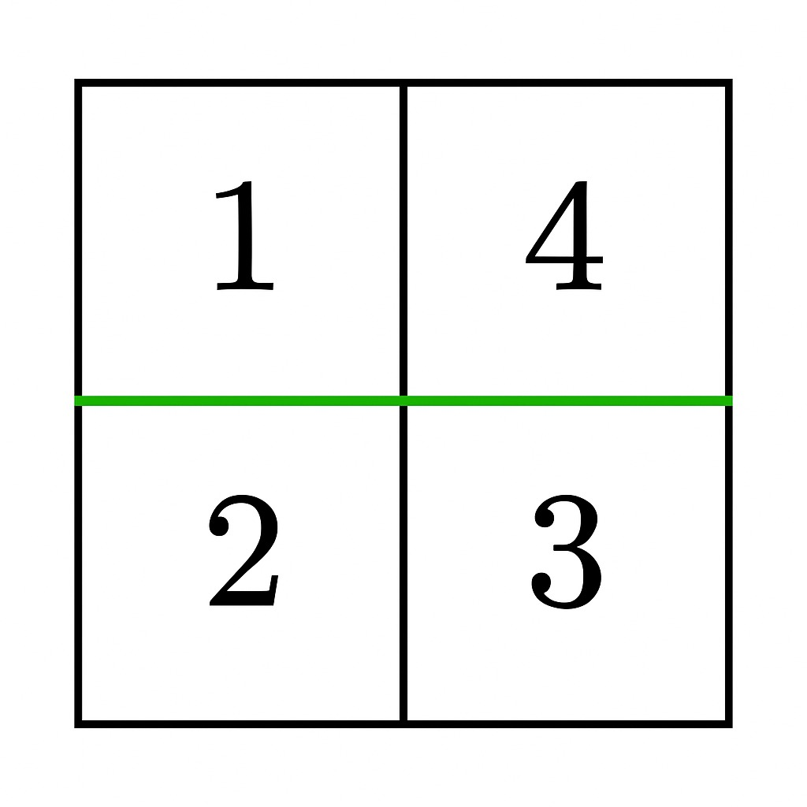

# 3546. 等和矩阵分割 I

Medium · [力扣原题](https://leetcode.cn/problems/equal-sum-grid-partition-i/)

| 作者 | 题解 | 动画讲解 |
|---|---|---|
| 灵茶山艾府 | [📄 题解](灵茶山艾府.md) | [▶︎ 3546 等和矩阵分割 I · 灵茶山艾府.mp4](3546%20等和矩阵分割%20I%20·%20灵茶山艾府.mp4) |
| yiduobo | [📄 题解](yiduobo.md) | [▶︎ 3546 等和矩阵分割 I · yiduobo.mp4](3546%20等和矩阵分割%20I%20·%20yiduobo.mp4) |

## 题目描述

给你一个由正整数组成的 `m x n` 矩阵 `grid`。你的任务是判断是否可以通过 **一条水平或一条垂直分割线** 将矩阵分割成两部分，使得：

- 分割后形成的每个部分都是 **非空** 的。

- 两个部分中所有元素的和 **相等** 。

如果存在这样的分割，返回 `true`；否则，返回 `false`。

**示例 1：**

**输入：** grid = \[\[1,4],[2,3]]

**输出：** true

**解释：**

在第 0 行和第 1 行之间进行水平分割，得到两个非空部分，每部分的元素之和为 5。因此，答案是 `true`。

**示例 2：**

**输入：** grid = \[\[1,3],[2,4]]

**输出：** false

**解释：**

无论是水平分割还是垂直分割，都无法使两个非空部分的元素之和相等。因此，答案是 `false`。

**提示：**

- `1 <= m == grid.length <= 10⁵`

- `1 <= n == grid[i].length <= 10⁵`

- `2 <= m * n <= 10⁵`

- `1 <= grid[i][j] <= 10⁵`

---
[↑ 返回 3500-3599](../README.md) · [总索引](../../../索引.md) · [仓库首页](../../../README.md)
