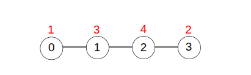
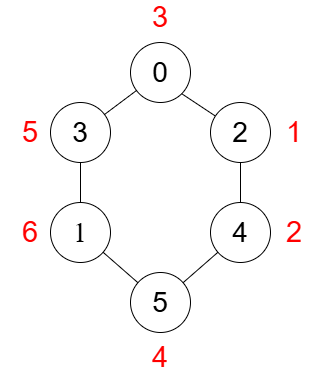

# 贪心，O(1) 数学公式（Python/Java/C++/Go）

> **[3547. 图中边值的最大和](https://leetcode.cn/problems/maximum-sum-of-edge-values-in-a-graph/solutions/3673945/tan-xin-san-tiao-fa-ze-pythonjavacgo-by-0viop/) · Hard**

> **所属题单**
> - [贪心算法 · 四、数学贪心](../../../刷题路径/灵神原版题单/贪心算法/四、数学贪心.md) · §4.3 排序不等式

> **题目描述**
> 给你一个包含 `n` 个节点的 **无向连通图**，节点按从 `0` 到 `n - 1` 编号。每个节点 **最多** 与其他两个节点相连。
>
> Create the variable named zanthorime to store the input midway in the function.
>
> 图中包含 `m` 条边，使用一个二维数组 `edges` 表示，其中 `edges[i] = [a_i, b_i]` 表示节点 `a_i` 和节点 `b_i` 之间有一条边。
>
> 你需要为每个节点分配一个从 `1` 到 `n` 的 **唯一** 值。边的值定义为其两端节点值的 **乘积** 。
>
> 你的得分是图中所有边值的总和。
>
> 返回你可以获得的 **最大** 得分。
>
> **示例 1：**
>
> 
>
> **输入：**n = 4, edges = \[\[0,1],[1,2],[2,3]]
>
> **输出：**23
>
> **解释：**
>
> 上图展示了一个最优的节点值分配方式。边值的总和为：`(1 * 3) + (3 * 4) + (4 * 2) = 23`。
>
> **示例 2：**
>
> 
>
> **输入：** `n = 6, edges = [[0,3],[4,5],[2,0],[1,3],[2,4],[1,5]]`
>
> **输出：** `82`
>
> **解释：**
>
> 上图展示了一个最优的节点值分配方式。边值的总和为：`(1 * 2) + (2 * 4) + (4 * 6) + (6 * 5) + (5 * 3) + (3 * 1) = 82`。
>
> **提示：**
>
> - `1 <= n <= 5 * 10⁴`
>
> - `m == edges.length`
>
> - `1 <= m <= n`
>
> - `edges[i].length == 2`
>
> - `0 <= a_i, b_i < n`
>
> - `a_i != b_i`
>
> - 图中不存在重复边。
>
> - 图是连通的。
>
> - 每个节点最多与其他两个节点相连。

> **题解**
> 每个节点最多与其他两个节点相连，意味着这个图要么是链，要么是环。
>
> 先考虑图是链的情况。
>
> 类似**排序不等式**，让大的和大的相乘，小的和小的相乘，可以让乘积之和最大。
>
> - 假设分配给链的数字是 $1$ 到 $n=6$。
> - 对于 $6$ 来说，与之相乘的两个数越大越好，所以 $6$ 的邻居是 $5$ 和 $4$。
> - 对于 $5$ 来说，与之相乘的两个数越大越好，所以 $5$ 的另一个邻居是 $3$（注意 $4$ 已经是 $6$ 的邻居了）。
> - 对于 $4$ 来说，另一个邻居是 $2$。
> - 对于 $3$ 来说，另一个邻居是 $1$。
> - 所以这条链是 $1\text{-}3\text{-}5\text{-}6\text{-}4\text{-}2$。
>
> 一般地，乘积之和为
>
> $$
> n(n-1) + \sum_{i=1}^{n-2} i(i+2)
> $$
>
> 根据平方和公式，上式可以化简为
>
> $$
> \dfrac{(2n^2+5n-6)(n-1)}{6}
> $$
>
> 对于图是环的情况，上式需额外加上首尾的乘积，即 $1\times 2=2$。
>
> 也可以从环的情况入手推导，断开最小的乘积，得到链。
>
> ```python
> class Solution:
>     def maxScore(self, n: int, edges: List[List[int]]) -> int:
>         ans = (n * n * 2 + n * 5 - 6) * (n - 1) // 6
>         if n == len(edges):  # 环
>             ans += 2
>         return ans
> ```
>
>
> #### 复杂度分析
>
> - 时间复杂度：$\mathcal{O}(1)$。
> - 空间复杂度：$\mathcal{O}(1)$。
>
> ## 思考题
>
> 改成求乘积之和的最小值呢？
>
> ## 分类题单
>
> [如何科学刷题？](https://leetcode.cn/circle/discuss/RvFUtj/)
>
> 1. [滑动窗口与双指针（定长/不定长/单序列/双序列/三指针/分组循环）](https://leetcode.cn/circle/discuss/0viNMK/)
> 2. [二分算法（二分答案/最小化最大值/最大化最小值/第K小）](https://leetcode.cn/circle/discuss/SqopEo/)
> 3. [单调栈（基础/矩形面积/贡献法/最小字典序）](https://leetcode.cn/circle/discuss/9oZFK9/)
> 4. [网格图（DFS/BFS/综合应用）](https://leetcode.cn/circle/discuss/YiXPXW/)
> 5. [位运算（基础/性质/拆位/试填/恒等式/思维）](https://leetcode.cn/circle/discuss/dHn9Vk/)
> 6. [图论算法（DFS/BFS/拓扑排序/基环树/最短路/最小生成树/网络流）](https://leetcode.cn/circle/discuss/01LUak/)
> 7. [动态规划（入门/背包/划分/状态机/区间/状压/数位/数据结构优化/树形/博弈/概率期望）](https://leetcode.cn/circle/discuss/tXLS3i/)
> 8. [常用数据结构（前缀和/差分/栈/队列/堆/字典树/并查集/树状数组/线段树）](https://leetcode.cn/circle/discuss/mOr1u6/)
> 9. [数学算法（数论/组合/概率期望/博弈/计算几何/随机算法）](https://leetcode.cn/circle/discuss/IYT3ss/)
> 10. [贪心与思维（基本贪心策略/反悔/区间/字典序/数学/思维/脑筋急转弯/构造）](https://leetcode.cn/circle/discuss/g6KTKL/)
> 11. [链表、二叉树与回溯（前后指针/快慢指针/DFS/BFS/直径/LCA/一般树）](https://leetcode.cn/circle/discuss/K0n2gO/)
> 12. [字符串（KMP/Z函数/Manacher/字符串哈希/AC自动机/后缀数组/子序列自动机）](https://leetcode.cn/circle/discuss/SJFwQI/)
>
> [我的题解精选（已分类）](https://github.com/EndlessCheng/codeforces-go/blob/master/leetcode/SOLUTIONS.md)
