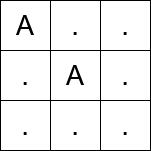
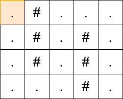

# 0-1 BFS（Python/Java/C++/Go）

> **[3552. 网格传送门旅游](https://leetcode.cn/problems/grid-teleportation-traversal/solutions/3679952/0-1-bfspythonjavacgo-by-endlesscheng-8nj9/) · Medium · 难度分 2036**

> **所属题单**
> - [网格图 · 三、网格图 0-1 BFS](../../../刷题路径/灵神原版题单/网格图/三、网格图%200-1%20BFS.md)

> **题目描述**
> 给你一个大小为 `m x n` 的二维字符网格 `matrix`，用字符串数组表示，其中 `matrix[i][j]` 表示第 `i` 行和第 `j` 列处的单元格。每个单元格可以是以下几种字符之一：
>
> - `'.'` 表示一个空单元格。
>
> - `'#'` 表示一个障碍物。
>
> - 一个大写字母（`'A'` 到 `'Z'`）表示一个传送门。
>
> 你从左上角单元格 `(0, 0)` 出发，目标是到达右下角单元格 `(m - 1, n - 1)`。你可以从当前位置移动到相邻的单元格（上、下、左、右），移动后的单元格必须在网格边界内且不是障碍物**。**
>
> 如果你踏入一个包含传送门字母的单元格，并且你之前没有使用过该传送门字母，你可以立即传送到网格中另一个具有相同字母的单元格。这次传送不计入移动次数，但每个字母对应的传送门在旅程中 **最多** 只能使用一次。
>
> 返回到达右下角单元格所需的 **最少** 移动次数。如果无法到达目的地，则返回 `-1`。
>
> **示例 1：**
>
> **输入：** `matrix = ["A..",".A.","..."]`
>
> **输出：** 2
>
> **解释：**
>
> 
>
> - 在第一次移动之前，从 `(0, 0)` 传送到 `(1, 1)`。
>
> - 第一次移动，从 `(1, 1)` 移动到 `(1, 2)`。
>
> - 第二次移动，从 `(1, 2)` 移动到 `(2, 2)`。
>
> **示例 2：**
>
> **输入：** `matrix = [".#...",".#.#.",".#.#.","...#."]`
>
> **输出：** `13`
>
> **解释：**
>
> 
>
> **提示：**
>
> - `1 <= m == matrix.length <= 10³`
>
> - `1 <= n == matrix[i].length <= 10³`
>
> - `matrix[i][j]` 是 `'#'`、`'.'` 或一个大写英文字母。
>
> - `matrix[0][0]` 不是障碍物。

> **题解**
> **前置题目**：[2290. 到达角落需要移除障碍物的最小数目](https://leetcode.cn/problems/minimum-obstacle-removal-to-reach-corner/)
>
> 本质上是计算如下图的最短路：
>
> - 所有相同字母之间都有一条边权为 $0$ 的边。
> - 所有相邻格子之间都有一条边权为 $1$ 的边。
>
> 这可以用 Dijkstra 算法解决。不过，对于边权只有 $0$ 和 $1$ 的特殊图，可以用 **0-1 BFS**（双端队列）解决，做到线性时间：
>
> - 如果当前格子是非字母格子，那么像普通 BFS 那样遍历四方向的相邻格子。
> - 如果当前格子是字母格子，那么除了像普通 BFS 那样遍历四方向的相邻格子以外，还需要遍历该字母的所有传送门，传送过去（边权为 $0$）。使用所有传送门后，清空传送门的位置列表，避免反复使用传送门。
>
> 具体请看 [视频讲解](https://www.bilibili.com/video/BV1Z3JGzwEU9/?t=19m54s)，欢迎点赞关注~
>
> ```python
> class Solution:
>     def minMoves(self, matrix: List[str]) -> int:
>         if matrix[-1][-1] == '#':
>             return -1
>
>         m, n = len(matrix), len(matrix[0])
>         pos = defaultdict(list)
>         for i, row in enumerate(matrix):
>             for j, c in enumerate(row):
>                 if c.isupper():
>                     pos[c].append((i, j))
>
>         DIRS = [(0, -1), (0, 1), (-1, 0), (1, 0)]
>         dis = [[inf] * n for _ in range(m)]
>         dis[0][0] = 0
>         q = deque([(0, 0)])
>
>         while q:
>             x, y = q.popleft()
>             d = dis[x][y]
>
>             if x == m - 1 and y == n - 1:  # 到达终点
>                 return d
>
>             c = matrix[x][y]
>             if c in pos:
>                 # 使用所有传送门
>                 for px, py in pos[c]:
>                     if d < dis[px][py]:
>                         dis[px][py] = d
>                         q.appendleft((px, py))
>                 del pos[c]  # 避免重复使用传送门
>
>             # 下面代码和普通 BFS 是一样的
>             for dx, dy in DIRS:
>                 nx, ny = x + dx, y + dy
>                 if 0 <= nx < m and 0 <= ny < n and matrix[nx][ny] != '#' and d + 1 < dis[nx][ny]:
>                     dis[nx][ny] = d + 1
>                     q.append((nx, ny))
>
>         return -1
> ```
>
>
> #### 复杂度分析
>
> - 时间复杂度：$\mathcal{O}(mn)$，其中 $m$ 和 $n$ 分别为 $\textit{matrix}$ 的行数和列数。
> - 空间复杂度：$\mathcal{O}(mn)$。
>
> 更多相似题目，见下面网格图题单的「**三、网格图 0-1 BFS**」。
>
> ## 分类题单
>
> [如何科学刷题？](https://leetcode.cn/circle/discuss/RvFUtj/)
>
> 1. [滑动窗口与双指针（定长/不定长/单序列/双序列/三指针/分组循环）](https://leetcode.cn/circle/discuss/0viNMK/)
> 2. [二分算法（二分答案/最小化最大值/最大化最小值/第K小）](https://leetcode.cn/circle/discuss/SqopEo/)
> 3. [单调栈（基础/矩形面积/贡献法/最小字典序）](https://leetcode.cn/circle/discuss/9oZFK9/)
> 4. [网格图（DFS/BFS/综合应用）](https://leetcode.cn/circle/discuss/YiXPXW/)
> 5. [位运算（基础/性质/拆位/试填/恒等式/思维）](https://leetcode.cn/circle/discuss/dHn9Vk/)
> 6. [图论算法（DFS/BFS/拓扑排序/基环树/最短路/最小生成树/网络流）](https://leetcode.cn/circle/discuss/01LUak/)
> 7. [动态规划（入门/背包/划分/状态机/区间/状压/数位/数据结构优化/树形/博弈/概率期望）](https://leetcode.cn/circle/discuss/tXLS3i/)
> 8. [常用数据结构（前缀和/差分/栈/队列/堆/字典树/并查集/树状数组/线段树）](https://leetcode.cn/circle/discuss/mOr1u6/)
> 9. [数学算法（数论/组合/概率期望/博弈/计算几何/随机算法）](https://leetcode.cn/circle/discuss/IYT3ss/)
> 10. [贪心与思维（基本贪心策略/反悔/区间/字典序/数学/思维/脑筋急转弯/构造）](https://leetcode.cn/circle/discuss/g6KTKL/)
> 11. [链表、二叉树与回溯（前后指针/快慢指针/DFS/BFS/直径/LCA/一般树）](https://leetcode.cn/circle/discuss/K0n2gO/)
> 12. [字符串（KMP/Z函数/Manacher/字符串哈希/AC自动机/后缀数组/子序列自动机）](https://leetcode.cn/circle/discuss/SJFwQI/)
>
> [我的题解精选（已分类）](https://github.com/EndlessCheng/codeforces-go/blob/master/leetcode/SOLUTIONS.md)
