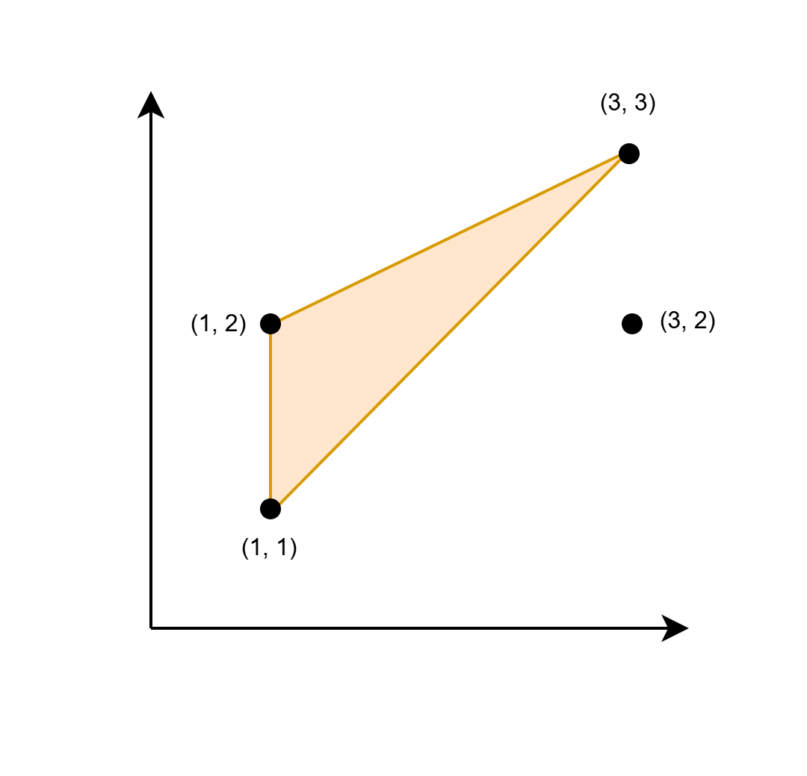

# 维护横纵坐标的最小值和最大值（Python/Java/C++/Go）

> **[3588. 找到最大三角形面积](https://leetcode.cn/problems/find-maximum-area-of-a-triangle/solutions/3705572/wei-hu-heng-zong-zuo-biao-de-zui-xiao-zh-rhdf/) · Medium**

> **题目描述**
> 给你一个二维数组 `coords`，大小为 `n x 2`，表示一个无限笛卡尔平面上 `n` 个点的坐标。
>
> 找出一个 **最大** 三角形的 **两倍** 面积，其中三角形的三个顶点来自 `coords` 中的任意三个点，并且该三角形至少有一条边与 x 轴或 y 轴平行。严格地说，如果该三角形的最大面积为 `A`，则返回 `2 * A`。
>
> 如果不存在这样的三角形，返回 -1。
>
> **注意**，三角形的面积 **不能** 为零。
>
> **示例 1：**
>
> **输入：** `coords = [[1,1],[1,2],[3,2],[3,3]]`
>
> **输出：** `2`
>
> **解释：**
>
> 
>
> 图中的三角形的底边为 1，高为 2。因此，它的面积为 `1/2 * 底边 * 高 = 1`。
>
> **示例 2：**
>
> **输入：** `coords = [[1,1],[2,2],[3,3]]`
>
> **输出：** `-1`
>
> **解释：**
>
> 唯一可能的三角形的顶点是 `(1, 1)`、`(2, 2)` 和 `(3, 3)`。它的任意边都不与 x 轴或 y 轴平行。
>
> **提示：**
>
> - `1 <= n == coords.length <= 10⁵`
>
> - `1 <= coords[i][0], coords[i][1] <= 10⁶`
>
> - 所有 `coords[i]` 都是 **唯一** 的。

> **题解**
> 讨论三角形底边与 $y$ 轴平行的情况（如示例 1）。
>
> 假设底边横坐标 $x=1$，为了最大化三角形面积，我们需要最大化三角形的底边长，以及三角形的高，二者相乘，就是三角形面积乘二的最大值。
>
> - **底边**：我们需要知道所有 $x=1$ 的点中，$y$ 的最小值 $\textit{minY}[x]$ 和最大值 $\textit{maxY}[x]$，取这两个点的连线作为底边，长度为 $\textit{maxY}[x] - \textit{minY}[x]$。
> - **高**：我们需要知道 $x$ 的最小值 $\textit{minX}$ 和最大值 $\textit{maxX}$，那么高就是 $\max(x-\textit{minX},\textit{maxX}-x)$。
>
> 三角形面积乘二为
>
> $$
> (\textit{maxY}[x] - \textit{minY}[x])\cdot \max(x-\textit{minX},\textit{maxX}-x)
> $$
>
> 对于三角形底边与 $x$ 轴平行的情况，我们只需交换每个点的横纵坐标，就可以复用上面的逻辑了。
>
> 具体请看 [视频讲解](https://www.bilibili.com/video/BV1qeNRzjEEk/?t=6m51s)，欢迎点赞关注~
>
> ## 写法一
>
> ```python
> # 手写 min max 更快
> min = lambda a, b: b if b < a else a
> max = lambda a, b: b if b > a else a
>
> class Solution:
>     def maxArea(self, coords: List[List[int]]) -> int:
>         ans = 0
>
>         def calc() -> None:
>             min_x, max_x = inf, 0
>             min_y = defaultdict(lambda: inf)
>             max_y = defaultdict(int)
>             for x, y in coords:
>                 min_x = min(min_x, x)
>                 max_x = max(max_x, x)
>                 min_y[x] = min(min_y[x], y)
>                 max_y[x] = max(max_y[x], y)
>
>             nonlocal ans
>             for x, y in min_y.items():
>                 ans = max(ans, (max_y[x] - y) * max(max_x - x, x - min_x))
>
>         calc()
>
>         for p in coords:
>             p[0], p[1] = p[1], p[0]
>         calc()
>
>         return ans or -1
> ```
>
>
> ## 写法二
>
> $\texttt{calc}$ 传入一个参数 $j$ 来控制是否交换横纵坐标。
>
> - 如果 $j=0$，那么 $x=p[0],\ y=p[1]$。
> - 如果 $j=1$，那么 $x=p[1],\ y=p[0]$。这样也相当于交换横纵坐标，但不修改输入。
>
> 两种情况合并为：$x=p[j],\ y=p[1-j]$。
>
> ```python
> # 手写 min max 更快
> min = lambda a, b: b if b < a else a
> max = lambda a, b: b if b > a else a
>
> class Solution:
>     def maxArea(self, coords: List[List[int]]) -> int:
>         def calc(j: int) -> int:
>             min_x, max_x = inf, 0
>             min_y = defaultdict(lambda: inf)
>             max_y = defaultdict(int)
>             for p in coords:
>                 x, y = p[j], p[1 - j]
>                 min_x = min(min_x, x)
>                 max_x = max(max_x, x)
>                 min_y[x] = min(min_y[x], y)
>                 max_y[x] = max(max_y[x], y)
>
>             res = 0
>             for x, y in min_y.items():
>                 res = max(res, (max_y[x] - y) * max(max_x - x, x - min_x))
>             return res
>
>         return max(calc(0), calc(1)) or -1
> ```
>
>
> #### 复杂度分析
>
> - 时间复杂度：$\mathcal{O}(n)$，其中 $n$ 是 $\textit{coords}$ 的长度。
> - 空间复杂度：$\mathcal{O}(n)$。
>
> ## 思考题
>
> 如果不要求一定有一边与坐标轴平行呢？
>
> 换言之，任选三个点，所组成的三角形的面积，最大是多少？
>
> 这是一个经典问题，感兴趣的读者可以搜索相关资料。
>
> ## 分类题单
>
> [如何科学刷题？](https://leetcode.cn/circle/discuss/RvFUtj/)
>
> 1. [滑动窗口与双指针（定长/不定长/单序列/双序列/三指针/分组循环）](https://leetcode.cn/circle/discuss/0viNMK/)
> 2. [二分算法（二分答案/最小化最大值/最大化最小值/第K小）](https://leetcode.cn/circle/discuss/SqopEo/)
> 3. [单调栈（基础/矩形面积/贡献法/最小字典序）](https://leetcode.cn/circle/discuss/9oZFK9/)
> 4. [网格图（DFS/BFS/综合应用）](https://leetcode.cn/circle/discuss/YiXPXW/)
> 5. [位运算（基础/性质/拆位/试填/恒等式/思维）](https://leetcode.cn/circle/discuss/dHn9Vk/)
> 6. [图论算法（DFS/BFS/拓扑排序/基环树/最短路/最小生成树/网络流）](https://leetcode.cn/circle/discuss/01LUak/)
> 7. [动态规划（入门/背包/划分/状态机/区间/状压/数位/数据结构优化/树形/博弈/概率期望）](https://leetcode.cn/circle/discuss/tXLS3i/)
> 8. [常用数据结构（前缀和/差分/栈/队列/堆/字典树/并查集/树状数组/线段树）](https://leetcode.cn/circle/discuss/mOr1u6/)
> 9. [数学算法（数论/组合/概率期望/博弈/计算几何/随机算法）](https://leetcode.cn/circle/discuss/IYT3ss/)
> 10. [贪心与思维（基本贪心策略/反悔/区间/字典序/数学/思维/脑筋急转弯/构造）](https://leetcode.cn/circle/discuss/g6KTKL/)
> 11. [链表、二叉树与回溯（前后指针/快慢指针/DFS/BFS/直径/LCA/一般树）](https://leetcode.cn/circle/discuss/K0n2gO/)
> 12. [字符串（KMP/Z函数/Manacher/字符串哈希/AC自动机/后缀数组/子序列自动机）](https://leetcode.cn/circle/discuss/SJFwQI/)
>
> [我的题解精选（已分类）](https://github.com/EndlessCheng/codeforces-go/blob/master/leetcode/SOLUTIONS.md)
