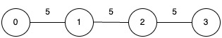

# 从小到大合并（Python/Java/C++/Go）

> **[3613. 最小化连通分量的最大成本](https://leetcode.cn/problems/minimize-maximum-component-cost/solutions/3722472/cong-xiao-dao-da-he-bing-pythonjavacgo-b-s72b/) · Medium · 难度分 1900**

> **所属题单**
> - [二分算法 · 二、二分答案](../../../刷题路径/灵神原版题单/二分算法/二、二分答案.md) · §2.4 最小化最大值
> - [常用数据结构 · 七、并查集](../../../刷题路径/灵神原版题单/常用数据结构/七、并查集.md) · §7.2 进阶

> **题目描述**
> 给你一个无向连通图，包含 `n` 个节点，节点编号从 0 到 `n - 1`，以及一个二维整数数组 `edges`，其中 `edges[i] = [u_i, v_i, w_i]` 表示一条连接节点 `u_i` 和节点 `v_i` 的无向边，边权为 `w_i`，另有一个整数 `k`。
>
> 你可以从图中移除任意数量的边，使得最终的图中 **最多** 只包含 `k` 个连通分量。
>
> 连通分量的 **成本** 定义为该分量中边权的 **最大值** 。如果一个连通分量没有边，则其代价为 0。
>
> 请返回在移除这些边之后，在所有连通分量之中的 **最大成本** 的 **最小可能值** 。
>
> **示例 1：**
>
> **输入：** `n = 5, edges = [[0,1,4],[1,2,3],[1,3,2],[3,4,6]], k = 2`
>
> **输出：** `4`
>
> **解释：**
>
> 
>
> - 移除节点 3 和节点 4 之间的边（权值为 6）。
>
> - 最终的连通分量成本分别为 0 和 4，因此最大代价为 4。
>
> **示例 2：**
>
> **输入：** `n = 4, edges = [[0,1,5],[1,2,5],[2,3,5]], k = 1`
>
> **输出：** `5`
>
> **解释：**
>
> 
>
> - 无法移除任何边，因为只允许一个连通分量（`k = 1`），图必须保持完全连通。
>
> - 该连通分量的成本等于其最大边权，即 5。
>
> **提示：**
>
> - `1 <= n <= 5 * 10⁴`
>
> - `0 <= edges.length <= 10⁵`
>
> - `edges[i].length == 3`
>
> - `0 <= u_i, v_i < n`
>
> - `1 <= w_i <= 10⁶`
>
> - `1 <= k <= n`
>
> - 输入图是连通图。

> **题解**
> 上场周赛出过一个类似的题目 [3608. 包含 K 个连通分量需要的最小时间](https://leetcode.cn/problems/minimum-time-for-k-connected-components/)，代码几乎一样。
>
> 如果 $k=n$，无需合并，返回 $0$。
>
> 否则，为了最小化答案，我们可以用**并查集**从小到大合并，直到连通块个数等于 $k$ 为止。此时，合并边之前有 $k+1$ 个连通块，合并后有 $k$ 个连通块，且参与合并的边权都是尽量小的，返回当前边的边权。合并更大的边权是没有意义的，因为小于等于最大边权的边我们都能合并，合并更大边权不会得到更优解。
>
> ```python
> # 完整的并查集模板，见我的数据结构题单
> class UnionFind:
>     def __init__(self, n: int):
>         # 一开始有 n 个集合 {0}, {1}, ..., {n-1}
>         # 集合 i 的代表元是自己，大小为 1
>         self._fa = list(range(n))  # 代表元
>         self.cc = n  # 连通块个数
>
>     # 返回 x 所在集合的代表元
>     # 同时做路径压缩，也就是把 x 所在集合中的所有元素的 fa 都改成代表元
>     def find(self, x: int) -> int:
>         # 如果 fa[x] == x，则表示 x 是代表元
>         if self._fa[x] != x:
>             self._fa[x] = self.find(self._fa[x])  # fa 改成代表元
>         return self._fa[x]
>
>     # 把 from 所在集合合并到 to 所在集合中
>     def merge(self, from_: int, to: int) -> None:
>         x, y = self.find(from_), self.find(to)
>         if x == y:  # from 和 to 在同一个集合，不做合并
>             return
>         self._fa[x] = y  # 合并集合。修改后就可以认为 from 和 to 在同一个集合了
>         self.cc -= 1  # 成功合并，连通块个数减一
>
>
> class Solution:
>     def minCost(self, n: int, edges: List[List[int]], k: int) -> int:
>         if k == n:
>             return 0
>     
>         edges.sort(key=lambda e: e[2])
>         u = UnionFind(n)
>         for x, y, w in edges:
>             u.merge(x, y)
>             if u.cc == k:
>                 return w
> ```
>
>
> #### 复杂度分析
>
> - 时间复杂度：$\mathcal{O}(m\log m + m\log n)$，其中 $m$ 是 $\textit{edges}$ 的长度。瓶颈在排序上。
> - 空间复杂度：$\mathcal{O}(n)$。忽略排序的栈开销。
>
> ## 专题训练
>
> 见下面数据结构题单的「**七、并查集**」。
>
> ## 分类题单
>
> [如何科学刷题？](https://leetcode.cn/circle/discuss/RvFUtj/)
>
> 1. [滑动窗口与双指针（定长/不定长/单序列/双序列/三指针/分组循环）](https://leetcode.cn/circle/discuss/0viNMK/)
> 2. [二分算法（二分答案/最小化最大值/最大化最小值/第K小）](https://leetcode.cn/circle/discuss/SqopEo/)
> 3. [单调栈（基础/矩形面积/贡献法/最小字典序）](https://leetcode.cn/circle/discuss/9oZFK9/)
> 4. [网格图（DFS/BFS/综合应用）](https://leetcode.cn/circle/discuss/YiXPXW/)
> 5. [位运算（基础/性质/拆位/试填/恒等式/思维）](https://leetcode.cn/circle/discuss/dHn9Vk/)
> 6. [图论算法（DFS/BFS/拓扑排序/基环树/最短路/最小生成树/网络流）](https://leetcode.cn/circle/discuss/01LUak/)
> 7. [动态规划（入门/背包/划分/状态机/区间/状压/数位/数据结构优化/树形/博弈/概率期望）](https://leetcode.cn/circle/discuss/tXLS3i/)
> 8. [常用数据结构（前缀和/差分/栈/队列/堆/字典树/并查集/树状数组/线段树）](https://leetcode.cn/circle/discuss/mOr1u6/)
> 9. [数学算法（数论/组合/概率期望/博弈/计算几何/随机算法）](https://leetcode.cn/circle/discuss/IYT3ss/)
> 10. [贪心与思维（基本贪心策略/反悔/区间/字典序/数学/思维/脑筋急转弯/构造）](https://leetcode.cn/circle/discuss/g6KTKL/)
> 11. [链表、二叉树与回溯（前后指针/快慢指针/DFS/BFS/直径/LCA/一般树）](https://leetcode.cn/circle/discuss/K0n2gO/)
> 12. [字符串（KMP/Z函数/Manacher/字符串哈希/AC自动机/后缀数组/子序列自动机）](https://leetcode.cn/circle/discuss/SJFwQI/)
>
> [我的题解精选（已分类）](https://github.com/EndlessCheng/codeforces-go/blob/master/leetcode/SOLUTIONS.md)
