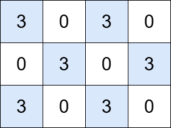

# 3619. 总价值可以被 K 整除的岛屿数目

Medium · 难度分 1461 · [力扣原题](https://leetcode.cn/problems/count-islands-with-total-value-divisible-by-k/)

所在刷题路径：灵神核心路线、灵神题单·网格图

| 作者 | 题解 | 动画讲解 |
|---|---|---|
| 灵茶山艾府 | [📄 题解](灵茶山艾府.md) | [▶︎ 3619 总价值可以被 K 整除的岛屿数目 · 灵茶山艾府.mp4](3619%20总价值可以被%20K%20整除的岛屿数目%20·%20灵茶山艾府.mp4) |
| yiduobo | [📄 题解](yiduobo.md) | [▶︎ 3619 总价值可以被 K 整除的岛屿数目 · yiduobo.mp4](3619%20总价值可以被%20K%20整除的岛屿数目%20·%20yiduobo.mp4) |

## 题目描述

给你一个 `m x n` 的矩阵 `grid` 和一个正整数 `k`。一个 **岛屿** 是由 **正** 整数（表示陆地）组成的，并且陆地间 **四周** 连通（水平或垂直）。

一个岛屿的总价值是该岛屿中所有单元格的值之和。

返回总价值可以被 `k` **整除** 的岛屿数量。

**示例 1:**

**输入:** `grid = [[0,2,1,0,0],[0,5,0,0,5],[0,0,1,0,0],[0,1,4,7,0],[0,2,0,0,8]], k = 5`

**输出:** `2`

**解释:**

网格中包含四个岛屿。蓝色高亮显示的岛屿的总价值可以被 5 整除，而红色高亮显示的岛屿则不能。

**示例 2:**

**输入:** `grid = [[3,0,3,0], [0,3,0,3], [3,0,3,0]], k = 3`

**输出:** `6`

**解释:**

网格中包含六个岛屿，每个岛屿的总价值都可以被 3 整除。

**提示:**

- `m == grid.length`

- `n == grid[i].length`

- `1 <= m, n <= 1000`

- `1 <= m * n <= 10⁵`

- `0 <= grid[i][j] <= 10⁶`

- `1 <= k < = 10⁶`

---
[↑ 返回 3600-3699](../README.md) · [总索引](../../../索引.md) · [仓库首页](../../../README.md)
