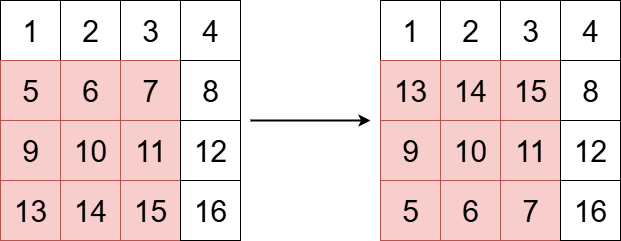
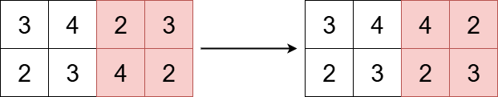

# 3643. 垂直翻转子矩阵

Easy · 难度分 1235 · [力扣原题](https://leetcode.cn/problems/flip-square-submatrix-vertically/)

所在刷题路径：灵神题单·滑动窗口与双指针

| 作者 | 题解 | 动画讲解 |
|---|---|---|
| 灵茶山艾府 | [📄 题解](灵茶山艾府.md) | [▶︎ 动画（GIF）](3643%20垂直翻转子矩阵%20·%20灵茶山艾府.gif) · [mp4 文件](3643%20垂直翻转子矩阵%20·%20灵茶山艾府.mp4) |
| yiduobo | [📄 题解](yiduobo.md) | [▶︎ 动画（GIF）](3643%20垂直翻转子矩阵%20·%20yiduobo.gif) · [mp4 文件](3643%20垂直翻转子矩阵%20·%20yiduobo.mp4) |

## 动画讲解

> 动图会循环播放；想暂停、拖进度条请下载上面表格里的 mp4 文件。

### 灵茶山艾府

### yiduobo

## 题目描述

给你一个 `m x n` 的整数矩阵 `grid`，以及三个整数 `x`、`y` 和 `k`。

整数 `x` 和 `y` 表示一个 **正方形子矩阵** 的左上角下标，整数 `k` 表示该正方形子矩阵的边长。

你的任务是垂直翻转子矩阵的行顺序。

返回更新后的矩阵。

**示例 1：**

**输入：** grid = \[\[1,2,3,4],[5,6,7,8],[9,10,11,12],[13,14,15,16]], x = 1, y = 0, k = 3

**输出：** `[[1,2,3,4],[13,14,15,8],[9,10,11,12],[5,6,7,16]]`

**解释：**

上图展示了矩阵在变换前后的样子。

**示例 2：**

**输入：** `grid = [[3,4,2,3],[2,3,4,2]], x = 0, y = 2, k = 2`

**输出：** `[[3,4,4,2],[2,3,2,3]]`

**解释：**

上图展示了矩阵在变换前后的样子。

**提示：**

- `m == grid.length`

- `n == grid[i].length`

- `1 <= m, n <= 50`

- `1 <= grid[i][j] <= 100`

- `0 <= x < m`

- `0 <= y < n`

- `1 <= k <= min(m - x, n - y)`

---
[↑ 返回 3600-3699](../README.md) · [总索引](../../../索引.md) · [仓库首页](../../../README.md)
