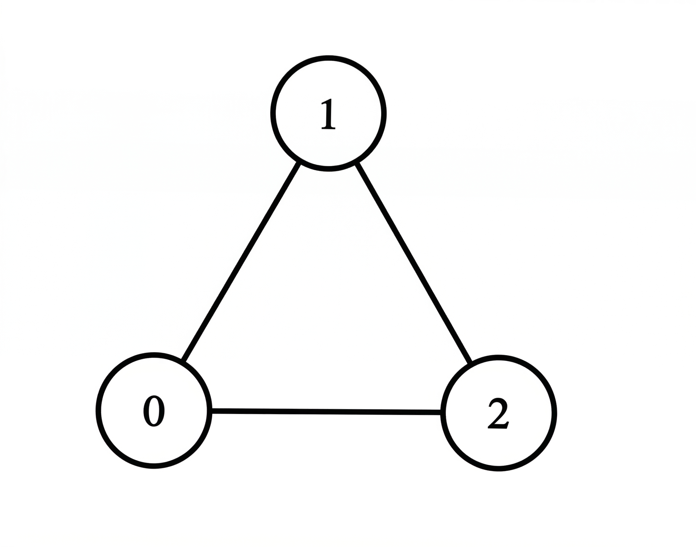
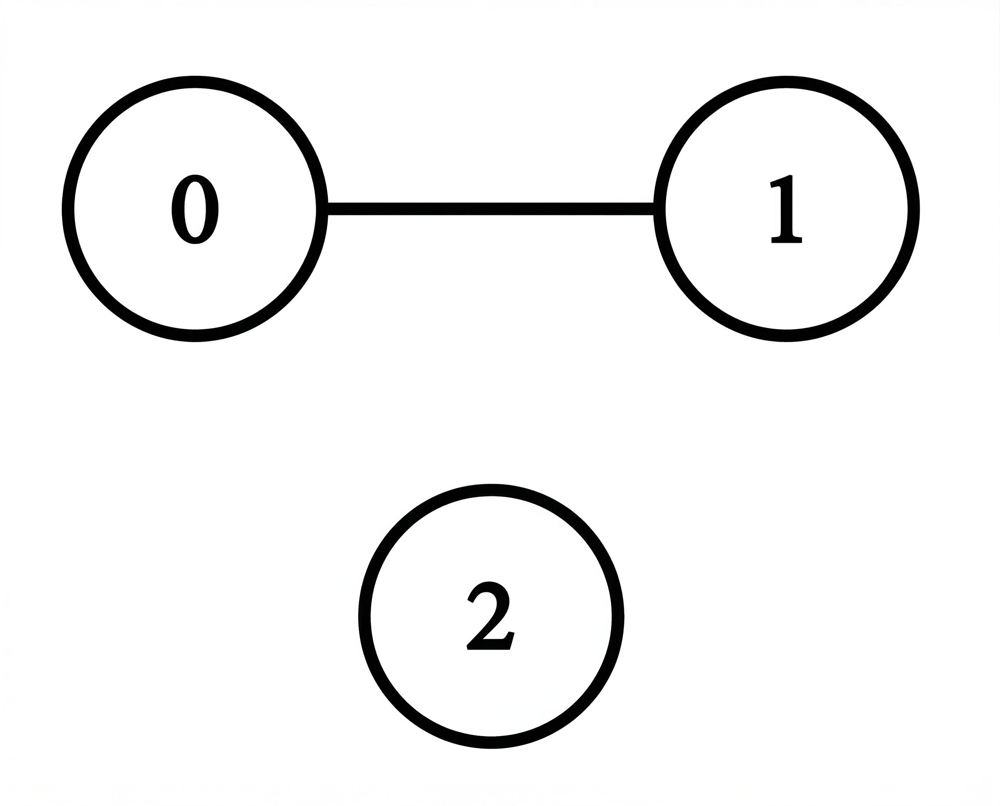

# 3898. 统计每个顶点的度

Easy · [力扣原题](https://leetcode.cn/problems/find-the-degree-of-each-vertex/)

| 作者 | 题解 | 动画讲解 |
|---|---|---|
| 灵茶山艾府 | [📄 题解](灵茶山艾府.md) | [▶︎ 动画（GIF）](3898%20统计每个顶点的度%20·%20灵茶山艾府.gif) · [mp4 文件](3898%20统计每个顶点的度%20·%20灵茶山艾府.mp4) |
| yiduobo | [📄 题解](yiduobo.md) | [▶︎ 动画（GIF）](3898%20统计每个顶点的度%20·%20yiduobo.gif) · [mp4 文件](3898%20统计每个顶点的度%20·%20yiduobo.mp4) |

## 动画讲解

> 动图会循环播放；想暂停、拖进度条请下载上面表格里的 mp4 文件。

### 灵茶山艾府

### yiduobo

## 题目描述

给你一个大小为 `n x n` 的二维整数数组 `matrix`，以邻接矩阵形式表示一个 **无向图**。该图包含 `n` 个顶点，编号从 0 到 `n - 1`。

- `matrix[i][j] = 1` 表示顶点 `i` 与顶点 `j` 之间存在一条边。

- `matrix[i][j] = 0` 表示顶点 `i` 与顶点 `j` 之间不存在边。

顶点的 **度（degree）**定义为与该顶点相连的边的数量。

请返回一个长度为 `n` 的整数数组 `ans`，其中 `ans[i]` 表示顶点 `i` 的度。

**示例 1：**

**输入：** `matrix = [[0,1,1],[1,0,1],[1,1,0]]`

**输出：** `[2,2,2]`

**解释：**

- 顶点 0 与顶点 1 和 2 相连，因此其度为 2。

- 顶点 1 与顶点 0 和 2 相连，因此其度为 2。

- 顶点 2 与顶点 0 和 1 相连，因此其度为 2。

因此，答案为 `[2, 2, 2]`。

**示例 2：**

**输入：** `matrix = [[0,1,0],[1,0,0],[0,0,0]]`

**输出：** `[1,1,0]`

**解释：**

- 顶点 0 与顶点 1 相连，因此其度为 1。

- 顶点 1 与顶点 0 相连，因此其度为 1。

- 顶点 2 没有与任何顶点相连，因此其度为 0。

因此，答案为 `[1, 1, 0]`。

**示例 3：**

**输入：** `matrix = [[0]]`

**输出：** `[0]`

**解释：**

图中只有一个顶点，且没有任何边与其相连，因此答案为 `[0]`。

**提示：**

- `1 <= n == matrix.length == matrix[i].length <= 100`

- `matrix[i][i] == 0`

- `matrix[i][j]` 仅为 0 或 1

- `matrix[i][j] == matrix[j][i]`

---
[↑ 返回 3800-3899](../README.md) · [总索引](../../../索引.md) · [仓库首页](../../../README.md)
