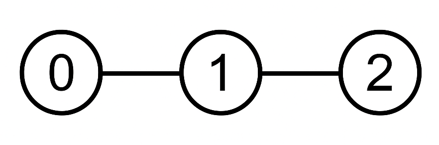
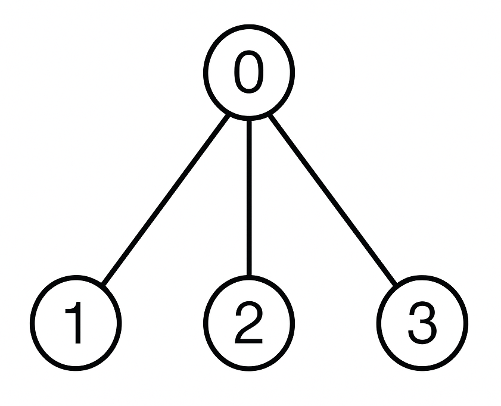

# 3939. 统计有根树中不相邻子集的数目

Hard · 难度分 2354 · [力扣原题](https://leetcode.cn/problems/count-non-adjacent-subsets-in-a-rooted-tree/)

所在刷题路径：灵神题单·动态规划

| 作者 | 题解 | 动画讲解 |
|---|---|---|
| 灵茶山艾府 | [📄 题解](灵茶山艾府.md) | [▶︎ 3939 统计有根树中不相邻子集的数目 · 灵茶山艾府.mp4](3939%20统计有根树中不相邻子集的数目%20·%20灵茶山艾府.mp4) |
| yiduobo | [📄 题解](yiduobo.md) | [▶︎ 3939 统计有根树中不相邻子集的数目 · yiduobo.mp4](3939%20统计有根树中不相邻子集的数目%20·%20yiduobo.mp4) |

## 题目描述

给你一棵有 `n` 个节点的有根树，节点编号从 0 到 `n - 1` ，由一个长度为 `n` 的整数数组 `parent` 表示，其中：

- `parent[0] = -1` （节点 0 是根节点）。

- 对于每个 `1 <= i < n` ，`parent[i]` 是节点 `i` 的父节点（`0 <= parent[i] < i`）。

另外给你一个长度为 `n` 的整数数组 `nums` ，其中 `nums[i]` 是节点 `i` 的值，以及一个整数 `k`。

如果节点的一个非空子集满足以下条件，则称为 **有效** 子集：

- 所选节点的值之 **和** 可以被 `k` **整除** 。

- 所选节点中没有 **两** 个节点在树中是 **相邻** 的（即没有节点及其直接父节点同时包含在子集中）。

返回有效子集的数量对 `10⁹ + 7` 取余的结果。

**示例 1：**

**输入：** `parent = [-1,0,1], nums = [1,2,3], k = 3`

**输出：** `1`

**解释：**

唯一有效的子集是 `{2}` 。它包含值为 3 的节点 2，可以被 3 整除。

**示例 2：**

**输入：** `parent = [-1,0,0,0], nums = [2,1,2,1], k = 3`

**输出：** `2`

**解释：**

有效的子集有：

- `{1, 2}`：节点 1 和 2 都是节点 0 的子节点，且彼此不直接相连。它们的值之和为 `1 + 2 = 3` ，可以被 3 整除。

- `{2, 3}`：节点 2 和 3 也不相邻。它们的值之和为 `2 + 1 = 3` ，可以被 3 整除。

没有其他子集同时满足两个条件。因此，答案是 2 。

**提示：**

- `n == parent.length == nums.length`

- `1 <= n <= 1000`

- `parent[0] == -1`

- 对于所有的 `1 <= i < n`：

    - `0 <= parent[i] < i`

- `1 <= nums[i] <= 10⁹`

- `1 <= k <= 100`​​​​​​​`​​​​​​​`

- `parent` 表示一棵有效的有根树。

---
[↑ 返回 3900-3999](../README.md) · [总索引](../../../索引.md) · [仓库首页](../../../README.md)
