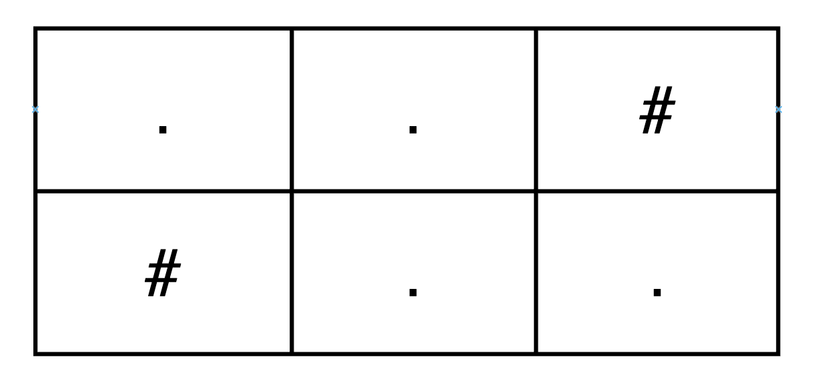
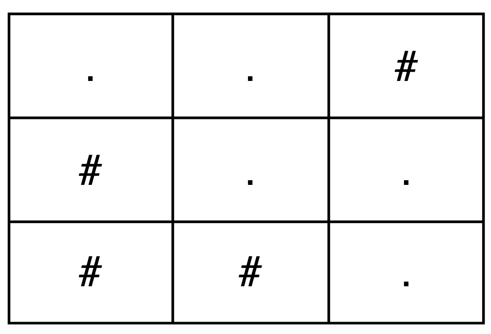

# 3963. 构造恰好一条路径的网格

Easy · 难度分 1311 · [力扣原题](https://leetcode.cn/problems/create-grid-with-exactly-one-path/)

所在刷题路径：灵神题单·贪心与思维

| 作者 | 题解 | 动画讲解 |
|---|---|---|
| 灵茶山艾府 | [📄 题解](灵茶山艾府.md) | [▶︎ 动画（GIF）](3963%20构造恰好一条路径的网格%20·%20灵茶山艾府.gif) · [mp4 文件](3963%20构造恰好一条路径的网格%20·%20灵茶山艾府.mp4) |
| yiduobo | [📄 题解](yiduobo.md) | [▶︎ 动画（GIF）](3963%20构造恰好一条路径的网格%20·%20yiduobo.gif) · [mp4 文件](3963%20构造恰好一条路径的网格%20·%20yiduobo.mp4) |

## 动画讲解

> 动图会循环播放；想暂停、拖进度条请下载上面表格里的 mp4 文件。

### 灵茶山艾府

### yiduobo

## 题目描述

给你两个整数 `m` 和 `n`，分别表示网格的行数和列数。

请你构造 **任意** 一个只包含字符 `'.'` 和 `'#'` 的 `m x n` 网格，其中：

- `'.'` 表示空单元格。

- `'#'` 表示障碍物单元格。

**有效路径** 是满足以下条件的空单元格序列：

- 从左上角单元格 `(0, 0)` 开始。

- 在右下角单元格 `(m - 1, n - 1)` 结束。

- 只能向：

    - 右移动，从 `(i, j)` 到 `(i, j + 1)`，或者

    - 下移动，从 `(i, j)` 到 `(i + 1, j)`。

返回任意一个从左上角到右下角 **恰好只有一条有效路径** 的网格。

**示例 1：**

**输入：** `m = 2, n = 3`

**输出：** `["..#","#.."]`

**解释：**

唯一的有效路径是：`(0,0) → (0,1) → (1,1) → (1,2)`

**示例 2：**

**输入：** `m = 3, n = 3`

**输出：** `["..#","#..","##."]`

**解释：**

唯一的有效路径是：`(0,0) → (0,1) → (1,1) → (1,2) → (2,2)`

**示例 3：**

**输入：** `m = 1, n = 4`

**输出：** `["...."]`

**解释：**

唯一的有效路径是：`(0,0) → (0,1) → (0,2) → (0,3)`

**提示：**

- `1 <= m, n <= 25`

---
[↑ 返回 3900-3999](../README.md) · [总索引](../../../索引.md) · [仓库首页](../../../README.md)
