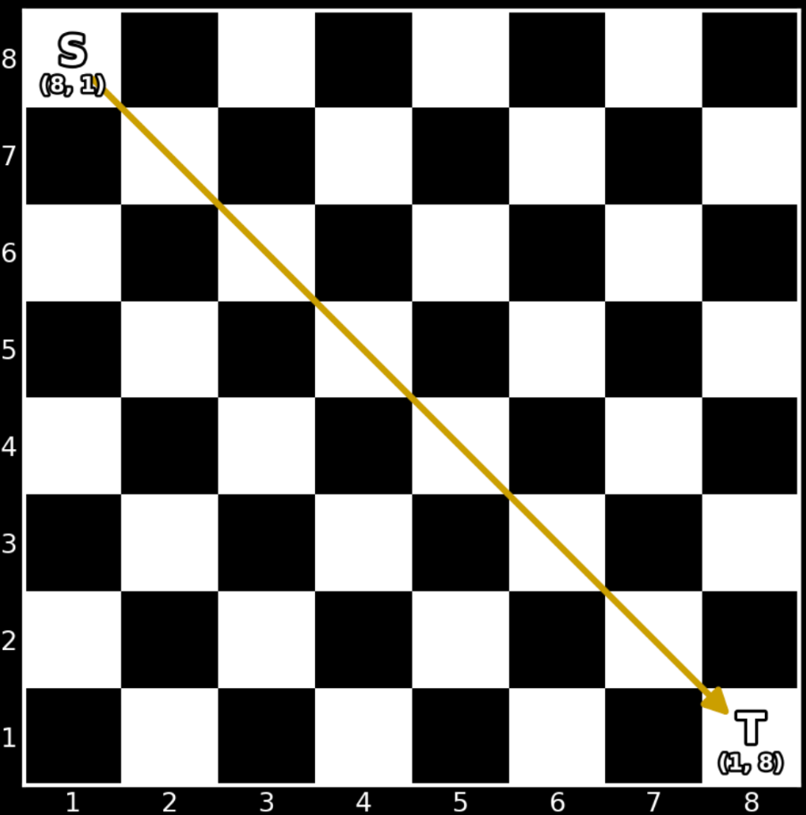
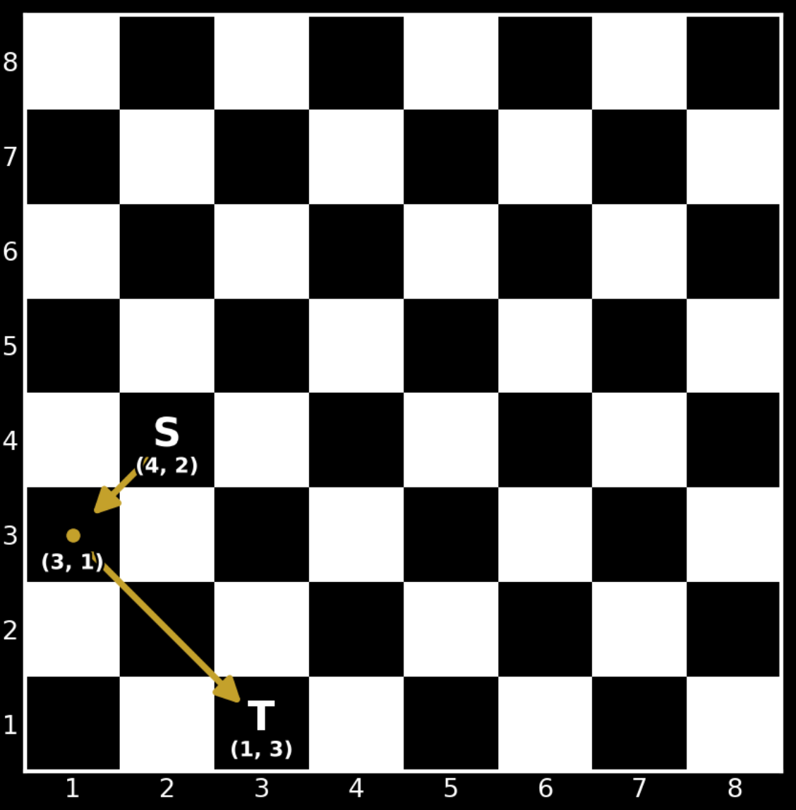

# 至多走两步（Python/Java/C++/Go）

> **[4034. 象到达目标格子的最少移动步数](https://leetcode.cn/problems/minimum-bishop-moves-to-reach-target/solutions/4019786/o1-shi-jian-zuo-fa-pythonjavacgo-by-endl-3bzt/) · Medium**

> **题目描述**
> 给你一个 `8 x 8` 的棋盘，行和列的**下标从 1 开始**。
>
> 给你一个数组 `source = [sr, sc]`，表示 **象** 的起始位置，以及一个数组 `target = [tr, tc]`。在一步移动中，象可以在棋盘范围内沿着单个 **对角线** 方向移动任意数量的格子。
>
> 返回象 **恰好** 到达 `target` 位置所需的 **最少** 移动次数。如果它永远无法到达 `target`，则返回 -1。
>
> **示例 1：**
>
> **输入：** `source = [8,1], target = [1,8]`
>
> **输出：** `1`
>
> **解释：**
>
> 
>
> 一步对角线移动即可将象直接从 `(8, 1)` 送达 `(1, 8)`。
>
> **示例 2：**
>
> **输入：** `source = [4,2], target = [1,3]`
>
> **输出：** `2`
>
> **解释：**
>
> 
>
> 象从 `(4, 2)` 移动到 `(3, 1)`，然后再从 `(3, 1)` 移动到 `(1, 3)`，经过 2 步移动到达目标位置。
>
> **示例 3：**
>
> **输入：** `source = [1,1], target = [3,4]`
>
> **输出：** `-1`
>
> **解释：**
>
> 无论进行多少次对角线移动，从 `(1, 1)` 出发的象都永远无法到达 `(3, 4)`。因此，答案是 -1。
>
> **提示：**
>
> - `source.length == target.length == 2`
>
> - `1 <= sr, sc, tr, tc <= 8`
>
> - `source != target`

> **题解**
> 首先，由于象移动后不改变所在格子的颜色，所以如果两个象的格子颜色不同，那么无解。
>
> 否则一定有解。如果两点之间的直线斜率为 $-1$ 或者 $1$，那么一步可达，否则需要两步。
>
> ```python
> class Solution:
>     def minBishopMoves(self, source: list[int], target: list[int]) -> int:
>         sx, sy = source
>         tx, ty = target
>
>         # 颜色不同
>         if (sx + sy) % 2 != (tx + ty) % 2:
>             return -1
>
>         # 两点之间的直线，如果斜率是 -1 或者 1，那么两点可以直接到达，否则要走两步
>         return 1 if sx + sy == tx + ty or sx - sy == tx - ty else 2
> ```
>
>
> #### 复杂度分析
>
> - 时间复杂度：$\mathcal{O}(1)$。
> - 空间复杂度：$\mathcal{O}(1)$。
>
> ## 分类题单
>
> [如何科学刷题？](https://leetcode.cn/discuss/post/3141566/ru-he-ke-xue-shua-ti-by-endlesscheng-q3yd/)
>
> 1. [滑动窗口与双指针（定长/不定长/单序列/双序列/三指针/分组循环）](https://leetcode.cn/discuss/post/3578981/ti-dan-hua-dong-chuang-kou-ding-chang-bu-rzz7/)
> 2. [二分算法（二分答案/最小化最大值/最大化最小值/第K小）](https://leetcode.cn/discuss/post/3579164/ti-dan-er-fen-suan-fa-er-fen-da-an-zui-x-3rqn/)
> 3. [单调栈（基础/矩形面积/贡献法/最小字典序）](https://leetcode.cn/discuss/post/3579480/ti-dan-dan-diao-zhan-ju-xing-xi-lie-zi-d-u4hk/)
> 4. [网格图（DFS/BFS/综合应用）](https://leetcode.cn/discuss/post/3580195/fen-xiang-gun-ti-dan-wang-ge-tu-dfsbfszo-l3pa/)
> 5. [位运算（基础/性质/拆位/试填/恒等式/思维）](https://leetcode.cn/discuss/post/3580371/fen-xiang-gun-ti-dan-wei-yun-suan-ji-chu-nth4/)
> 6. [图论算法（DFS/BFS/拓扑排序/基环树/最短路/最小生成树/网络流）](https://leetcode.cn/discuss/post/3581143/fen-xiang-gun-ti-dan-tu-lun-suan-fa-dfsb-qyux/)
> 7. [动态规划（入门/背包/划分/状态机/区间/状压/数位/数据结构优化/树形/博弈/概率期望）](https://leetcode.cn/discuss/post/3581838/fen-xiang-gun-ti-dan-dong-tai-gui-hua-ru-007o/)
> 8. [常用数据结构（前缀和/差分/栈/队列/堆/字典树/并查集/树状数组/线段树）](https://leetcode.cn/discuss/post/3583665/fen-xiang-gun-ti-dan-chang-yong-shu-ju-j-bvmv/)
> 9. [数学算法（数论/组合/概率期望/博弈/计算几何/随机算法）](https://leetcode.cn/discuss/post/3584388/fen-xiang-gun-ti-dan-shu-xue-suan-fa-shu-gcai/)
> 10. [贪心与思维（基本贪心策略/反悔/区间/字典序/数学/思维/脑筋急转弯/构造）](https://leetcode.cn/discuss/post/3091107/fen-xiang-gun-ti-dan-tan-xin-ji-ben-tan-k58yb/)
> 11. [链表、树与回溯（前后指针/快慢指针/DFS/BFS/直径/LCA）](https://leetcode.cn/discuss/post/3142882/fen-xiang-gun-ti-dan-lian-biao-er-cha-sh-6srp/)
> 12. [字符串（KMP/Z函数/Manacher/字符串哈希/AC自动机/后缀数组/子序列自动机）](https://leetcode.cn/discuss/post/3144832/fen-xiang-gun-ti-dan-zi-fu-chuan-kmpzhan-ugt4/)
>
> [我的题解精选（已分类）](https://github.com/EndlessCheng/codeforces-go/blob/master/leetcode/SOLUTIONS.md)
>
> 欢迎关注 [B站@灵茶山艾府](https://space.bilibili.com/206214)
