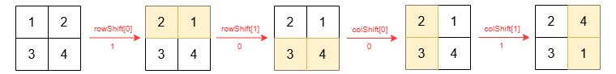
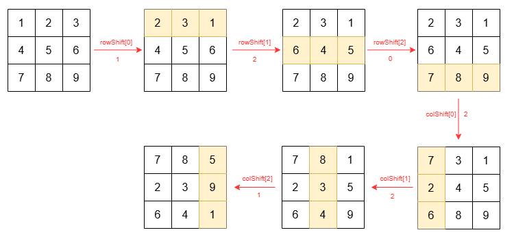

# 两种写法：模拟 / 直接计算（Python/Java/C++/Go）

> **[4052. 行列循环移位](https://leetcode.cn/problems/cyclically-shift-rows-and-columns/solutions/4027861/mo-ni-pythonjavacgo-by-endlesscheng-kd65/) · Easy**

> **题目描述**
> 给你一个整数 `n`、一个大小为 `n x n` 的二维整数数组 `grid`，以及两个长度均为 `n` 的整数数组 `rowShift` 和 `colShift`，其中：
>
> - `rowShift[i]` 表示将 `grid` 的第 `i` 行向左 **循环移位** 的位数。
>
> - `colShift[j]` 表示将 `grid` 的第 `j` 列向上 **循环移位** 的位数。
>
> 首先按照 `rowShift` 对每一行进行循环移位，然后按照 `colShift` 对每一列进行循环移位。
>
> 返回完成所有移位操作后的网格。
>
> 将第 `i` 行向左 **循环移位** `k` 位时，只移动该行。原本位于第 `j` 列的元素会移动到第 `(j - k + n) % n` 列，其余各行保持不变。
>
> 将第 `j` 列向上 **循环移位** `k` 位时，只移动该列。原本位于第 `i` 行的元素会移动到第 `(i - k + n) % n` 行，其余各列保持不变。
>
> **示例 1：**
>
> **输入：** `n = 2, grid = [[1,2],[3,4]], rowShift = [1,0], colShift = [0,1]`
>
> **输出：** `[[2,4],[3,1]]`
>
> **解释：**
>
> `grid` 的变化过程如下：
>
> 
>
> **示例 2：**
>
> **输入：** `n = 3, grid = [[1,2,3],[4,5,6],[7,8,9]], rowShift = [1,2,0], colShift = [2,2,1]`
>
> **输出：** `[[7,8,5],[2,3,9],[6,4,1]]`
>
> **解释：**
>
> `grid` 的变化过程如下：
>
> 
>
> **提示：**
>
> - `1 <= n == grid.length == grid[i].length <= 10`
>
> - `1 <= grid[i][j] <= 100`
>
> - `rowShift.length == colShift.length == n`
>
> - `0 <= rowShift[i], colShift[i] < n`

> **题解**
> ## 写法一：按题意模拟
>
> ```python
> class Solution:
>     def cyclicShift(self, n: int, grid: list[list[int]], rowShift: list[int], colShift: list[int]) -> list[list[int]]:
>         for i, row in enumerate(grid):
>             shift = rowShift[i]
>             grid[i] = row[shift:] + row[:shift]
>
>         for j, col in enumerate(zip(*grid)):
>             shift = colShift[j]
>             new_col = col[shift:] + col[:shift]
>             for row, x in zip(grid, new_col):
>                 row[j] = x
>
>         return grid
> ```
>
>
> #### 复杂度分析
>
> - 时间复杂度：$\mathcal{O}(n^2)$，其中 $n$ 是 $\textit{grid}$ 的行数和列数。
> - 空间复杂度：$\mathcal{O}(n)$。
>
> ## 写法二：直接计算
>
> 答案 $\textit{ans}[i][j]$ 来自哪个格子？
>
> 来自哪一行？列移位后，$\textit{row} = (i+\textit{colShift}[j])\bmod n$ 行移到了 $i$ 行。
>
> 来自哪一列？行移位后，$\textit{row}$ 行的 $\textit{col} = (j + \textit{rowShift}[\textit{row}])\bmod n$ 列移到了 $j$ 列。
>
> 所以 $\textit{ans}[i][j] = \textit{grid}[\textit{row}][\textit{col}]$。
>
> ```python
> class Solution:
>     def cyclicShift(self, n: int, grid: list[list[int]], rowShift: list[int], colShift: list[int]) -> list[list[int]]:
>         ans = [[0] * n for _ in range(n)]
>         for i in range(n):
>             for j in range(n):
>                 row = (i + colShift[j]) % n
>                 col = (j + rowShift[row]) % n
>                 ans[i][j] = grid[row][col]
>         return ans
> ```
>
>
> #### 复杂度分析
>
> - 时间复杂度：$\mathcal{O}(n^2)$，其中 $n$ 是 $\textit{grid}$ 的行数和列数。
> - 空间复杂度：$\mathcal{O}(1)$。返回值不计入。
>
> **注**：利用 [189. 轮转数组](https://leetcode.cn/problems/rotate-array/) 的技巧，可以做到完美的**原地修改**。详见 [我的题解](../../0100-0199/0189%20轮转数组/灵茶山艾府.md)。
>
> ## 分类题单
>
> [如何科学刷题？](https://leetcode.cn/discuss/post/3141566/ru-he-ke-xue-shua-ti-by-endlesscheng-q3yd/)
>
> 1. [滑动窗口与双指针（定长/不定长/单序列/双序列/三指针/分组循环）](https://leetcode.cn/discuss/post/3578981/ti-dan-hua-dong-chuang-kou-ding-chang-bu-rzz7/)
> 2. [二分算法（二分答案/最小化最大值/最大化最小值/第K小）](https://leetcode.cn/discuss/post/3579164/ti-dan-er-fen-suan-fa-er-fen-da-an-zui-x-3rqn/)
> 3. [单调栈（基础/矩形面积/贡献法/最小字典序）](https://leetcode.cn/discuss/post/3579480/ti-dan-dan-diao-zhan-ju-xing-xi-lie-zi-d-u4hk/)
> 4. [网格图（DFS/BFS/综合应用）](https://leetcode.cn/discuss/post/3580195/fen-xiang-gun-ti-dan-wang-ge-tu-dfsbfszo-l3pa/)
> 5. [位运算（基础/性质/拆位/试填/恒等式/思维）](https://leetcode.cn/discuss/post/3580371/fen-xiang-gun-ti-dan-wei-yun-suan-ji-chu-nth4/)
> 6. [图论算法（DFS/BFS/拓扑排序/基环树/最短路/最小生成树/网络流）](https://leetcode.cn/discuss/post/3581143/fen-xiang-gun-ti-dan-tu-lun-suan-fa-dfsb-qyux/)
> 7. [动态规划（入门/背包/划分/状态机/区间/状压/数位/数据结构优化/树形/博弈/概率期望）](https://leetcode.cn/discuss/post/3581838/fen-xiang-gun-ti-dan-dong-tai-gui-hua-ru-007o/)
> 8. [常用数据结构（前缀和/差分/栈/队列/堆/字典树/并查集/树状数组/线段树）](https://leetcode.cn/discuss/post/3583665/fen-xiang-gun-ti-dan-chang-yong-shu-ju-j-bvmv/)
> 9. [数学算法（数论/组合/概率期望/博弈/计算几何/随机算法）](https://leetcode.cn/discuss/post/3584388/fen-xiang-gun-ti-dan-shu-xue-suan-fa-shu-gcai/)
> 10. [贪心与思维（基本贪心策略/反悔/区间/字典序/数学/思维/脑筋急转弯/构造）](https://leetcode.cn/discuss/post/3091107/fen-xiang-gun-ti-dan-tan-xin-ji-ben-tan-k58yb/)
> 11. [链表、树与回溯（前后指针/快慢指针/DFS/BFS/直径/LCA）](https://leetcode.cn/discuss/post/3142882/fen-xiang-gun-ti-dan-lian-biao-er-cha-sh-6srp/)
> 12. [字符串（KMP/Z函数/Manacher/字符串哈希/AC自动机/后缀数组/子序列自动机）](https://leetcode.cn/discuss/post/3144832/fen-xiang-gun-ti-dan-zi-fu-chuan-kmpzhan-ugt4/)
>
> [我的题解精选（已分类）](https://github.com/EndlessCheng/codeforces-go/blob/master/leetcode/SOLUTIONS.md)
>
> 欢迎关注 [B站@灵茶山艾府](https://space.bilibili.com/206214)
