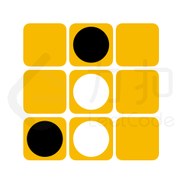
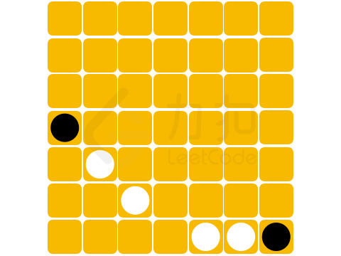

# LCP 41. 黑白翻转棋

Medium · [力扣原题](https://leetcode.cn/problems/fHi6rV/)

| 作者 | 题解 | 动画讲解 |
|---|---|---|
| 灵茶山艾府 | [📄 题解](灵茶山艾府.md) | — |
| yiduobo | [📄 题解](yiduobo.md) | [▶︎ LCP 41 黑白翻转棋 · yiduobo.mp4](LCP%2041%20黑白翻转棋%20·%20yiduobo.mp4) |

## 题目描述

在 `n*m` 大小的棋盘中，有黑白两种棋子，黑棋记作字母 `"X"`, 白棋记作字母 `"O"`，空余位置记作 `"."`。当落下的棋子与其他相同颜色的棋子在行、列或对角线完全包围（中间不存在空白位置）另一种颜色的棋子，则可以翻转这些棋子的颜色。

{:height=170px}{:height=170px}{:height=170px}

「力扣挑战赛」黑白翻转棋项目中，将提供给选手一个未形成可翻转棋子的棋盘残局，其状态记作 `chessboard`。若下一步可放置一枚黑棋，请问选手最多能翻转多少枚白棋。

**注意：**
- 若翻转白棋成黑棋后，棋盘上仍存在可以翻转的白棋，将可以 **继续** 翻转白棋
- 输入数据保证初始棋盘状态无可以翻转的棋子且存在空余位置

**示例 1：**
> 输入：`chessboard = ["....X.","....X.","XOOO..","......","......"]`
>
> 输出：`3`
>
> 解释：
> 可以选择下在 `[2,4]` 处，能够翻转白方三枚棋子。

**示例 2：**
> 输入：`chessboard = [".X.",".O.","XO."]`
>
> 输出：`2`
>
> 解释：
> 可以选择下在 `[2,2]` 处，能够翻转白方两枚棋子。

**示例 3：**
> 输入：`chessboard = [".......",".......",".......","X......",".O.....","..O....","....OOX"]`
>
> 输出：`4`
>
> 解释：
> 可以选择下在 `[6,3]` 处，能够翻转白方四枚棋子。

**提示：**
- `1 <= chessboard.length, chessboard[i].length <= 8`
- `chessboard[i]` 仅包含 `"."、"O"` 和 `"X"`

---
[↑ 返回 LCP](../README.md) · [总索引](../../../索引.md) · [仓库首页](../../../README.md)
