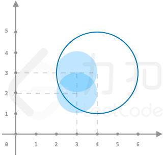
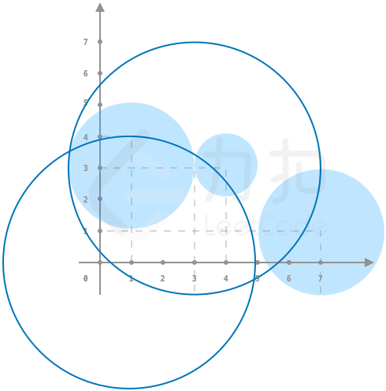

# 排序二分+暴力枚举

> **[LCP 42. 玩具套圈](https://leetcode.cn/problems/vFjcfV/solutions/991705/er-fen-bao-li-mei-ju-by-endlesscheng-vezb/) · Hard**

> **所属题单**
> - [数学算法 · 五、计算几何](../../../刷题路径/灵神原版题单/数学算法/五、计算几何.md) · §5.2 圆

> **题目描述**
> 「力扣挑战赛」场地外，小力组织了一个套玩具的游戏。所有的玩具摆在平地上，`toys[i]` 以 `[xi,yi,ri]` 的形式记录了第 `i` 个玩具的坐标 `(xi,yi)` 和半径 `ri`。小扣试玩了一下，他扔了若干个半径均为 `r` 的圈，`circles[j]` 记录了第 `j` 个圈的坐标 `(xj,yj)`。套圈的规则如下：
> - 若一个玩具被某个圈完整覆盖了（即玩具的任意部分均在圈内或者圈上），则该玩具被套中。
> - 若一个玩具被多个圈同时套中，最终仅计算为套中一个玩具
>
> 请帮助小扣计算，他成功套中了多少玩具。
>
> **注意：**
> - 输入数据保证任意两个玩具的圆心不会重合，但玩具之间可能存在重叠。
>
> **示例 1：**
>
> > 输入：`toys = [[3,3,1],[3,2,1]], circles = [[4,3]], r = 2`
> >
> > 输出：`1`
> >
> > 解释： 如图所示，仅套中一个玩具
> 
>
> **示例 2：**
>
> > 输入：`toys = [[1,3,2],[4,3,1],[7,1,2]], circles = [[1,0],[3,3]], r = 4`
> >
> > 输出：`2`
> >
> > 解释： 如图所示，套中两个玩具
> {:width="400px"}
>
> **提示：**
> - `1 <= toys.length <= 10^4`
> - `0 <= toys[i][0], toys[i][1] <= 10^9`
> - `1 <= circles.length <= 10^4`
> - `0 <= circles[i][0], circles[i][1] <= 10^9`
> - `1 <= toys[i][2], r <= 10`

> **题解**
> 注意到半径很小，我们可以枚举每个玩具，并暴力枚举该玩具**周围**是否有可以套住该玩具的圈。
>
> 具体来说，将 $\textit{circles}$ 排序后，将横坐标相同的圈分为一组。对每个玩具，可以套住该玩具的圈，在横坐标上，必然满足圈的最右端点不小于玩具的最右端点，且圈的最左端点不大于玩具的最左端点。对于纵坐标，我们只需要找最接近玩具纵坐标的上下两个圈。这样我们就可以二分出圈的横坐标的范围，对每个横坐标上的圈二分纵坐标最接近玩具纵坐标的圈。
