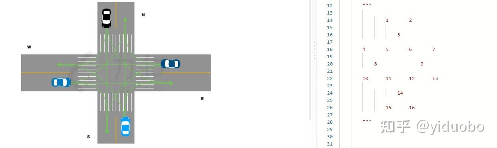
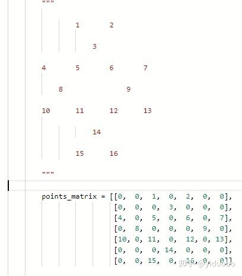

# LCP 43. 十字路口的交通

> **[yiduobo的每日leetcode LCP43.十字路口的交通](https://zhuanlan.zhihu.com/p/576321562) · 知乎 · 2022-10-23 · 赞同 1**
> 力扣：[LCP 43. 十字路口的交通](https://leetcode.cn/problems/Y1VbOX/) · Hard · 灵茶山艾府：[动态规划](灵茶山艾府.md)

祖传的手艺不想丢了，所以按顺序写一个leetcode的题解。计划每日一题，争取不卡题吧。

LCP43.十字路口的交通

[力扣](https://leetcode.cn/problems/Y1VbOX/)

从题目数据范围来看，这是一道非常典型的动态规划的题目。令f\[pos\[0\]\]\[pos\[1\]\]\[pos\[2\]\]\[pos\[3\]\]表示当东、西、南、北方的车辆分别已经开走了pos\[0\]、pos\[1\]、pos\[2\]、pos\[3\]辆时，剩余车辆通过十字路口所需的最少时间。

那么对于f\[pos\[0\]\]\[pos\[1\]\]\[pos\[2\]\]\[pos\[3\]\]，则需要分别枚举4个方向当前的车辆，即directions\[0\]\[pos\[0\]\]、directions\[1\]\[pos\[1\]\]、directions\[2\]\[pos\[2\]\]、directions\[3\]\[pos\[3\]\]，可以选择走或者是停着。对于方向i，如果选择走，那么这个方向上走掉的车辆就是pi \= pos\[i\] + 1，否则就依然是pi \= pos\[i\]。当然，对于选择走的车辆，必须满足两两之间的路线不会交叉，那么就有

f\[pos\[0\]\]\[pos\[1\]\]\[pos\[2\]\]\[pos\[3\]\] \= min(f\[pos\[0\]\]\[pos\[1\]\]\[pos\[2\]\]\[pos\[3\]\], f\[p0\]\[p1\]\[p2\]\[p3\] + 1)

思路是非常清晰易懂的，但是难点在于判断哪些车辆组合是不会产生交叉的。

题目非常贴心地把路口的图示给了出来，可以发现，在题目给出的图中，两条线路交叉的话必然存在某个交叉点。在这里不妨从上到下从左到右讲这些交点编号，并按一定间距将这个编号表示出来，就可以得到右侧这个图形



其中四个起点的位置分别为7、16、10、1，而所有的可行线路分别为

7 -> 2， 7 -> 6 -> 5 -> 4， 7 -> 9 -> 12 -> 14 -> 15

16 -> 13， 16 -> 12 -> 6 -> 2， 16 -> 14 -> 11 -> 8 -> 4

10 -> 15， 10 -> 11 -> 12 -> 13， 10 -> 8 -> 5 -> 3 -> 2

1 -> 4， 1 -> 5 -> 11 -> 15， 1 -> 3 -> 6 -> 9 -> 13

这样表示虽然直观了一些，但是就代码而言依然不是太好写。不过注意到对于每个起点，都有两条四十五度角的路线和一条垂直或者水平的路线，那么如果将上面的图放在一个二维矩阵中，同时选择合适的位置进行放置，就可以通过枚举二维矩阵中的坐标来确定每条路线经过的点了。

具体来说，可以给出



这样一个二维矩阵，那么四个起点的坐标就分别是[2, 6], [6, 4], [4, 0], [0, 2]。接下来，就可以从这些起点出发，不断通过x和y坐标的修改模拟行进路线，直到抵达矩阵的边缘位置。期间经过的非0节点就是路线上的交点。那么对于多条线路，可以使用一个哈希表记录经过的交点，若某个交点被经过了多次，说明这个线路组合就是不行的。

更进一步的，对于每个方向上，加上停在原地不动，每一轮就只有四种可行的选择。那么完全可以先离线将所有合法的路线选择全部预处理好，并使用哈希表记录下来。在之后的动态规划中，就只需要判断选择的移动方案是否在可行路线的哈希表中即可。

具体实现上，我使用的是记忆化搜索，相比递推实现的动态规划更好些点。

最后附上python代码：

```python
class Solution(object):
    def trafficCommand(self, directions):
        """
        :type directions: List[str]
        :rtype: int
        """

        max_l = [len(directions[0]), len(directions[1]), len(directions[2]), len(directions[3])]

        f = [[[[None] * (max_l[3] + 1) for _ in range(max_l[2] + 1)] for _ in range(max_l[1] + 1)] for _ in range(max_l[0] + 1)]

        """

                1       2

                    3

        4       5       6       7

            8               9

        10      11      12      13

                    14

                15      16

        """

        points_matrix = [[0,  0,  1,  0,  2,  0,  0],
                         [0,  0,  0,  3,  0,  0,  0],
                         [4,  0,  5,  0,  6,  0,  7],
                         [0,  8,  0,  0,  0,  9,  0],
                         [10, 0, 11,  0,  12, 0, 13],
                         [0,  0,  0, 14,  0,  0,  0],
                         [0,  0, 15,  0,  16, 0,  0]]

        start_coord = [[2, 6], [6, 4], [4, 0], [0, 2]]
        #dx和dy表示路线上坐标的变化
        #其中dx[0]、dy[0]表示东方的车辆路线，因此只需要考虑原地不动、左下、左、左上三个方向
        #另外三个方向的dx和dy也是一样
        dx = [[0, 1, 0, -1], [-1, 0, -1, -1], [0, 1, 0, -1], [1, 1, 1, 0]]
        dy = [[0, -1, -1, -1], [1, 0, -1, 0], [1, 1, 0, 1], [1, 0, -1, 0]]
        d_map = {'E': 0, 'S': 1, 'W': 2, 'N': 3}

        candidate_list = []
        for d in range(4):
            candidate_list.append([])
            candidate_list[-1].append([d, []])
            for target_d in range(4):
                if d == target_d:
                    continue
                
                x = start_coord[d][0] + dx[d][target_d]
                y = start_coord[d][1] + dy[d][target_d]
                used_points = []
                #将当前行进路线上经过的交叉点加入到used_points中
                while x >= 0 and x < 7 and y >= 0 and y < 7:
                    if points_matrix[x][y] > 0:
                        used_points.append(points_matrix[x][y])
                    x += dx[d][target_d]
                    y += dy[d][target_d]
                
                #candidate_list储存的是当前方向上，目的地为target_d时需要经过的交叉点集合used_points
                candidate_list[-1].append([target_d, used_points[:]])

        #valid储存合法的行车方案
        valid = set()

        #枚举四个方向上行车方案的组合
        for p0, used0 in candidate_list[0]:
            for p1, used1 in candidate_list[1]:
                for p2, used2 in candidate_list[2]:
                    for p3, used3 in candidate_list[3]:
                        #cnt记录经过交叉点的次数
                        cnt = {}
                        for p in used0:
                            cnt[p] = cnt.get(p, 0) + 1
                        for p in used1:
                            cnt[p] = cnt.get(p, 0) + 1
                        for p in used2:
                            cnt[p] = cnt.get(p, 0) + 1
                        for p in used3:
                            cnt[p] = cnt.get(p, 0) + 1

                        #cnt为空表示所有方向的车辆都在原地停留，这也是不合法的行动方案
                        if not cnt or max(cnt.values()) != 1:
                            continue
                        
                        valid.add((p0, p1, p2, p3))
        
        #记忆化搜索实现
        def dfs(pos, f):
            if f[pos[0]][pos[1]][pos[2]][pos[3]] is not None:
                return f[pos[0]][pos[1]][pos[2]][pos[3]]
            
            if pos == max_l:
                return 0
            
            candidate_list = []
            for d in range(4):
                candidate_list.append([])
                candidate_list[-1].append([pos[d], d])
                if pos[d] < max_l[d]:
                    target_d = d_map[directions[d][pos[d]]]
                    candidate_list[-1].append([pos[d] + 1, target_d])
            
            f[pos[0]][pos[1]][pos[2]][pos[3]] = sum(max_l) + 1
            for p0, d0 in candidate_list[0]:
                for p1, d1 in candidate_list[1]:
                    for p2, d2 in candidate_list[2]:
                        for p3, d3 in candidate_list[3]:
                            if (d0, d1, d2, d3) in valid:
                                f[pos[0]][pos[1]][pos[2]][pos[3]] = min(f[pos[0]][pos[1]][pos[2]][pos[3]], dfs([p0, p1, p2, p3], f) + 1)
            
            return f[pos[0]][pos[1]][pos[2]][pos[3]]
        
        return dfs([0, 0, 0, 0], f)
```
