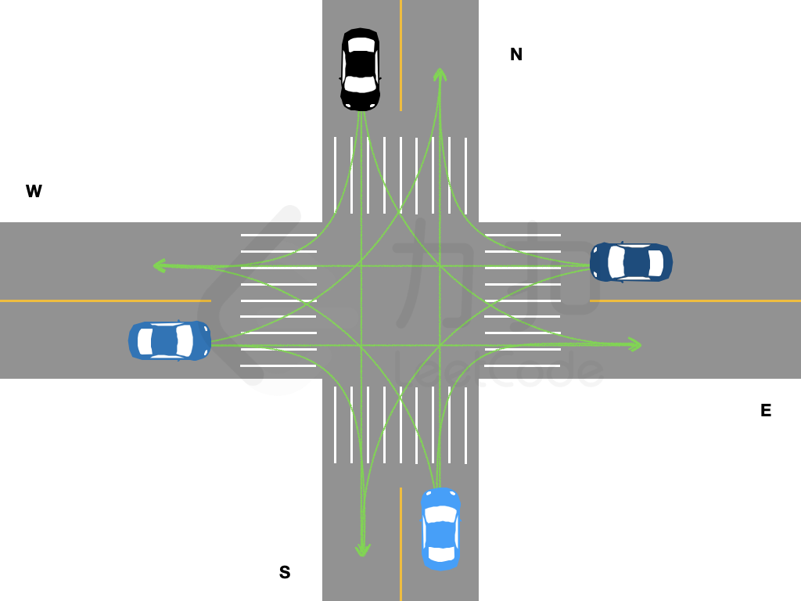

# 动态规划

> **[LCP 43. 十字路口的交通](https://leetcode.cn/problems/Y1VbOX/solutions/991709/dong-tai-gui-hua-by-endlesscheng-bcmi/) · Hard**

> **所属题单**
> - [动态规划 · 七、其他线性 DP](../../../刷题路径/灵神原版题单/动态规划/七、其他线性%20DP.md) · §7.6 多维 DP

> **题目描述**
> 前往「力扣挑战赛」场馆的道路上，有一个拥堵的十字路口，该十字路口由两条双向两车道的路交叉构成。由于信号灯故障，交警需要手动指挥拥堵车辆。假定路口没有新的来车且一辆车从一个车道驶入另一个车道所需的时间恰好为一秒钟，长度为 4 的一维字符串数组 `directions` 中按照 **东、南、西、北** 顺序记录了四个方向从最靠近路口到最远离路口的车辆计划开往的方向。其中：
> - `"E"` 表示向东行驶；
> - `"S"` 表示向南行驶；
> - `"W"` 表示向西行驶；
> - `"N"` 表示向北行驶。
>
> 交警每秒钟只能指挥各个车道距离路口最近的一辆车，且每次指挥需要满足如下规则：
> - 同一秒钟内，一个方向的车道只允许驶出一辆车；
> - 同一秒钟内，一个方向的车道只允许驶入一辆车；
> - 同一秒钟内，车辆的行驶路线不可相交。
>
> 请返回最少需要几秒钟，该十字路口等候的车辆才能全部走完。
>
> 各个车道驶出的车辆可能的行驶路线如图所示：
>
> {:height="350px"}
>
> **注意：**
> - 测试数据保证不会出现掉头行驶指令，即某一方向的行驶车辆计划开往的方向不会是当前车辆所在的车道的方向;
> - 表示堵塞车辆行驶方向的字符串仅用大写字母 `"E"`，`"N"`，`"W"`，`"S"` 表示。
>
> **示例 1：**
> >输入：`directions = ["W","N","ES","W"]`
> >
> >输出：`2`
> >
> >解释：
> >第 1 秒：东西方向排在最前的车先行，剩余车辆状态 `["","N","S","W"]`；
> >第 2 秒：南、西、北方向的车行驶，路口无等待车辆；
> >因此最少需要 2 秒，返回 2。
>
> **示例 2：**
> >输入：`directions = ["NS","WE","SE","EW"]`
> >
> >输出：`3`
> >
> >解释：
> >第 1 秒：四个方向排在最前的车均可驶出；
> >第 2 秒：东南方向的车驶出，剩余车辆状态 `["","","E","W"]`；
> >第 3 秒：西北方向的车驶出。
>
> **提示：**
> - `directions.length = 4`
> - `0 <= directions[i].length <= 20`

