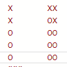
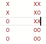
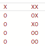
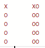
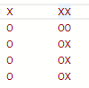

# LCP 53. 守护太空城

> **[yiduobo的每日leetcode LCP53.守护太空城](https://zhuanlan.zhihu.com/p/578034826) · 知乎 · 2022-10-28 · 赞同 0**
> 力扣：[LCP 53. 守护太空城](https://leetcode.cn/problems/EJvmW4/) · Hard · 灵茶山艾府：[O(n*3^m) 子集状压 DP + 贪心预处理（Python/Java/C++/Go）](灵茶山艾府.md)

祖传的手艺不想丢了，所以按顺序写一个leetcode的题解。计划每日一题，争取不卡题吧。

LCP53.守护太空城

[力扣](https://leetcode.cn/problems/EJvmW4/)

题目实际上相当于给出了一块5 \* n的棋盘，其中有些点被做上了标记。现在给出若干k \* 1和k \* 2的板子，这里的1 \<\= k \<\= 5，其中i \* j的板子的使用代价为i + j + 1。

现在需要使用板子覆盖住所有的标记，要求板子不能旋转，且板子互相之间不能重叠，问最低的代价是多少。

如果板子的规模都是1 \* 2，那么这又是按黑白棋盘建模的网络流问题，不过这里的板子形式多变，那么就只能老老实实用状态压缩动态规划去做了。

令g[i][state]表示前i列，已经覆盖好了前i - 1列的标记，且最后一列的覆盖状态为state时的最小代价。那么对于g[i][state]，由于题目中存在宽度为2的板子，那么就需要从最后两列的状态中得到state，即将state \= 2^5扩展到right_state \= 2^10。接下来枚举上一轮的状态left_state，那么就有

g[i][right_state & 31] \= min(g[i][right_state & 31], g[i - 1][left_state] + f[left_state][right_state])

这个转移方程的含义是，对于最后两列状态为right_state的情况，其在g中的表示为g[i][right_state & 31]。当倒数第二列的覆盖情况为left_state时，可以通过在最后一列添加某些单列的板子，或者在最后两列添加某些双列的板子，得到最终的right_state，在这期间使用板子的代价记为f[left_state][right_state]。

---

可以发现，这里的f在确定了left_state和right_state之后就是一个定值，那么在这里可以先使用动态规划，将f的值都预处理出来。具体来说，对于f[left_state][right_state]：

1、若left_state的二进制表示中有些1没有出现在right_state高5位的对应位置上，那么right_state必然不可能从left_state转移过来。需要注意的是，这里f的定义是只能在最后一列放置单列板，不能在倒数第二列放置单列版。在倒数第二列放置单列版的操作应该在计算倒数第二列的时候完成。

例如下图这种情况，左侧的left_state不可能变成最终的right_state



2、接下来可以通过right_state的高5位与left_state的异或值确定在left_state转化到right_state期间，在哪些行上使用了双列板。记使用双列板的最高的行为hyper_left。若没有行被双列板覆盖，那么hyper_left \= -1。

3、同样的，可以通过right_state的低5位计算出最后一列被板子覆盖的所有位置。记被覆盖的最高的行为hyper_right。若没有行被覆盖，那么hyper_right \= -1。

例如下图这种情况



可以发现，左侧这一列的中间这一行产生了变化，因此hyper_left \= 2。

对于最后这一列，hyper_right同样等于2。

4、那么当hyper_left > hyper_right时，right_state也必然不可能从left_state转移过来，因为在这种情况下需要在hyper_left这一行放置双列的板子，但是从hyper_right来看最后一列的对应行是没有被覆盖的。

例如下图这种情况



此时的hyper_left \= 2，而hyper_right \= 1，即倒数第二列的第2行需要双列板来覆盖，但是从最后一列的最终情况来看，第2行是不存在板子的，所以有问题

5、否则若hyper_left和hyper_right都等于-1，说明从left_state到right_state无需进行操作，此时就有f[left_state][right_state] \= 0

例如下图这种情况



倒数第二列没有被新覆盖的格子，最后一列也没有被覆盖的格子，此时的hyper_left和hyper_right都等于-1

6、否则的话若hyper_right > hyper_left，那么就需要先单独覆盖最后这一列。具体的覆盖方案则可以枚举单列石板的长度length，那么就有f[left_state][right_state] \= min(f[left_state][right_state], f[left_state][right_state ^ single_state] + 2 + length - 1)，这里的single_state表示从hyper_right开始，长度为length的石板对应的二进制状态

例如下图这种情况



hyper_right \= 4，此时可以在hyper_right这里放置1 \* 1、2 \* 1或者3 \* 1的单列板，而对应覆盖的single_state则分别为

(1 \<\< 4) \= 16

(1 \<\< 4) + (1 \<\< 3) \= 24

(1 \<\< 4) + (1 \<\< 3) + (1 \<\< 2) \= 28

对应的转移方程就是

f[left_state][right_state] \= min(f[left_state][right_state], f[left_state][right_state ^ 16] + 2)

f[left_state][right_state] \= min(f[left_state][right_state], f[left_state][right_state ^ 24] + 3)

f[left_state][right_state] \= min(f[left_state][right_state], f[left_state][right_state ^ 28] + 4)

7、最后一种情况，则是hyper_left \= hyper_right >\= 0，此时需要使用双列板进行覆盖。具体的覆盖方案同样是枚举板子长度length，那么就有f[left_state][right_state] \= min(f[left_state][right_state], f[left_state][right_state ^ combo_state] + 3 + length - 1)

其中combo_state的计算方式与上面类似，这里就不举例说明了

---

计算得到f之后，使用最开始提到的g[i][state]表示的动态规划算法计算所有的覆盖情况。动态规划完成后，从0到31枚举所有的state，若当前state可以覆盖住最后一列的标记，那么就用g[-1][state]来更新答案。这里需要校验标记的理由是g的状态表示只保证了0到n - 2列的所有标记都被覆盖住，但最后的n - 1列只是覆盖状态为state，并未保证state可以覆盖最后一列的标记，所以需要进行校验。

最后附上python代码：

```python
class Solution(object):
    def defendSpaceCity(self, time, position):
        """
        :type time: List[int]
        :type position: List[int]
        :rtype: int
        """

        f = [[100] * 1024 for _ in range(32)]
        
        for left_state in range(32):
            for right_state in range(1024):
                if ((right_state >> 5) & left_state) != left_state:
                    continue
                
                left_change = (right_state >> 5) ^ left_state
                if left_change == 0:
                    hyper_left = -1
                else:
                    hyper_left = 4
                    while (left_change & (1 << hyper_left)) == 0:
                        hyper_left -= 1

                if (right_state & 31) == 0:
                    hyper_right = -1
                else:
                    hyper_right = 4
                    while (right_state & (1 << hyper_right)) == 0:
                        hyper_right -= 1

                if hyper_left > hyper_right:
                    continue
                
                if hyper_left == -1 and hyper_right == -1:
                    f[left_state][right_state] = 0
                    continue
                
                if hyper_right > hyper_left:
                    single_state = 0
                    length = 0
                    while hyper_right > hyper_left and (right_state & (1 << hyper_right)) == (1 << hyper_right):
                        single_state |= (1 << hyper_right)
                        f[left_state][right_state] = min(f[left_state][right_state], f[left_state][right_state ^ single_state] + 2 + length)
                        hyper_right -= 1
                        length += 1
                else:
                    combo_state = 0
                    length = 0
                    while hyper_left >= 0 and (left_change & (1 << hyper_left)) == (1 << hyper_left) and (right_state & (1 << hyper_right)) == (1 << hyper_right):
                        combo_state |= (1 << (hyper_right + 5)) | (1 << hyper_right)
                        f[left_state][right_state] = min(f[left_state][right_state], f[left_state][right_state ^ combo_state] + 3 + length)
                        hyper_left -= 1
                        hyper_right -= 1
                        length += 1

        n = max(position)
        state_list = [0] * n
        for index in range(len(time)):
            state_list[position[index] - 1] |= (1 << (time[index] - 1))
        
        g = [[1000] * 32 for _ in range(n)]
        for state in range(32):
            g[0][state] = f[0][state]

        for index in range(1, n):
            for left_state in range(32):
                if g[index - 1][left_state] == 1000:
                    continue
                for right_state in range(1024):
                    if f[left_state][right_state] < 100 and ((right_state >> 5) & state_list[index - 1]) == state_list[index - 1]:
                        g[index][right_state & 31] = min(g[index][right_state & 31], g[index - 1][left_state] + f[left_state][right_state])
        
        res = 1000
        for state in range(32):
            if (state & state_list[-1]) == state_list[-1]:
                res = min(res, g[-1][state])

        return res
```
