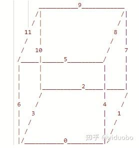
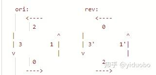

# LCP 58. 积木拼接

> **[yiduobo的每日leetcode LCP58.积木拼接](https://zhuanlan.zhihu.com/p/578619151) · 知乎 · 2022-10-30 · 赞同 0**
> 力扣：[LCP 58. 积木拼接](https://leetcode.cn/problems/De4qBB/) · Hard · 灵茶山艾府：[0ms 最强剪枝](灵茶山艾府.md)

祖传的手艺不想丢了，所以按顺序写一个leetcode的题解。计划每日一题，争取不卡题吧。

LCP58.积木拼接

[力扣](https://leetcode.cn/problems/De4qBB/)

非常麻烦的枚举题。题目给出的6块板子中间都是实心的，意思就是说这六块板子的四条边拼起来，能否刚刚好构成正方体的十二条棱。

对于棱长为n的正方体而言，这12条棱上一共有12 \* n - 16个位置，这里的减16是因为8个顶点每个顶点都被计算了3次。那么一开始就可以先统计给出的6块板子的四条边上1的数量，若这些1的总数不等于12 \* n - 16，那么就可以直接返回false。

在这里需要注意，统计四条边上的1时，对于四个角上的四个位置不要重复计算。

接下来就需要枚举这些板子的放置方式。不妨在图上将正方体画出来，然后将所有的棱做上标记。



一开始，可以直接选择第0块板子作为正方体的底面。由于选择底面实际上改变的只是正方体的朝向，因此在这里无需考虑旋转底面的情况，但是翻转底面的情况依然需要考虑。

可以发现，底面影响到的棱为[0, 1, 2, 3]

接下来，需要从剩下的板子里枚举前面。前面涉及到的棱为[0, 4, 5, 6]。可以发现，前面和底面都将影响0这一条棱，因此在这里的要求就是对于这两个板子对应到0这一条棱的边而言，不能出现有格子重叠的情况。另外，对于0这条棱而言，左侧角上的点将被左侧面影响，而右侧角上的点则会被右侧面影响，在这里不方便进行判断，但是0这条棱中间的部分，只会被底面和前面影响到，因此在这里还需要底面和前面对应到0这一条的棱可以完全填充0这条棱中间的部分。

题目的棱长不超过10，那么在这里很明显就应该使用位运算来帮助判断重叠和填充的情况。那么对于上面所说的两个条件，则分别为：

1、底面的下侧边和前面的下侧边按位与必须等于0，否则就有位置重叠了

2、底面的下侧边和前面的下侧边按位或必须大于等于(1 \<\< (n - 1)) - 2，也就是二进制表示中的0111...1110

接下来，则可以按相同的做法从剩下的板子里分别按顺序枚举右面，后面，左面，最后则是上面。这几个面影响到的棱分别为[1, 7, 8, 4], [2, 7, 9, 10], [3, 10, 11, 6]以及[5, 8, 9, 11]。同样的，如果当前这个面影响到了之前已经填充过的棱，那么就需要检验重叠和中间位置填充是否合法。

实际上，由于鸽笼原理，在这里并不需要检测中间位置以及角落是否被填充，因为1的数量是刚刚好的。如果没有出现重叠，那么必然就是刚好填充满每一条棱。在这里检测中间位置的理由是可以提前去除掉不合法的情况，加快运算效率。

---

上面给出了面的枚举顺序，接下来需要想办法将板子四条边给适配上去。

在这里不妨将板子原始状态的四条边按照逆时针从下边开始进行编号，同时也按照逆时针从高位到低位进行位运算编码，那么原始状态和翻转后板子的四条边的编号及编码顺序分别为：



在这里需要特别说明的是，对于翻转后的板子，0和2进行了交换，但是高低位没有变化，因此翻转后的编码恰好就是原始编码的顺时针版本。而对于1'和3'，虽然编号没变，但是编码的高低位翻转了过来，因此翻转后的编码恰好也是原始编码的顺时针版本。

换言之，对于原始的板子，都是直接按照逆时针顺序进行编码，而对于翻转后的板子，其逆时针编码实际上就相当于对于原始板子按照顺时针顺序进行编码。

对于原始的板子，因为可以旋转，所以一共有四种放置方式。四条边逆时针的方式排列出来就是

[0, 1, 2, 3]，[1, 2, 3, 0]，[2, 3, 0, 1]，[3, 0, 1, 2]

另一方面，对于翻转后的板子，四条边按照逆时针的方式排列出来则是

[0, 3, 2, 1]，[1, 0, 3, 2]，[2, 1, 0, 3]，[3, 2, 1, 0]

需要注意的是，这种情况下边的编码应该采用原始板子的顺时针编码

为了提高效率，在一开始就可以将板子的四条边的顺时针以及逆时针编码都预处理出来，接下来就只需要按照上面枚举板子的顺序，依次尝试每块板子的8种放置方式就行了。

还有一点需要注意的是，上面的算法还存在一个问题，就是边的编码顺序间有冲突。例如编号为4的棱，其在前面的编码中应该是从下往上进行编码的，而在右面的编码中，则是从上往下编码的，存在编码方向不一致的问题，此时直接进行校验就会有问题。解决方法也很简单，只需在校验时，将其中一方按照当前编码方式的相反版本进行校验即可。除了4之外，还有棱2、10、11、5、8都存在这个问题，那么可以为这些棱设置标记，在其需要进行校验时根据这个标记选择是否需要将其中一条边进行反向编码。

最后附上python代码：

```python
class Solution(object):
    def composeCube(self, shapes):
        """
        :type shapes: List[List[str]]
        :rtype: bool
        """

        '''
                       ___________9____________
                      /|                      /|
                     / |                     / |
                   11  |                    8  |
                   /   |                   /   |  
                  /   10                  /    7
                 /_____|______5__________/     |
                 |     |                 |     |
                 |     |                 |     |
                 |     |___________2_____|_____|
                 |     /                 |     / 
                 6    /                  4    /
                 |   3                   |   1
                 |  /                    |  /
                 | /                     | /
                 |/___________0__________|/

                ori:                rev:
                   <----               <----
                     2                   0
               |            ^      |            ^
               | 3        1 |      | 3'       1'|
               v            |      v            |
                     0                   2
                   ---->               ----> 
        '''

        #6个面的枚举顺序，以及影响到的棱
        target_list = [[0, 1, 2, 3], [0, 4, 5, 6], [1, 7, 8, 4], [2, 7, 9, 10], [3, 10, 11, 6], [5, 8, 9, 11]]

        #编码顺序冲突的棱，检验时需要一方反向编码
        reverst_list = [[0, 0, 0, 0], [0, 0, 0, 0], [0, 0, 0, 1], [1, 0, 0, 0], [1, 1, 0, 0], [1, 1, 0, 0]]
        
        n = len(shapes[0])
        state_without_corner = (1 << (n - 1)) - 2
        edge_list = []
        one_cnt = 0
        for s in shapes:
            edge_list.append([[0, 0, 0, 0], [0, 0, 0, 0]])
            for index in range(n):
                #按下、右、上、左的顺序逆时针编码
                edge_list[-1][0][0] += edge_list[-1][0][0] + int(s[n - 1][index])
                edge_list[-1][0][1] += edge_list[-1][0][1] + int(s[n - 1 - index][n - 1])
                edge_list[-1][0][2] += edge_list[-1][0][2] + int(s[0][n - 1 - index])
                edge_list[-1][0][3] += edge_list[-1][0][3] + int(s[index][0])

                #顺时针编码
                edge_list[-1][1][0] += edge_list[-1][1][0] + int(s[n - 1][n - 1 - index])
                edge_list[-1][1][1] += edge_list[-1][1][1] + int(s[index][n - 1])
                edge_list[-1][1][2] += edge_list[-1][1][2] + int(s[0][index])
                edge_list[-1][1][3] += edge_list[-1][1][3] + int(s[n - 1 - index][0])
        
                #统计1的数量
                one_cnt += int(s[0][index]) + int(s[n - 1][index]) + int(s[index][0]) + int(s[index][n - 1])
            
            #减去四个角重复计算的1
            one_cnt -= int(s[0][0]) + int(s[0][n - 1]) + int(s[n - 1][n - 1]) + int(s[n - 1][0])

        #判断1的数量是否合法
        if one_cnt != n * 12 - 16:
            return False

        #8种板子的放置方式
        candidate_list = [[[0, 1, 2, 3], [1, 2, 3, 0], [2, 3, 0, 1], [3, 0, 1, 2]], 
                     [[0, 3, 2, 1], [1, 0, 3, 2], [2, 1, 0, 3], [3, 2, 1, 0]]]

        def dfs(level, choose, used):
            if level == 6:
                return True
            
            for edge in range(6):
                if not used[edge]:
                    #对于没有用过的板子，枚举所有可能的放置方法
                    for d in range(2):
                        for candidate in candidate_list[d]:
                            #放置后4条边对应的编码
                            #当前编码方式d与reverst_list异或，表示对于冲突棱的校验需要按当前编码方式进行反向编码
                            tmp = [edge_list[edge][d ^ reverst_list[level][index]][candidate[index]] for index in range(4)]
                            flag = True
                            fill_cnt = 0
                            for index in range(4):
                                #对于已经填充过的棱，需要检验重叠以及中间部分填充
                                if target_list[level][index] < len(choose):
                                    now = tmp[index]
                                    filled = choose[target_list[level][index]]
                                    if (now & filled) != 0 or (now | filled) < state_without_corner:
                                        flag = False
                                        break
                                else:
                                    fill_cnt += 1
                            
                            if flag:
                                #检验通过，按当前枚举的方式放置板子，然后继续处理下一个面
                                for index in range(4):
                                    if target_list[level][index] < len(choose):
                                        continue
                                    choose.append(tmp[index])
                                used[edge] = True
                                if dfs(level + 1, choose, used):
                                    return True
                                used[edge] = False
                                for index in range(fill_cnt):
                                    choose.pop()
            
            return False

        #板子0作为底面
        choose = [edge_list[0][0][0], edge_list[0][0][1], edge_list[0][0][2], edge_list[0][0][3]]
        used = [False] * 6
        used[0] = True
        if dfs(1, choose, used):
            return True

        #板子0翻转后作为底面
        choose = [edge_list[0][1][0], edge_list[0][1][3], edge_list[0][1][2], edge_list[0][1][1]]
        if dfs(1, choose, used):
            return True
        
        return False
```
