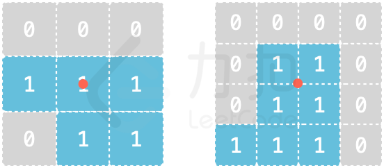

# 0ms 最强剪枝

> **[LCP 58. 积木拼接](https://leetcode.cn/problems/De4qBB/solutions/1444450/0ms-zui-qiang-jian-zhi-by-endlesscheng-1beq/) · Hard**

> **所属题单**
> - [常用数据结构 · 编程能力强化训练](../../../刷题路径/灵神原版题单/常用数据结构/编程能力强化训练.md) · Part C
> - [链表、二叉树与回溯 · 四、回溯](../../../刷题路径/灵神原版题单/链表、二叉树与回溯/四、回溯.md) · §4.7 搜索

> **题目描述**
> 欢迎各位勇者来到力扣城，本次试炼主题为「积木拼接」。
> 勇者面前有 `6` 片积木（厚度均为 1），每片积木的形状记录于二维字符串数组 `shapes` 中，`shapes[i]` 表示第 `i` 片积木，其中 `1` 表示积木对应位置无空缺，`0` 表示积木对应位置有空缺。
> 例如 `["010","111","010"]` 对应积木形状为
> 
>
> 拼接积木的规则如下：
> - 积木片可以旋转、翻面
> - 积木片边缘必须完全吻合才能拼接在一起
> - **每片积木片 `shapes[i]` 的中心点在拼接时必须处于正方体对应面的中心点**
>
> 例如 `3*3`、`4*4` 的积木片的中心点如图所示（红色点）：
> {:height="150px"}
>
> 请返回这 6 片积木能否拼接成一个**严丝合缝的正方体**且每片积木正好对应正方体的一个面。
>
> **注意：**
> - 输入确保每片积木均无空心情况（即输入数据保证对于大小 `N*N` 的 `shapes[i]`，内部的 `(N-2)*(N-2)` 的区域必然均为 1）
> - 输入确保每片积木的所有 `1` 位置均连通
>
> **示例 1：**
> >输入：`shapes = [["000","110","000"],["110","011","000"],["110","011","110"],["000","010","111"],["011","111","011"],["011","010","000"]]`
> >
> >输出：`true`
> >
> >解释：
> 
>
> **示例 2：**
> >输入：`shapes = [["101","111","000"],["000","010","111"],["010","011","000"],["010","111","010"],["101","111","010"],["000","010","011"]]`
> >
> >输出：`false`
> >
> >解释：
> >由于每片积木片的中心点在拼接时必须处于正方体对应面的中心点，积木片 `["010","011","000"]` 不能作为 `["100","110","000"]` 使用，因此无法构成正方体
>
> **提示：**
> - `shapes.length == 6`
> - `shapes[i].length == shapes[j].length`
> - `shapes[i].length == shapes[i][j].length`
> - `3 <= shapes[i].length <= 10`

> **题解**
> 
>
> 基本思路是搜索每个面放哪块积木，枚举积木的旋转+翻转状态。放之前先检查下当前放的积木和相邻的积木：
>
> - 边是否严丝合缝；
> - 角是否有重叠。
>
> 注意第一块积木直接放顶上就行，从第二块积木开始搜索。
>
> 下面是比赛中写的代码（合并了一些 `if` 逻辑），比赛中写了 200 行居然一次就过了。
