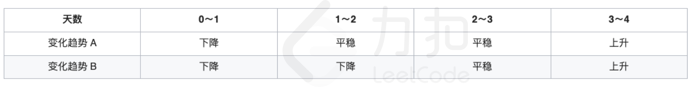

# LCP 61. 气温变化趋势

Easy · [力扣原题](https://leetcode.cn/problems/6CE719/)

| 作者 | 题解 | 动画讲解 |
|---|---|---|
| 灵茶山艾府 | [📄 题解](灵茶山艾府.md) | [▶︎ 动画（GIF）](LCP%2061%20气温变化趋势%20·%20灵茶山艾府.gif) · [mp4 文件](LCP%2061%20气温变化趋势%20·%20灵茶山艾府.mp4) |
| yiduobo | [📄 题解](yiduobo.md) | [▶︎ 动画（GIF）](LCP%2061%20气温变化趋势%20·%20yiduobo.gif) · [mp4 文件](LCP%2061%20气温变化趋势%20·%20yiduobo.mp4) |

## 动画讲解

> 动图会循环播放；想暂停、拖进度条请下载上面表格里的 mp4 文件。

### 灵茶山艾府

### yiduobo

## 题目描述

力扣城计划在两地设立「力扣嘉年华」的分会场，气象小组正在分析两地区的气温变化趋势，对于第 `i ~ (i+1)` 天的气温变化趋势，将根据以下规则判断：
- 若第 `i+1` 天的气温 **高于** 第 `i` 天，为 **上升** 趋势
- 若第 `i+1` 天的气温 **等于** 第 `i` 天，为 **平稳** 趋势
- 若第 `i+1` 天的气温 **低于** 第 `i` 天，为 **下降** 趋势

已知 `temperatureA[i]` 和 `temperatureB[i]` 分别表示第 `i` 天两地区的气温。
组委会希望找到一段天数尽可能多，且两地气温变化趋势相同的时间举办嘉年华活动。请分析并返回两地气温变化趋势**相同的最大连续天数**。
> 即最大的 `n`，使得第 `i~i+n` 天之间，两地气温变化趋势相同

**示例 1：**
>输入：
>`temperatureA = [21,18,18,18,31]`
>`temperatureB = [34,32,16,16,17]`
>
>输出：`2`
>
>解释：如下表所示， 第 `2～4` 天两地气温变化趋势相同，且持续时间最长，因此返回 `4-2=2`
{:width=1000px}

**示例 2：**
>输入：
>`temperatureA = [5,10,16,-6,15,11,3]`
>`temperatureB = [16,22,23,23,25,3,-16]`
>
>输出：`3`

**提示：**
- `2 <= temperatureA.length == temperatureB.length <= 1000`
- `-20 <= temperatureA[i], temperatureB[i] <= 40`

---
[↑ 返回 LCP](../README.md) · [总索引](../../../索引.md) · [仓库首页](../../../README.md)
