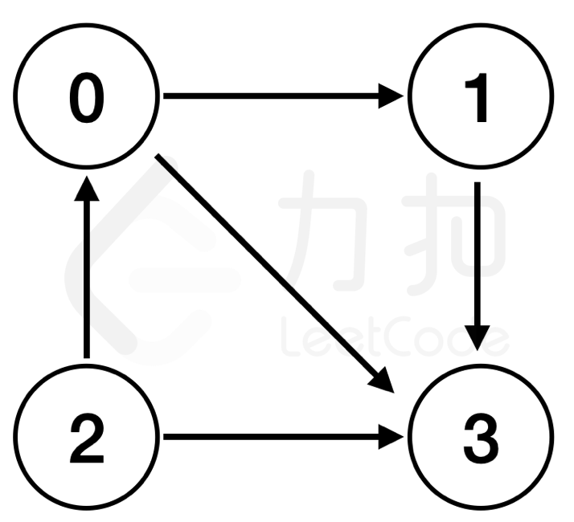
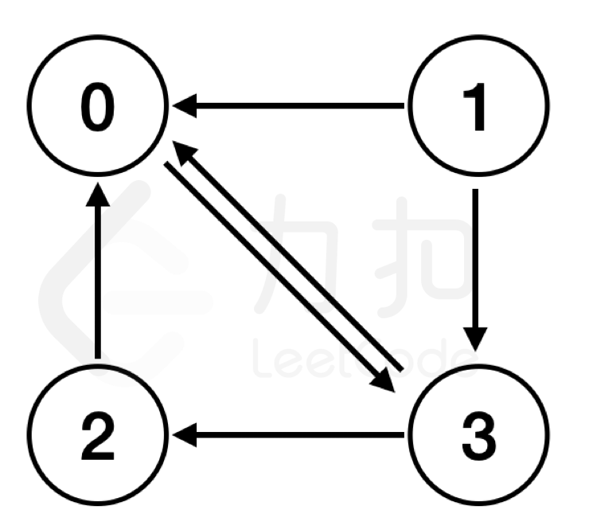

# LCP 62. 交通枢纽

Medium · [力扣原题](https://leetcode.cn/problems/D9PW8w/)

| 作者 | 题解 | 动画讲解 |
|---|---|---|
| 灵茶山艾府 | [📄 题解](灵茶山艾府.md) | [▶︎ 动画（GIF）](LCP%2062%20交通枢纽%20·%20灵茶山艾府.gif) · [mp4 文件](LCP%2062%20交通枢纽%20·%20灵茶山艾府.mp4) |
| yiduobo | [📄 题解](yiduobo.md) | [▶︎ 动画（GIF）](LCP%2062%20交通枢纽%20·%20yiduobo.gif) · [mp4 文件](LCP%2062%20交通枢纽%20·%20yiduobo.mp4) |

## 动画讲解

> 动图会循环播放；想暂停、拖进度条请下载上面表格里的 mp4 文件。

### 灵茶山艾府

### yiduobo

## 题目描述

为了缓解「力扣嘉年华」期间的人流压力，组委会在活动期间开设了一些交通专线。`path[i] = [a, b]` 表示有一条从地点 `a`通往地点 `b` 的 **单向** 交通专线。
若存在一个地点，满足以下要求，我们则称之为 **交通枢纽**：
- 所有地点（除自身外）均有一条 **单向** 专线 **直接** 通往该地点；
- 该地点不存在任何 **通往其他地点** 的单向专线。

请返回交通专线的 **交通枢纽**。若不存在，则返回 `-1`。

**注意：**
- 对于任意一个地点，至少被一条专线连通。

**示例 1：**
>输入：`path = [[0,1],[0,3],[1,3],[2,0],[2,3]]`
>
>输出：`3`
>
>解释：如下图所示：
> 地点 `0,1,2` 各有一条通往地点 `3` 的交通专线，
> 且地点 `3` 不存在任何**通往其他地点**的交通专线。
>{:width=200px}

**示例 2：**
>输入：`path = [[0,3],[1,0],[1,3],[2,0],[3,0],[3,2]]`
>
>输出：`-1`
>
>解释：如下图所示：不存在满足 **交通枢纽** 的地点。
>{:width=200px}

**提示：**
- `1 <= path.length <= 1000`
- `0 <= path[i][0], path[i][1] <= 1000`
- `path[i][0]` 与 `path[i][1]` 不相等

---
[↑ 返回 LCP](../README.md) · [总索引](../../../索引.md) · [仓库首页](../../../README.md)
