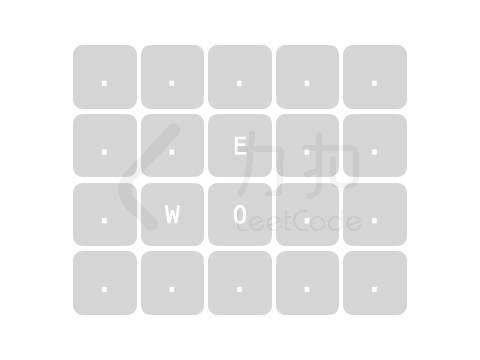

# 暴力枚举模拟

> **[LCP 63. 弹珠游戏](https://leetcode.cn/problems/EXvqDp/solutions/1847059/mei-ju-by-endlesscheng-5wzf/) · Medium**

> **所属题单**
> - [网格图 · 一、网格图 DFS](../../../刷题路径/灵神原版题单/网格图/一、网格图%20DFS.md)

> **题目描述**
> 欢迎各位来到「力扣嘉年华」，接下来将为各位介绍在活动中广受好评的弹珠游戏。
>
> `N*M` 大小的弹珠盘的初始状态信息记录于一维字符串型数组 `plate` 中，数组中的每个元素为仅由 `"O"`、`"W"`、`"E"`、`"."` 组成的字符串。其中：
> - `"O"` 表示弹珠洞（弹珠到达后会落入洞中，并停止前进）；
> - `"W"` 表示逆时针转向器（弹珠经过时方向将逆时针旋转 90 度）；
> - `"E"` 表示顺时针转向器（弹珠经过时方向将顺时针旋转 90 度）；
> - `"."` 表示空白区域（弹珠可通行）。
>
> 游戏规则要求仅能在边缘位置的 **空白区域** 处（弹珠盘的四角除外）沿 **与边缘垂直** 的方向打入弹珠，并且打入后的每颗弹珠最多能 **前进** `num` 步。请返回符合上述要求且可以使弹珠最终入洞的所有打入位置。你可以 **按任意顺序** 返回答案。
>
> **注意：**
> - 若弹珠已到达弹珠盘边缘并且仍沿着出界方向继续前进，则将直接出界。
>
> **示例 1：**
> > 输入：
> >`num = 4`
> >`plate = ["..E.",".EOW","..W."]`
> >
> > 输出：`[[2,1]]`
> >
> > 解释：
> > 在 `[2,1]` 处打入弹珠，弹珠前进 1 步后遇到转向器，前进方向顺时针旋转 90 度，再前进 1 步进入洞中。
> {:width="300px"}
>
> **示例 2：**
> > 输入：
> >`num = 5`
> >`plate = [".....","..E..",".WO..","....."]`
> >
> > 输出：`[[0,1],[1,0],[2,4],[3,2]]`
> >
> > 解释：
> > 在 `[0,1]` 处打入弹珠，弹珠前进 2 步，遇到转向器后前进方向逆时针旋转 90 度，再前进 1 步进入洞中。
> > 在 `[1,0]` 处打入弹珠，弹珠前进 2 步，遇到转向器后前进方向顺时针旋转 90 度，再前进 1 步进入洞中。
> > 在 `[2,4]` 处打入弹珠，弹珠前进 2 步后进入洞中。
> > 在 `[3,2]` 处打入弹珠，弹珠前进 1 步后进入洞中。
> {:width="350px"}
>
> **示例 3：**
> > 输入：
> >`num = 3`
> >`plate = [".....","....O","....O","....."]`
> >
> > 输出：`[]`
> >
> > 解释：
> > 由于弹珠被击中后只能前进 3 步，且不能在弹珠洞和弹珠盘四角打入弹珠，故不存在能让弹珠入洞的打入位置。
>
> **提示：**
> - `1 <= num <= 10^6`
> - `1 <= plate.length, plate[i].length <= 1000`
> - `plate[i][j]` 仅包含 `"O"`、`"W"`、`"E"`、`"."`

> **题解**
> 个人赛五道题目的 [视频讲解](https://www.bilibili.com/video/BV1zN4y1K762) 已出炉，欢迎点赞三连，在评论区分享你对这场比赛的看法~
>
> ---
>
> 由于路径是唯一的，一个入口只会对应一个唯一的出口；一个出口+进入出口的方向，可以找到唯一的入口。
>
> 因此，从不同入口出发的弹珠，走过的路径在同一个格子上是不会重叠的（方向相反不算重叠），且路径不存在环（可以画图理解）。
>
> 枚举所有入口，模拟即可。不需要 DFS，写个循环就行。
>
> ```python
> DIRS = ((0, 1), (1, 0), (0, -1), (-1, 0))  # 右下左上（顺时针）
>
> class Solution:
>     def ballGame(self, num: int, plate: List[str]) -> List[List[int]]:
>         m, n = len(plate), len(plate[0])
>
>         def check(x: int, y: int, d: int) -> bool:
>             left = num
>             while plate[x][y] != 'O':
>                 if left == 0: return False  # 无剩余步数
>                 if plate[x][y] == 'W':   d = (d + 3) % 4  # 逆时针
>                 elif plate[x][y] == 'E': d = (d + 1) % 4  # 顺时针
>                 x += DIRS[d][0]
>                 y += DIRS[d][1]
>                 if not (0 <= x < m and 0 <= y < n): return False  # 出界
>                 left -= 1
>             return True
>
>         ans = []
>         for j in range(1, n - 1):
>             if plate[0][j] == '.' and check(0, j, 1): ans.append([0, j])  # 上边
>             if plate[-1][j] == '.' and check(m - 1, j, 3): ans.append([m - 1, j])  # 下边
>         for i in range(1, m - 1):
>             if plate[i][0] == '.' and check(i, 0, 0): ans.append([i, 0])  # 左边
>             if plate[i][-1] == '.' and check(i, n - 1, 2): ans.append([i, n - 1])  # 右边
>         return ans
> ```
>
>
> #### 复杂度分析
>
> - 时间复杂度：$O(mn)$，其中 $m$ 和 $n$ 分别为 $\textit{plate}$ 的行数和列数。每个状态（横坐标，纵坐标，方向）至多被访问一次，总共有 $4mn$ 个状态。
> - 空间复杂度：$O(1)$。返回值不计入。
