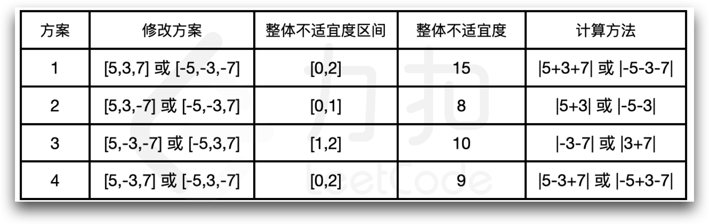

# 数形结合 + 巧妙地定义状态（Python/Java/C++/Go）

> **[LCP 65. 舒适的湿度](https://leetcode.cn/problems/3aqs1c/solutions/1847193/by-endlesscheng-fu9b/) · Hard**

> **所属题单**
> - [动态规划 · 七、其他线性 DP](../../../刷题路径/灵神原版题单/动态规划/七、其他线性%20DP.md) · §7.6 多维 DP

> **题目描述**
> 力扣嘉年华为了确保更舒适的游览环境条件，在会场的各处设置了湿度调节装置，这些调节装置受控于总控室中的一台控制器。
> 控制器中已经预设了一些调节指令，整数数组`operate[i]` 表示第 `i` 条指令增加空气湿度的大小。现在你可以将任意数量的指令修改为降低湿度（变化的数值不变），以确保湿度尽可能的适宜：
> - 控制器会选择 **一段连续的指令** ，从而进行湿度调节的操作；
> - 这段指令最终对湿度影响的绝对值，即为当前操作的「不适宜度」
> - 在控制器所有可能的操作中，**最大** 的「不适宜度」即为「整体不适宜度」
>
> 请返回在所有修改指令的方案中，可以得到的 **最小** 「整体不适宜度」。
>
> **示例 1：**
> > 输入：`operate = [5,3,7]`
> >
> > 输出：`8`
> >
> > 解释：对于方案 `2` 的 `[5,3,-7]`
> >操作指令 `[5],[3],[-7]` 的「不适宜度」分别为 `5,3,7`
> >操作指令 `[5,3],[3,-7]` 的「不适宜度」分别为 `8,4`
> >操作指令 `[5,3,-7]` 的「不适宜度」为 `1`，
> >因此对于方案 `[5,3,-7]`的「整体不适宜度」为 `8`，其余方案的「整体不适宜度」均不小于 `8`，如下表所示：
> {:width=650px}
>
> **示例 2：**
> > 输入：`operate = [20,10]`
> >
> > 输出：`20`
>
> **提示：**
> - `1 <= operate.length <= 1000`
> - `1 <= operate[i] <= 1000`

> **题解**
> 个人赛五道题目的 [视频讲解](https://www.bilibili.com/video/BV1zN4y1K762) 已出炉，欢迎点赞三连，在评论区分享你对这场比赛的看法~
>
> ---
>
> 数形结合更好理解，推荐先看视频哦，下面整理了视频中讲的重点。
>
> 1. 画折线图，问题转换成最小化折线图中最大值与最小值的差。
> 2. 定义 $f[i][j]$ 表示考虑 $\textit{operate}$ 的前 $i$ 个数，其中某些数字变成负数后，折线图最右端点到折线图最下端点的纵坐标距离为 $j$ 时，折线图中最大值与最小值的差的最小值（请注意：状态定义中的 $j$ 不是坐标，是到下界的相对距离）。
> 3. 设 $x=\textit{operate}[i]$，分类讨论（**下面的等号表示左值和右值取 $\min$ 后赋给左值**）：
>    - 取正号，折线图往上走：$f[i][j+x] = \max(f[i-1][j],j+x)$；
>    - 取负号，折线图往下走，且纵坐标没有小于最下端点的纵坐标：$f[i][j-x] = f[i-1][j]$；
>    - 取负号，折线图往下走，且纵坐标小于最下端点的纵坐标，那么产生了一个新的最下端点，按照定义：$f[i][0] = f[i-1][j]-j+x$。
> 4. 初始值 $f[0][0] = 0$，其余为 $+\infty$。
> 5. 答案为 $\min(f[n-1])$。
> 6. 代码实现时，用滚动数组优化空间。
>
> ```python
> class Solution:
>     def unSuitability(self, operate: List[int]) -> int:
>         mx = max(operate) * 2
>         pre = [0] + [inf] * mx
>         for x in operate:
>             f = [inf] * (mx + 1)
>             for j, dis in enumerate(pre):
>                 if dis == inf: continue  # 无效的长度（无法组成）
>                 if j + x <= mx: f[j + x] = min(f[j + x], max(dis, j + x))
>                 if j >= x: f[j - x] = min(f[j - x], dis)
>                 else: f[0] = min(f[0], dis - j + x)
>             pre = f
>         return min(pre)
> ```
>
>
> #### 复杂度分析
>
> - 时间复杂度：$O(nU)$，其中 $n$ 为 $\textit{operate}$ 的长度，$U=max(\textit{operate})$。
> - 空间复杂度：$O(U)$。
