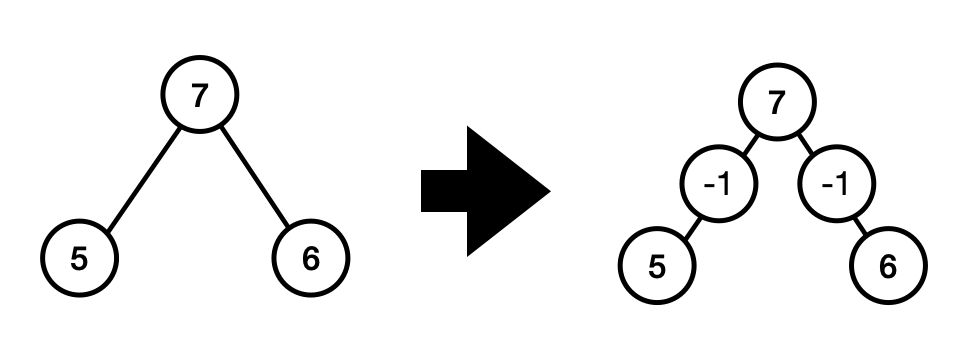
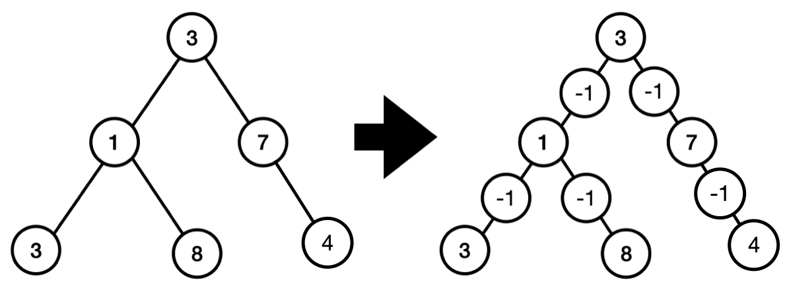

# LCP 67. 装饰树

Medium · [力扣原题](https://leetcode.cn/problems/KnLfVT/)

所在刷题路径：灵神核心路线、灵神题单·链表树与回溯

| 作者 | 题解 | 动画讲解 |
|---|---|---|
| 灵茶山艾府 | [📄 题解](灵茶山艾府.md) | [▶︎ LCP 67 装饰树 · 灵茶山艾府.mp4](LCP%2067%20装饰树%20·%20灵茶山艾府.mp4) |
| yiduobo | [📄 题解](yiduobo.md) | [▶︎ LCP 67 装饰树 · yiduobo.mp4](LCP%2067%20装饰树%20·%20yiduobo.mp4) |

## 题目描述

力扣嘉年华上的 DIY 手工展位准备了一棵缩小版的 **二叉** 装饰树 `root` 和灯饰，你需要将灯饰逐一插入装饰树中，要求如下：

- 完成装饰的二叉树根结点与 `root` 的根结点值相同
- 若一个节点拥有父节点，则在该节点和他的父节点之间插入一个灯饰（即插入一个值为 `-1` 的节点）。具体地：
    - 在一个 父节点 x 与其左子节点 y 之间添加 -1 节点， 节点 -1、节点 y 为各自父节点的左子节点，
    - 在一个 父节点 x 与其右子节点 y 之间添加 -1 节点， 节点 -1、节点 y 为各自父节点的右子节点，

现给定二叉树的根节点 `root` ，请返回完成装饰后的树的根节点。
**示例 1：**
>输入：
>`root = [7,5,6]`
>
>输出：`[7,-1,-1,5,null,null,6]`
>
>解释：如下图所示，
>{:width=400px}

**示例 2：**
>输入：
>`root = [3,1,7,3,8,null,4]`
>
>输出：`[3,-1,-1,1,null,null,7,-1,-1,null,-1,3,null,null,8,null,4]`
>
>解释：如下图所示
{:width=500px}

**提示：**
>`0 <= root.Val <= 1000`
>`root` 节点数量范围为 `[1, 10^5]`

---
[↑ 返回 LCP](../README.md) · [总索引](../../../索引.md) · [仓库首页](../../../README.md)
