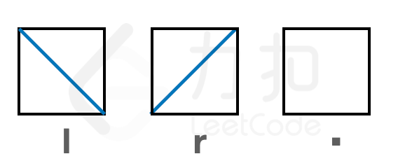
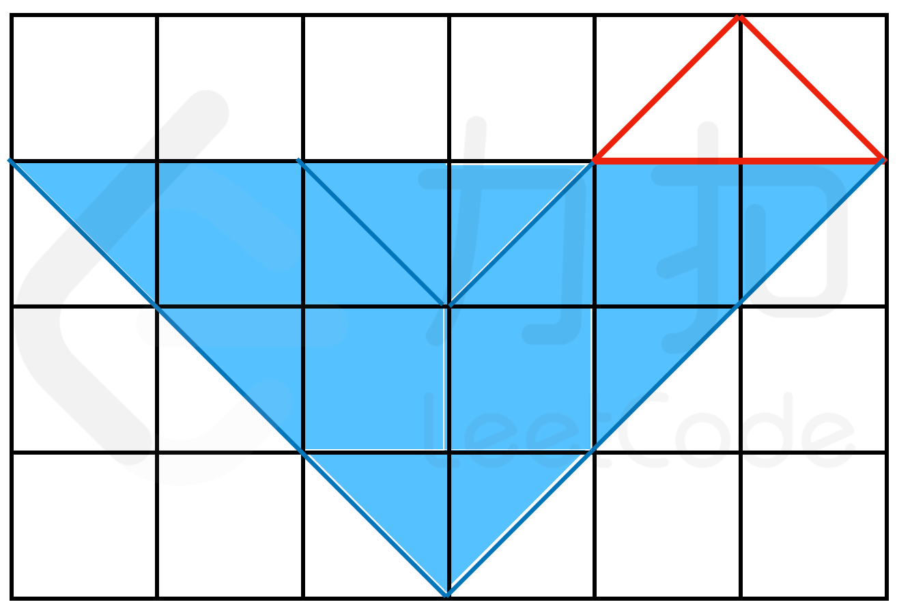
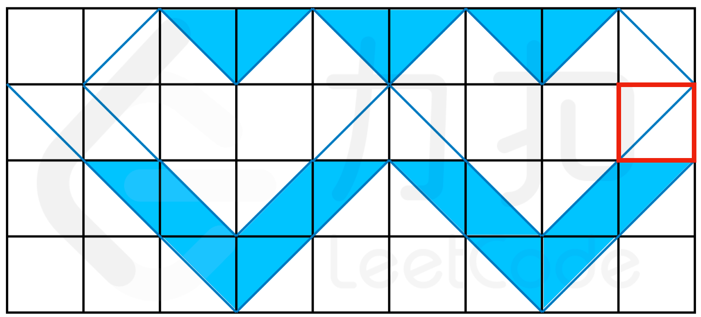
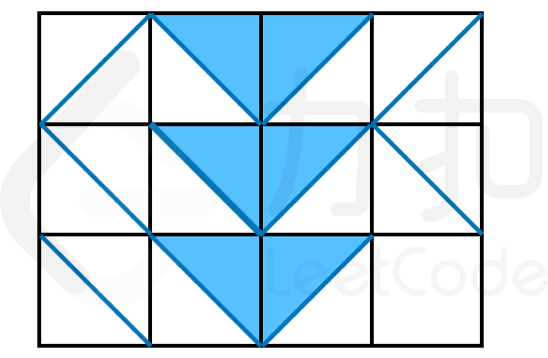
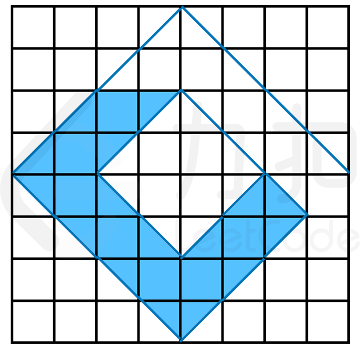

# 建图技巧 + 并查集（Python/Java/C++/Go）

> **[LCP 71. 集水器](https://leetcode.cn/problems/kskhHQ/solutions/1876216/jiantu-by-endlesscheng-rkra/) · Hard**

> **所属题单**
> - [常用数据结构 · 七、并查集](../../../刷题路径/灵神原版题单/常用数据结构/七、并查集.md) · §7.2 进阶

> **题目描述**
> 字符串数组 `shape` 描述了一个二维平面中的矩阵形式的集水器，`shape[i][j]` 表示集水器的第 `i` 行 `j` 列为：
> - `'l'`表示向左倾斜的隔板（即从左上到右下）；
> - `'r'`表示向右倾斜的隔板（即从左下到右上）；
> - `'.'` 表示此位置没有隔板
> {:width=200px}
>
> 已知当隔板构成存储容器可以存水，每个方格代表的蓄水量为 `2`。集水器初始浸泡在水中，除内部密闭空间外，所有位置均被水填满。
> 现将其从水中竖直向上取出，请返回集水器最终的蓄水量。
>
> **注意：**
> - 隔板具有良好的透气性，因此空气可以穿过隔板，但水无法穿过
>
> **示例 1：**
> > 输入：
> > `shape = ["....rl","l.lr.r",".l..r.","..lr.."]`
> >
> > 输出：`18`
> >
> > 解释：如下图所示，由于空气会穿过隔板，因此红框区域没有水
> {:width="280px"}
>
> **示例 2：**
> > 输入：
> > `shape = [".rlrlrlrl","ll..rl..r",".llrrllrr","..lr..lr."]`
> > 输出：`18`
> >
> > 解释：如图所示。由于红框右侧未闭合，因此多余的水会从该处流走。
> {:width="400px"}
>
> **示例 3：**
> > 输入：
> > `shape = ["rlrr","llrl","llr."]`
> > 输出：`6`
> >
> > 解释：如图所示。
> {:width="230px"}
>
> **示例 4：**
> > 输入：
> > `shape = ["...rl...","..r..l..",".r.rl.l.","r.r..l.l","l.l..rl.",".l.lr.r.","..l..r..","...lr..."]`
> >
> > 输出：`30`
> >
> > 解释：如下图所示。由于中间为内部密闭空间，无法蓄水。
> {:width="350px"}
>
> **提示**：
> - `1 <= shape.length <= 50`
> - `1 <= shape[i].length <= 50`
> - `shape[i][j]` 仅为 `'l'`、`'r'` 或 `'.'`

> **题解**
> [视频讲解](https://www.bilibili.com/video/BV1rT411P7NA) 已出炉，欢迎点赞三连，在评论区分享你对这场力扣杯的看法~
>
> 记录关键思路，详细的说明见视频讲解。
>
> 1. 判断能否容纳水：第 $i$ 行的水，在不走到第 $i-1$ 行的前提下，无法触及左、右、下边界。
> 2. 转换成连通性问题，用并查集处理。
> 3. 为了方便判断是否触及边界，还需要在左、右、下各加一条格子。
> 4. 根据 1，我们可以从最后一行往上计算。
> 5. 用并查集合并当前行各个区域，以及边界。
> 6. 如果合并完了，枚举当前行的各个区域，如果不和边界相连，那么该区域能容纳水。
> 7. 边界、最上面一层和超级汇点 $0$ 相连。
> 8. 最后判断的时候，如果该区域能容纳水，且和超级汇点相连，那么不是闭合区域，就真的有水。
> 9. 统计真的有水的格子，即为答案。
> 10. 代码实现时，把每个格子划分四个区域，相对两个区域，代码写起来要容易一些。
>
> ```python
> class Solution:
>     def reservoir(self, shape: List[str]) -> int:
>         n, m = len(shape), len(shape[0])
>         # 每个格子分成四个区域（上下左右），标上序号，方便用并查集连通
>         # 假设左右下还有一圈格子，直接连到超级汇点 0
>         u = [[0] * (m + 2) for _ in range(n + 1)]
>         d = [[0] * (m + 2) for _ in range(n + 1)]
>         l = [[0] * (m + 2) for _ in range(n + 1)]
>         r = [[0] * (m + 2) for _ in range(n + 1)]
>         c = 1
>         for i in range(n):
>             for j in range(1, m + 1):  # 假设格子的列号从 1 开始，这样方便表示左右边界
>                 u[i][j] = c; c += 1
>                 d[i][j] = c; c += 1
>                 l[i][j] = c; c += 1
>                 r[i][j] = c; c += 1
>
>         # 并查集模板
>         fa = list(range(c))
>         def find(x: int) -> int:
>             if fa[x] != x:
>                 fa[x] = find(fa[x])
>             return fa[x]
>         def merge(x: int, y: int):
>             fa[find(x)] = find(y)
>
>         ok = [False] * c  # 能否容纳水
>         # 倒着判断每一行，寻找可能有水的区域
>         for i in range(n - 1, -1, -1):
>             for j in range(m + 1):
>                 merge(r[i][j], l[i][j + 1])  # 连通左右
>             for j, type in enumerate(shape[i], 1):
>                 merge(d[i][j], u[i + 1][j])  # 连通下
>                 # 根据格子的类型连接格子内部四个区域
>                 if type == '.':
>                     merge(l[i][j], u[i][j])
>                     merge(l[i][j], d[i][j])
>                     merge(l[i][j], r[i][j])
>                 elif type == 'l':
>                     merge(l[i][j], d[i][j])
>                     merge(r[i][j], u[i][j])
>                 else:
>                     merge(l[i][j], u[i][j])
>                     merge(r[i][j], d[i][j])
>             for j in range(1, m + 1):
>                 # 在没有连接第 i-1 行的情况下，无法到达左右下边界 => 能容纳水
>                 ok[l[i][j]] = find(l[i][j]) != find(0)
>                 ok[r[i][j]] = find(r[i][j]) != find(0)
>                 ok[u[i][j]] = find(u[i][j]) != find(0)
>                 ok[d[i][j]] = find(d[i][j]) != find(0)
>
>         # 第一行连上超级汇点，方便后面统一判断是否在闭合区域里面
>         for j in range(1, m + 1):
>             merge(u[0][j], 0)
>
>         ans = 0
>         for i, b in enumerate(ok):
>             if b and find(i) == find(0):  # 能容纳水，且不在闭合区域里面
>                 ans += 1
>         return ans // 2
> ```
>
>
> ## 分类题单
>
> [如何科学刷题？](https://leetcode.cn/circle/discuss/RvFUtj/)
>
> 1. [滑动窗口（定长/不定长/多指针）](https://leetcode.cn/circle/discuss/0viNMK/)
> 2. [二分算法（二分答案/最小化最大值/最大化最小值/第K小）](https://leetcode.cn/circle/discuss/SqopEo/)
> 3. [单调栈（基础/矩形面积/贡献法/最小字典序）](https://leetcode.cn/circle/discuss/9oZFK9/)
> 4. [网格图（DFS/BFS/综合应用）](https://leetcode.cn/circle/discuss/YiXPXW/)
> 5. [位运算（基础/性质/拆位/试填/恒等式/思维）](https://leetcode.cn/circle/discuss/dHn9Vk/)
> 6. [图论算法（DFS/BFS/拓扑排序/最短路/最小生成树/二分图/基环树/欧拉路径）](https://leetcode.cn/circle/discuss/01LUak/)
> 7. [动态规划（入门/背包/状态机/划分/区间/状压/数位/数据结构优化/树形/博弈/概率期望）](https://leetcode.cn/circle/discuss/tXLS3i/)
> 8. [常用数据结构（前缀和/差分/栈/队列/堆/字典树/并查集/树状数组/线段树）](https://leetcode.cn/circle/discuss/mOr1u6/)
> 9. [数学算法（数论/组合/概率期望/博弈/计算几何/随机算法）](https://leetcode.cn/circle/discuss/IYT3ss/)
> 10. [贪心算法（基本贪心策略/反悔/区间/字典序/数学/思维/脑筋急转弯/构造）](https://leetcode.cn/circle/discuss/g6KTKL/)
>
> [我的题解精选（已分类）](https://github.com/EndlessCheng/codeforces-go/blob/master/leetcode/SOLUTIONS.md)
>
> 欢迎关注 [B站@灵茶山艾府](https://space.bilibili.com/206214)
