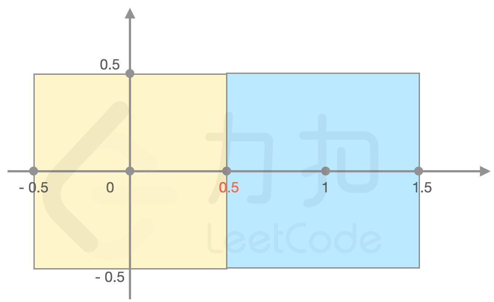
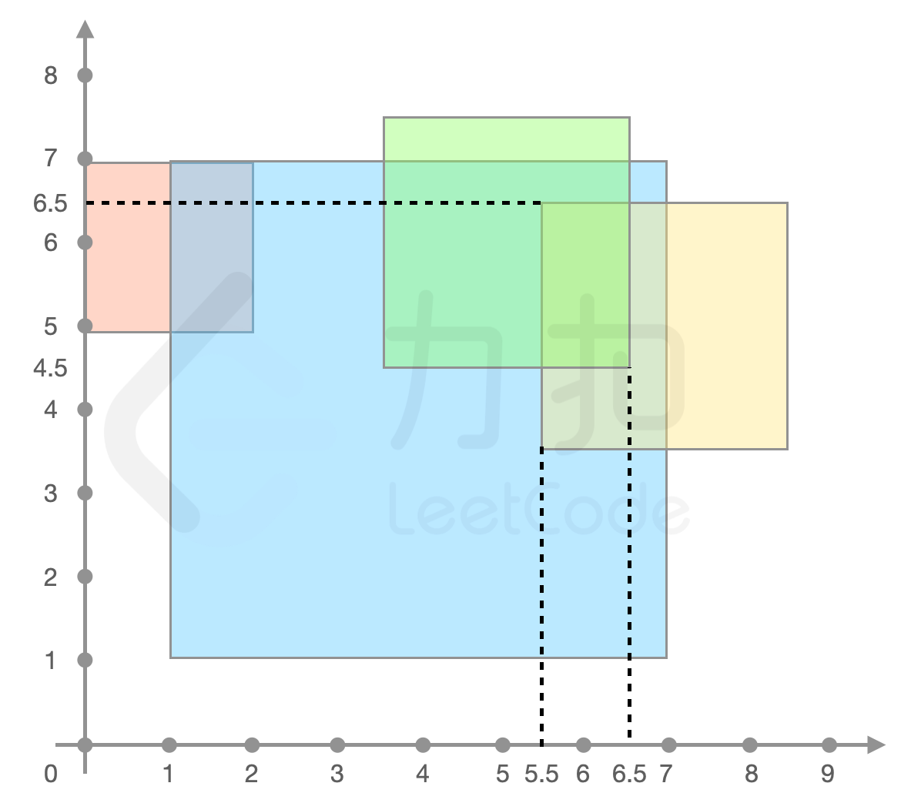

# 离散化+二维差分（Python/Java/C++/Go）

> **[LCP 74. 最强祝福力场](https://leetcode.cn/problems/xepqZ5/solutions/2240170/chi-san-hua-er-wei-chai-fen-by-endlessch-q43z/) · Medium**

> **所属题单**
> - [常用数据结构 · 二、差分](../../../刷题路径/灵神原版题单/常用数据结构/二、差分.md) · §2.2 二维差分

> **题目描述**
> 小扣在探索丛林的过程中，无意间发现了传说中“落寞的黄金之都”。而在这片建筑废墟的地带中，小扣使用探测仪监测到了存在某种带有「祝福」效果的力场。
> 经过不断的勘测记录，小扣将所有力场的分布都记录了下来。`forceField[i] = [x,y,side]` 表示第 `i` 片力场将覆盖以坐标 `(x,y)` 为中心，边长为 `side` 的正方形区域。
>
> 若任意一点的 **力场强度** 等于覆盖该点的力场数量，请求出在这片地带中 **力场强度** 最强处的 **力场强度**。
>
> **注意：**
> - 力场范围的边缘同样被力场覆盖。
>
> **示例 1：**
> >输入：
> >`forceField = [[0,0,1],[1,0,1]]`
> >
> >输出：`2`
> >
> >解释：如图所示，（0.5, 0) 处力场强度最强为 2， （0.5，-0.5）处力场强度同样是 2。
> {:width=400px}
>
> **示例 2：**
> >输入：
> >`forceField = [[4,4,6],[7,5,3],[1,6,2],[5,6,3]]`
> >
> >输出：`3`
> >
> >解释：如下图所示，
> >`forceField[0]、forceField[1]、forceField[3]` 重叠的区域力场强度最大，返回 `3`
> {:width=500px}
>
> **提示：**
> - `1 <= forceField.length <= 100`
> - `forceField[i].length == 3`
> - `0 <= forceField[i][0], forceField[i][1] <= 10^9`
> - `1 <= forceField[i][2] <= 10^9`

> **题解**
> ### 本题视频讲解
>
> 见[【力扣杯2023春·个人赛】](https://www.bilibili.com/video/BV1dg4y1j78A/)第三题。
>
> ### 思路
>
> 1. 统计所有左下和右上坐标，由于会出现 $0.5$，可以将坐标乘 $2$。
> 2. 离散化横纵坐标。
> 3. 二维差分，具体见视频讲解。
> 4. 用二维前缀和复原，计算最大值。
>
> ```python
> class Solution:
>     def fieldOfGreatestBlessing(self, forceField: List[List[int]]) -> int:
>         # 1. 统计所有左下和右上坐标
>         x_set = set()
>         y_set = set()
>         for i, j, side in forceField:
>             x_set.add(2 * i - side)
>             x_set.add(2 * i + side)
>             y_set.add(2 * j - side)
>             y_set.add(2 * j + side)
>
>         # 2. 离散化
>         xs = sorted(x_set)
>         ys = sorted(y_set)
>         n, m = len(xs), len(ys)
>
>         # 3. 二维差分：快速地把一个矩形范围内的数都 +1
>         diff = [[0] * (m + 2) for _ in range(n + 2)]
>         for i, j, side in forceField:
>             r1 = bisect_left(xs, 2 * i - side)
>             r2 = bisect_left(xs, 2 * i + side)
>             c1 = bisect_left(ys, 2 * j - side)
>             c2 = bisect_left(ys, 2 * j + side)
>             # 将区域 r1<=r<=r2 && c1<=c<=c2 上的数都加上 x
>             # 多 +1 是为了方便求后面用二维前缀和复原
>             diff[r1 + 1][c1 + 1] += 1
>             diff[r1 + 1][c2 + 2] -= 1
>             diff[r2 + 2][c1 + 1] -= 1
>             diff[r2 + 2][c2 + 2] += 1
>
>         # 4. 直接在 diff 上复原（二维前缀和），计算最大值
>         ans = 0
>         for i in range(1, n + 1):
>             for j in range(1, m + 1):
>                 diff[i][j] += diff[i][j - 1] + diff[i - 1][j] - diff[i - 1][j - 1]
>                 ans = max(ans, diff[i][j])
>         return ans
> ```
>
>
> ### 复杂度分析
>
> - 时间复杂度：$\mathcal{O}(n^2)$，其中 $n$ 为 $\textit{forceField}$ 的长度。
> - 空间复杂度：$\mathcal{O}(n^2)$。
