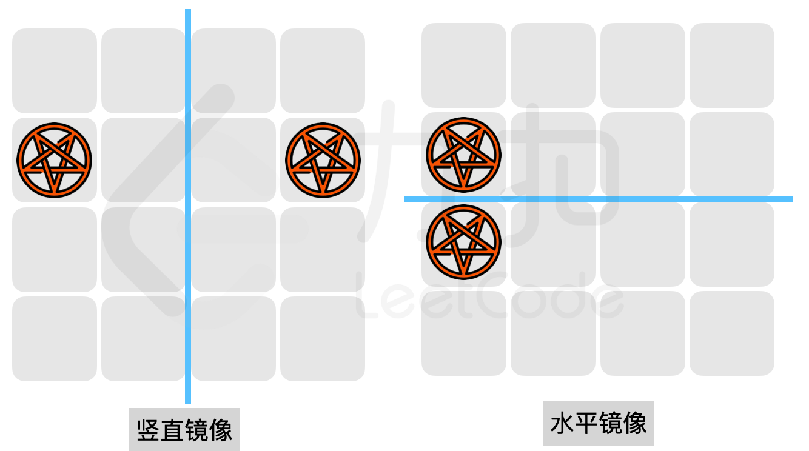
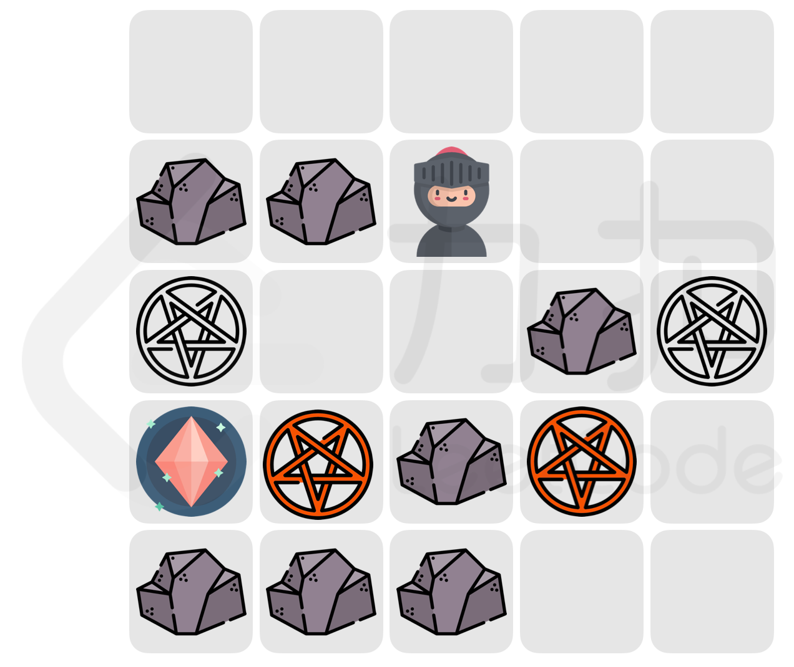
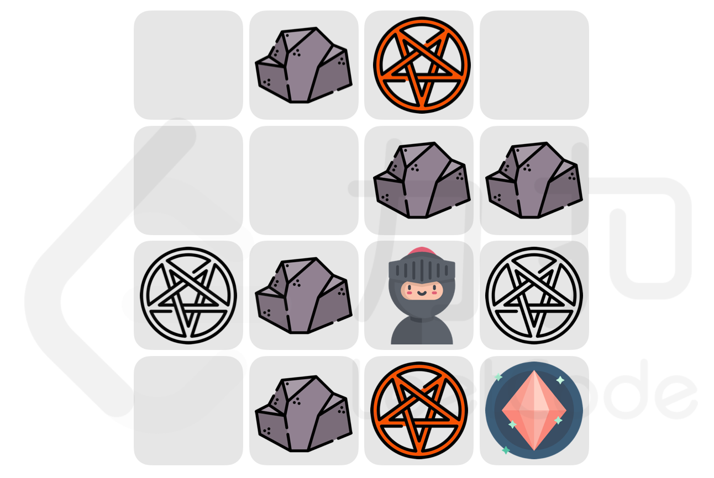
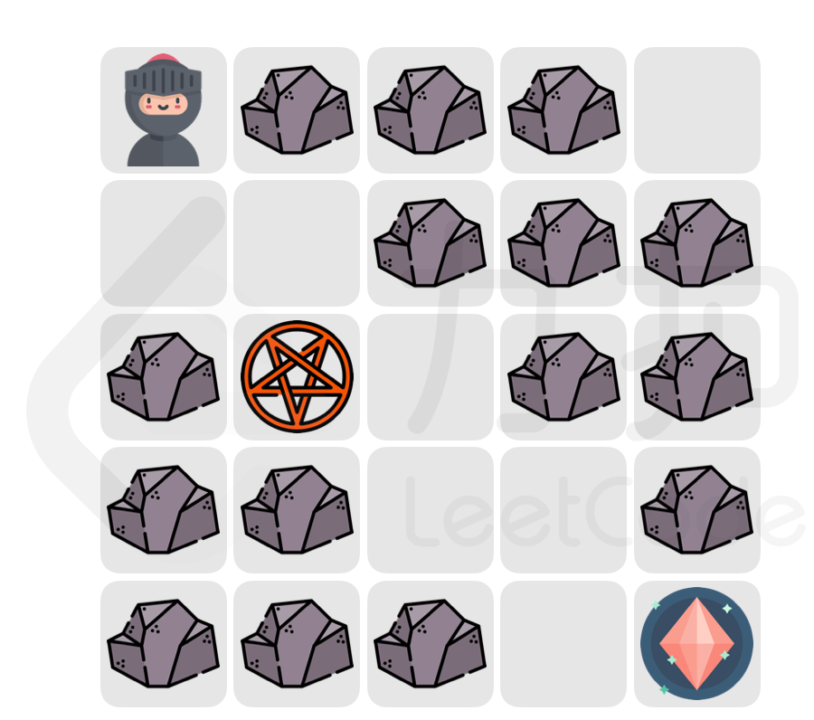

# 预处理终点到其余点的距离+二分答案（Python/Java/C++/Go）

> **[LCP 75. 传送卷轴](https://leetcode.cn/problems/rdmXM7/solutions/2240113/yu-chu-li-zhong-dian-dao-qi-yu-dian-de-j-nxfs/) · Hard**

> **所属题单**
> - [网格图 · 五、综合应用](../../../刷题路径/灵神原版题单/网格图/五、综合应用.md)

> **题目描述**
> 随着不断的深入，小扣来到了守护者之森寻找的魔法水晶。首先，他必须先通过守护者的考验。
>
> 考验的区域是一个正方形的迷宫，`maze[i][j]` 表示在迷宫 `i` 行 `j` 列的地形：
> - 若为 `.` ，表示可以到达的空地；
> - 若为 `#` ，表示不可到达的墙壁；
> - 若为 `S` ，表示小扣的初始位置；
> - 若为 `T` ，表示魔法水晶的位置。
>
> 小扣每次可以向 上、下、左、右 相邻的位置移动一格。而守护者拥有一份「传送魔法卷轴」，使用规则如下：
> - 魔法需要在小扣位于 **空地** 时才能释放，发动后卷轴消失；；
> - 发动后，小扣会被传送到水平或者竖直的镜像位置，且目标位置不得为墙壁(如下图所示)；
> {:width=400px}
>
> 在使用卷轴后，小扣将被「附加负面效果」，因此小扣需要尽可能缩短传送后到达魔法水晶的距离。而守护者的目标是阻止小扣到达魔法水晶的位置；如果无法阻止，则尽可能 **增加** 小扣传送后到达魔法水晶的距离。
> 假设小扣和守护者都按最优策略行事，返回小扣需要在 「附加负面效果」的情况下 **最少** 移动多少次才能到达魔法水晶。如果无法到达，返回 `-1`。
>
> **注意：**
> - 守护者可以不使用卷轴；
> - 传送后的镜像位置可能与原位置相同。
>
> **示例 1：**
> >输入：`maze = [".....","##S..","...#.","T.#..","###.."]`
> >
> >输出：`7`
> >
> >解释：如下图所示：
> >守护者释放魔法的两个最佳的位置为 [2,0] 或 [3,1]：
> >若小扣经过 [2,0]，守护者在该位置释放魔法，
> >小扣被传送至 [2,4] 处且加上负面效果，此时小扣还需要移动 7 次才能到达魔法水晶；
> >若小扣经过 [3,1]，守护者在该位置释放魔法，
> >小扣被传送至 [3,3] 处且加上负面效果，此时小扣还需要移动 9 次才能到达魔法水晶；
> >因此小扣负面效果下最少需要移动 7 次才能到达魔法水晶。
> {:width=300px}
>
> **示例 2：**
> >输入：`maze = [".#..","..##",".#S.",".#.T"]`
> >
> >输出：`-1`
> >
> >解释：如下图所示。
> >若小扣向下移动至 [3,2]，守护者使其传送至 [0,2]，小扣将无法到达魔法水晶；
> >若小扣向右移动至 [2,3]，守护者使其传送至 [2,0]，小扣将无法到达魔法水晶；
> {:width=300px}
>
> **示例 3：**
> >输入：`maze = ["S###.","..###","#..##","##..#","###.T"]`
> >
> >输出：`5`
> >
> >解释：如下图所示：
> >守护者需要小扣在空地才能释放，因此初始无法将其从 [0,0] 传送至 [0,4];
> >当小扣移动至 [2,1] 时，释放卷轴将其传送至水平方向的镜像位置 [2,1]（为原位置）
> >而后小扣需要移动 5 次到达魔法水晶
> {:width=300px}
>
> **提示：**
> - `4 <= maze.length == maze[i].length <= 200`
> - `maze[i][j]` 仅包含 `"."`、`"#"`、`"S"`、`"T"`

> **题解**
> ## 本题视频讲解
>
> 见[【力扣杯2023春·个人赛】](https://www.bilibili.com/video/BV1dg4y1j78A/)第四题。
>
> ## 思路
>
> 1. 遍历，找到 S 和 T 的位置。
> 2. BFS，计算 T 到其余点的最短距离。
> 3. 如果发现 S 无法到达 T，直接返回 $-1$。
> 4. 二分答案 $\textit{maxDis}$：看能否在「附加负面效果」的情况下，移动不超过 $\textit{maxDis}$ 步到达终点。我写的 DFS，如果 DFS 中的某个位置，守护者使用卷轴传送小扣，并将小扣传送到一个无法到达终点，或者无法在 $\textit{maxDis}$ 步内到达终点的位置，则不再 DFS（**相当于这种位置小扣不能走**）。在这种情况下，只要可以到达终点，则说明答案至多为  $\textit{maxDis}$，否则说明答案大于 $\textit{maxDis}$。
>
> > 注：如果守护者无法发动传送，则答案为 $0$。
>
> ```python
> class Solution:
>     def challengeOfTheKeeper(self, maze: List[str]) -> int:
>         m, n = len(maze), len(maze[0])
>
>         # 1. 找到起点终点坐标
>         for i, row in enumerate(maze):
>             for j, c in enumerate(row):
>                 if c == 'S':
>                     sx, sy = i, j
>                 elif c == 'T':
>                     tx, ty = i, j
>
>         # 2. BFS 计算终点到其余点的最短距离
>         dis_from_t = [[inf] * n for _ in range(m)]
>         dis_from_t[tx][ty] = 0
>         q = [(tx, ty)]
>         step = 1
>         while q:
>             tmp = q
>             q = []
>             for i, j in tmp:
>                 for x, y in (i + 1, j), (i - 1, j), (i, j + 1), (i, j - 1):
>                     if 0 <= x < m and 0 <= y < n and maze[x][y] != '#' and dis_from_t[x][y] == inf:
>                         dis_from_t[x][y] = step
>                         q.append((x, y))
>             step += 1
>
>         # 3. 剪枝：如果 S 无法到达 T，直接返回 -1
>         if dis_from_t[sx][sy] == inf:
>             return -1
>
>         # 4. 二分答案 https://www.bilibili.com/video/BV1AP41137w7/
>         vis = [[-1] * n for _ in range(m)]
>         def check(max_dis: int) -> bool:
>             # DFS，看能否在「附加负面效果」的情况下，移动不超过 max_dis 步到达终点
>             def dfs(i: int, j: int) -> bool:
>                 if i < 0 or i >= m or j < 0 or j >= n or vis[i][j] == max_dis or maze[i][j] == '#':
>                     return False
>                 if maze[i][j] == 'T':  # 到达终点
>                     return True
>                 vis[i][j] = max_dis  # 为避免反复创建 vis，用一个每次二分都不一样的数来标记
>                 # 守护者使用卷轴传送小扣，如果小扣无法在 maxDis 步内到达终点，则返回 false
>                 if maze[i][j] == '.' and \
>                    (maze[i][n - 1 - j] != '#' and dis_from_t[i][n - 1 - j] > max_dis or
>                     maze[m - 1 - i][j] != '#' and dis_from_t[m - 1 - i][j] > max_dis):
>                     return False
>                 for x, y in (i + 1, j), (i - 1, j), (i, j + 1), (i, j - 1):
>                     if dfs(x, y):
>                         return True
>                 return False
>             return dfs(sx, sy)
>         ans = bisect_left(range(m * n + 1), True, key=check)
>         return -1 if ans > m * n else ans
> ```
>
>
> #### 复杂度分析
>
> - 时间复杂度：$\mathcal{O}(mn\log(mn))$，其中 $m$ 和 $n$ 分别为 $\textit{maze}$ 的行数和列数。本题 $m=n$。
> - 空间复杂度：$\mathcal{O}(mn)$。
>
> ## 相似题目
>
> - [778. 水位上升的泳池中游泳](https://leetcode.cn/problems/swim-in-rising-water/)
>
> ## 分类题单
>
> 以下题单没有特定的顺序，可以按照个人喜好刷题。
>
> 1. [滑动窗口（定长/不定长/多指针）](https://leetcode.cn/circle/discuss/0viNMK/)
> 2. [二分算法（二分答案/最小化最大值/最大化最小值/第K小）](https://leetcode.cn/circle/discuss/SqopEo/)
> 3. [单调栈（基础/矩形面积/贡献法/最小字典序）](https://leetcode.cn/circle/discuss/9oZFK9/)
> 4. [网格图（DFS/BFS/综合应用）](https://leetcode.cn/circle/discuss/YiXPXW/)
> 5. [位运算（基础/性质/拆位/试填/恒等式/贪心/脑筋急转弯）](https://leetcode.cn/circle/discuss/dHn9Vk/)
> 6. [图论算法（DFS/BFS/拓扑排序/最短路/最小生成树/二分图/基环树/欧拉路径）](https://leetcode.cn/circle/discuss/01LUak/)
> 7. [动态规划（入门/背包/状态机/划分/区间/状压/数位/数据结构优化/树形/博弈/概率期望）](https://leetcode.cn/circle/discuss/tXLS3i/)
> 8. [常用数据结构（前缀和/差分/栈/队列/堆/字典树/并查集/树状数组/线段树）](https://leetcode.cn/circle/discuss/mOr1u6/)
> 9. [数学算法（数论/组合/概率期望/博弈/计算几何/随机算法）](https://leetcode.cn/circle/discuss/IYT3ss/)
> 10. [贪心（基本贪心策略/反悔/区间/字典序/数学/思维/构造）](https://leetcode.cn/circle/discuss/g6KTKL/)
>
> [我的题解精选（已分类）](https://github.com/EndlessCheng/codeforces-go/blob/master/leetcode/SOLUTIONS.md)
>
> 欢迎关注 [B站@灵茶山艾府](https://space.bilibili.com/206214)
