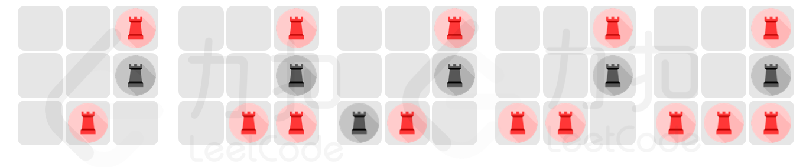

# LCP 76. 魔法棋盘

Hard · [力扣原题](https://leetcode.cn/problems/1ybDKD/)

所在刷题路径：灵神题单·动态规划、灵神题单·常用数据结构

| 作者 | 题解 | 动画讲解 |
|---|---|---|
| 灵茶山艾府 | [📄 题解](灵茶山艾府.md) | [▶︎ 动画（GIF）](LCP%2076%20魔法棋盘%20·%20灵茶山艾府.gif) · [mp4 文件](LCP%2076%20魔法棋盘%20·%20灵茶山艾府.mp4) |
| yiduobo | — | — |

## 动画讲解

> 动图会循环播放；想暂停、拖进度条请下载上面表格里的 mp4 文件。

### 灵茶山艾府

## 题目描述

在大小为 `n * m` 的棋盘中，有两种不同的棋子：黑色，红色。当两颗颜色不同的棋子同时满足以下两种情况时，将会产生魔法共鸣：
- 两颗异色棋子在同一行或者同一列
- 两颗异色棋子之间恰好只有一颗棋子
    > 注：异色棋子之间可以有空位

由于棋盘上被施加了魔法禁制，棋盘上的部分格子变成问号。`chessboard[i][j]` 表示棋盘第 `i` 行 `j` 列的状态：
- 若为 `.` ，表示当前格子确定为空
- 若为 `B` ，表示当前格子确定为 黑棋
- 若为 `R` ，表示当前格子确定为 红棋
- 若为 `?` ，表示当前格子待定

现在，探险家小扣的任务是确定所有问号位置的状态（留空/放黑棋/放红棋），使最终的棋盘上，任意两颗棋子间都 **无法** 产生共鸣。请返回可以满足上述条件的放置方案数量。

**示例1：**
> 输入：`n = 3, m = 3, chessboard = ["..R","..B","?R?"]`
>
> 输出：`5`
>
> 解释：给定的棋盘如图：
>{:height=150px}
> 所有符合题意的最终局面如图：
>{:height=150px}

**示例2：**
> 输入：`n = 3, m = 3, chessboard = ["?R?","B?B","?R?"]`
>
> 输出：`105`

**提示：**
- `n == chessboard.length`
- `m == chessboard[i].length`
- `1 <= n*m <= 30`
- `chessboard` 中仅包含 `"."、"B"、"R"、"?"`

---
[↑ 返回 LCP](../README.md) · [总索引](../../../索引.md) · [仓库首页](../../../README.md)
