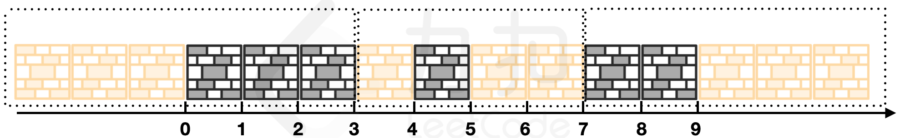

# LCP 78. 城墙防线

Medium · [力扣原题](https://leetcode.cn/problems/Nsibyl/)

所在刷题路径：灵神核心路线、灵神题单·二分算法

| 作者 | 题解 | 动画讲解 |
|---|---|---|
| 灵茶山艾府 | [📄 题解](灵茶山艾府.md) | [▶︎ 动画（GIF）](LCP%2078%20城墙防线%20·%20灵茶山艾府.gif) · [mp4 文件](LCP%2078%20城墙防线%20·%20灵茶山艾府.mp4) |
| yiduobo | — | — |

## 动画讲解

> 动图会循环播放；想暂停、拖进度条请下载上面表格里的 mp4 文件。

### 灵茶山艾府

## 题目描述

在探险营地间，小扣意外发现了一片城墙遗迹，在探索期间，却不巧遇到迁徙中的兽群向他迎面冲来。情急之下小扣吹响了他的苍蓝笛，随着笛声响起，遗迹中的城墙逐渐发生了横向膨胀。
已知 `rampart[i] = [x,y]` 表示第 `i` 段城墙的初始所在区间。当城墙发生膨胀时，将遵循以下规则：
- 所有的城墙会同时膨胀相等的长度；
- 每个城墙可以向左、向右或向两个方向膨胀。

小扣为了确保自身的安全，需要在所有城墙均无重叠的情况下，让城墙尽可能的膨胀。请返回城墙可以膨胀的 **最大值** 。

**注意：**
- 初始情况下，所有城墙均不重叠，且 `rampart` 中的元素升序排列；
- 两侧的城墙可以向外无限膨胀。

**示例 1：**
>输入：`rampart = [[0,3],[4,5],[7,9]]`
>
>输出：`3`
>
>解释：如下图所示：
>`rampart[0]` 向左侧膨胀 3 个单位；
>`rampart[2]` 向右侧膨胀 3 个单位；
>`rampart[1]` 向左侧膨胀 1 个单位，向右膨胀 2 个单位。
>不存在膨胀更多的方案，返回 3。
{:width=750px}

**示例 2：**
>输入：`rampart = [[1,2],[5,8],[11,15],[18,25]]`
>
>输出：`4`

**提示：**
- `3 <= rampart.length <= 10^4`
- `rampart[i].length == 2`
- `0 <= rampart[i][0] < rampart[i][1] <= rampart[i+1][0] <= 10^8`

---
[↑ 返回 LCP](../README.md) · [总索引](../../../索引.md) · [仓库首页](../../../README.md)
