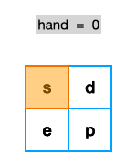

# 三维 BFS

> **[LCP 79. 提取咒文](https://leetcode.cn/problems/kjpLFZ/solutions/2260565/san-wei-bfs-by-endlesscheng-eebk/) · Medium**

> **题目描述**
> 随着兽群逐渐远去，一座大升降机缓缓的从地下升到了远征队面前。借由这台升降机，他们将能够到达地底的永恒至森。
> 在升降机的操作台上，是一个由魔法符号组成的矩阵，为了便于辨识，我们用小写字母来表示。 `matrix[i][j]` 表示矩阵第 `i` 行 `j` 列的字母。该矩阵上有一个提取装置，可以对所在位置的字母提取。
> 提取装置初始位于矩阵的左上角 `[0,0]`，可以通过每次操作移动到上、下、左、右相邻的 1 格位置中。提取装置每次移动或每次提取均记为一次操作。
>
> 远征队需要按照顺序，从矩阵中逐一取出字母以组成 `mantra`，才能够成功的启动升降机。请返回他们 **最少** 需要消耗的操作次数。如果无法完成提取，返回 `-1`。
>
> **注意：**
> - 提取装置可对同一位置的字母重复提取，每次提取一个
> - 提取字母时，需按词语顺序依次提取
>
> **示例 1：**
> >输入：`matrix = ["sd","ep"], mantra = "speed"`
> >
> >输出：`10`
> >
> >解释：如下图所示
> 
>
> **示例 2：**
> >输入：`matrix = ["abc","daf","geg"]， mantra = "sad"`
> >
> >输出：`-1`
> >
> >解释：矩阵中不存在 `s` ，无法提取词语
>
> **提示：**
> - `0 < matrix.length, matrix[i].length <= 100`
> - `0 < mantra.length <= 100`
> - `matrix 和 mantra` 仅由小写字母组成

> **题解**
> 简单记录一下思路。
>
> 1. BFS。
> 2. 状态为 $(i,j,k)$，表示当前位置在 $(i,j)$，**要去**提取 $\textit{mantra}[k]$。
> 3. 初始状态：$(0,0,0)$。
> 4. 终点为 $k=l$，这里 $l$ 为 $\textit{mantra}$ 的长度。
>
> ```python
> class Solution:
>     def extractMantra(self, matrix: List[str], mantra: str) -> int:
>         m, n = len(matrix), len(matrix[0])
>         q = [(0, 0, 0)]
>         vis = {q[0]}
>         step = 1
>         while q:
>             tmp = q
>             q = []
>             for i, j, k in tmp:
>                 if matrix[i][j] == mantra[k]:  # 可以提取
>                     if k == len(mantra) - 1:  # 下一步就是终点，直接返回
>                         return step
>                     p = (i, j, k + 1)
>                     if p not in vis:
>                         vis.add(p)
>                         q.append(p)
>                 # 枚举周围四个格子
>                 for x, y in (i + 1, j), (i - 1, j), (i, j + 1), (i, j - 1):
>                     if 0 <= x < m and 0 <= y < n:
>                         p = (x, y, k)
>                         if p not in vis:
>                             vis.add(p)
>                             q.append(p)
>             step += 1
>         return -1
> ```
>
> ### 复杂度分析
>
> - 时间复杂度：$\mathcal{O}(mnl)$，其中 $m$ 和 $n$ 分别为 $\textit{matrix}$ 的行数和列数，$l$ 为 $\textit{mantra}$ 的长度。
> - 空间复杂度：$\mathcal{O}(mnl)$。
