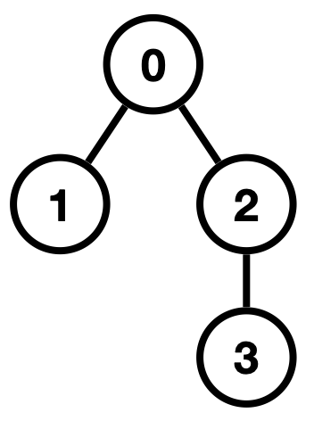
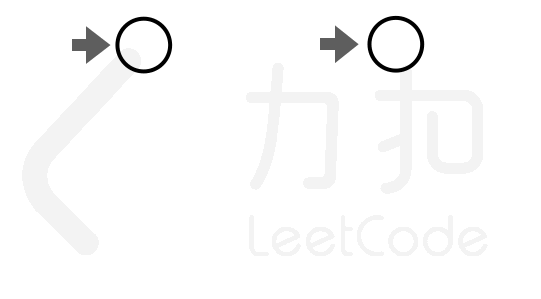

# 递归+排序

> **[LCP 80. 生物进化录](https://leetcode.cn/problems/qoQAMX/solutions/2260956/di-gui-pai-xu-by-endlesscheng-hnjf/) · Hard**

> **题目描述**
> 在永恒之森中，存在着一本生物进化录，以 **一个树形结构** 记载了所有生物的演化过程。经过观察并整理了各节点间的关系，`parents[i]` 表示编号 `i` 节点的父节点编号(根节点的父节点为 `-1`)。
>
> 为了探索和记录其中的演化规律，队伍中的炼金术师提出了一种方法，可以以字符串的形式将其复刻下来，规则如下：
> - 初始只有一个根节点，表示演化的起点，依次记录 `01` 字符串中的字符，
> - 如果记录 `0`，则在当前节点下添加一个子节点，并将指针指向新添加的子节点；
> - 如果记录 `1`，则将指针回退到当前节点的父节点处。
>
> 现在需要应用上述的记录方法，复刻下它的演化过程。请返回能够复刻演化过程的字符串中， **字典序最小** 的 `01` 字符串。
>
> **注意：**
> - 节点指针最终可以停在任何节点上，不一定要回到根节点。
>
> **示例 1：**
> > 输入：`parents = [-1,0,0,2]`
> >
> > 输出：`"00110"`
> >
> >解释：树结构如下图所示，共存在 2 种记录方案：
> >第 1 种方案为：0(记录编号 1 的节点) -> 1(回退至节点 0) -> 0(记录编号 2 的节点) -> 0((记录编号 3 的节点))
> >第 2 种方案为：0(记录编号 2 的节点) -> 0(记录编号 3 的节点) -> 1(回退至节点 2) -> 1(回退至节点 0) -> 0(记录编号 1 的节点)
> >返回字典序更小的 `"00110"`
> {:width=120px}{:width=320px}
>
> **示例 2：**
> > 输入：`parents = [-1,0,0,1,2,2]`
> >
> > 输出：`"00101100"`
>
> **提示：**
>
> - `1 <= parents.length <= 10^4`
> - `-1 <= parents[i] < i` (即父节点编号小于子节点)

> **题解**
> ### 本题视频讲解
>
> 见[【力扣杯2023春·战队赛】](https://www.bilibili.com/video/TODO/)第四题。
>
> ### 思路
>
> 1. 要使整棵树对应的字符串的字典序最小，对于根节点下面的子树，对应的字符串的字典序也要最小，这意味着可以递归处理。
> 2. 如何得到最小字典序？把所有子树的结果排序，然后拼接起来，在开头加上 $0$，末尾加上 $1$，然后返回。
> 3. 题目说「节点指针最终可以停在任何节点上，不一定要回到根节点」。我们可以把结果的末尾的 $1$ 都去掉来实现这一点（开头的一个 $0$ 也要去掉）。但这样的话，我们对字符串排序的做法是否会影响答案的正确性呢？
> 4. 假设有两棵子树 $A$ 和 $B$，先 $A$ 后 $B$ 的结果是 $000\cdots 11$，先 $B$ 后 $A$ 的结果（字典序更大）是 $001\cdots 0\cdots 11$，注意中间有个 $0$，因为无论按照何种顺序遍历 $A$ 和 $B$，$0$ 和 $1$ 的总数是不变的。所以原来字典序最小的，去掉末尾的 $1$，字典序仍然是最小的。
> 5. 因此按照上面第 2 点说的，递归实现就好了。
>
> ```python
> class Solution:
>     def evolutionaryRecord(self, parents: List[int]) -> str:
>         n = len(parents)
>         g = [[] for _ in range(n)]
>         for i in range(1, n):
>             g[parents[i]].append(i)  # 建树
>
>         def dfs(x: int) -> str:
>             a = sorted(dfs(y) for y in g[x])
>             return "0" + ''.join(a) + "1"
>         return dfs(0)[1:].rstrip('1')  # 去掉根节点以及返回根节点的路径
> ```
>
>
> ### 复杂度分析
>
> - 时间复杂度：$\mathcal{O}(n^2)$，其中 $n$ 为 $\textit{parents}$ 的长度。瓶颈在拼接字符串上（可以用链表等结构优化），对于排序的时间复杂度，感性理解，如果树高比较小，那么比较的字符串就比较短，如果树高比较大，那么参与比较的字符串就比较少。[具体分析](https://leetcode.cn/problems/special-binary-string/solution/on-log-n-by-hqztrue-nrmw/)。
> - 空间复杂度：$\mathcal{O}(n)$。
