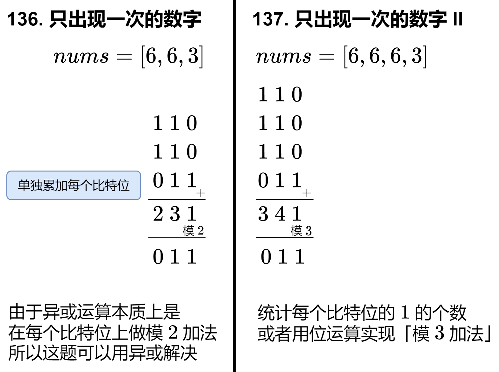

# 带你一步步推导出位运算公式！（Python/Java/C++/Go/JS/Rust）

> **[LCR 004. 只出现一次的数字 II](https://leetcode.cn/problems/WGki4K/solutions/2689740/dai-ni-yi-bu-bu-tui-dao-chu-wei-yun-suan-193h/) · Medium**

> **题目描述**
> 给你一个整数数组 `nums` ，除某个元素仅出现 **一次** 外，其余每个元素都恰出现 **三次 。**请你找出并返回那个只出现了一次的元素。
>
> **示例 1：**
>
> ```
>
> 输入：nums = [2,2,3,2]
> 输出：3
> ```
>
> **示例 2：**
>
> ```
>
> 输入：nums = [0,1,0,1,0,1,100]
> 输出：100
> ```
>
> **提示：**
>
> - `1 <= nums.length <= 3 * 10⁴`
>
> - `-2³¹ <= nums[i] <= 2³¹ - 1`
>
> - `nums` 中，除某个元素仅出现 **一次** 外，其余每个元素都恰出现 **三次**
>
> **进阶：**你的算法应该具有线性时间复杂度。 你可以不使用额外空间来实现吗？
>
> 注意：本题与主站 137 题相同：[https://leetcode.cn/problems/single-number-ii/](https://leetcode.cn/problems/single-number-ii/)

> **题解**
> ## 暴力思路
>
> 设只出现一次的那个数为 $x$。用**二进制**思考：
>
> - 如果 $x$ 的某个比特是 $0$，由于其余数字都出现了 $3$ 次，所以 $\textit{nums}$ 的所有元素在这个比特位上的 $1$ 的个数是 $3$ 的倍数。
> - 如果 $x$ 的某个比特是 $1$，由于其余数字都出现了 $3$ 次，所以 $\textit{nums}$ 的所有元素在这个比特位上的 $1$ 的个数除 $3$ 余 $1$。
>
> 这启发我们**统计每个比特位上有多少个** $1$。下图比较了 [136. 只出现一次的数字](https://leetcode.cn/problems/single-number/) 与本题的异同：
>
> 
>
> 先来看看如何实现「统计每个比特位的 $1$ 的个数」。
>
> 代码中用到了一些位运算技巧，请看 [从集合论到位运算，常见位运算技巧分类总结！](https://leetcode.cn/circle/discuss/CaOJ45/)
>
> ```python
> class Solution:
>     def singleNumber(self, nums: List[int]) -> int:
>         ans = 0
>         for i in range(31):
>             cnt1 = sum(x >> i & 1 for x in nums)
>             ans |= cnt1 % 3 << i
>         cnt1 = sum(x >> 31 & 1 for x in nums)
>         return ans - (cnt1 % 3 << 31)  # 符号位
> ```
>
>
> ## 位运算的魔法：模 3 加法
>
> 对于异或（模 $2$ 加法）来说，把一个数不断地异或 $1$，相当于在 $0$ 和 $1$ 之间不断转换，即：
>
> $$
> 0 \rightarrow 1 \rightarrow 0 \rightarrow 1 \rightarrow \cdots
> $$
>
> 类似地，模 $3$ 加法就是在 $0,1,2$ 之间不断转换，即：
>
> $$
> 0 \rightarrow 1 \rightarrow 2 \rightarrow 0 \rightarrow 1 \rightarrow 2 \rightarrow \cdots
> $$
>
> 由于 $0,1,2$ 需要两个比特才能表示，设这两个比特分别为 $a$ 和 $b$，即：
>
> - $a=0,\ b=0$ 表示数字 $0$；
> - $a=0,\ b=1$ 表示数字 $1$；
> - $a=1,\ b=0$ 表示数字 $2$。
>
> 那么转换规则就是：
>
> $$
> (0,0) \rightarrow (0,1) \rightarrow (1,0) \rightarrow (0,0) \rightarrow  (0,1) \rightarrow (1,0) \rightarrow  \cdots
> $$
>
> 这其中有大量 $0$ 和 $1$ 之间的转换，我们已经知道，这可以用异或运算实现，写成代码就是：
>
> ```
> a = a ^ 1
> b = b ^ 1
> ```
>
> **除了两个例外情况**：
>
> - 当 $a=0$ 且 $b=0$ 时，$a$ 必须保持不变，仍然为 $0$。
> - 当 $a=1$ 时（此时 $b$ 一定是 $0$），$b$ 必须保持不变，仍然为 $0$。
>
> 换句话说，我们可以在异或运算的基础上，增加一些「约束」：
>
> - 当 `(a | b) == 0` 时，把 $0$ 赋值给 $a$，否则（`(a | b) == 1`）可以执行异或操作。写成代码就是 `a = (a ^ 1) & (a | b)`。
> - 当 `a == 1` 时，把 $0$ 赋值给 $b$，否则（`~a == 1`）可以执行异或操作。写成代码就是 `b = (b ^ 1) & ~a`。
>
> 其中 `&` 运算相当于为异或运算添加了一个约束：当……为 $1$ 时，才执行异或操作。
>
> 如果模 $3$ 加法遇到了 $0$，那么 $a$ 和 $b$ 都应当维持不变。好在把 $1$ 改成 $0$，我们的代码仍然是正确的，也就是：
>
>
> 该代码在 $x=0$ 和 $x=1$ 的情况下都是成立的（注意 $a$ 和 $b$ 不可能都为 $1$）。
>
> 由于位运算具有「并行计算」的特点，上述运算规则可以推广到多个比特的情况。遍历 $\textit{nums}$，利用上式计算出最终的 $a$ 和 $b$。
>
> 最后，由于模 $3$ 加法的结果要么是 $0$，要么是 $1$，这刚好就是 $b$，所以最后返回 $b$。
>
> ```python
> class Solution:
>     def singleNumber(self, nums: List[int]) -> int:
>         a = b = 0
>         for x in nums:
>             a, b = (a ^ x) & (a | b), (b ^ x) & ~a
>         return b
> ```
>
>
> ## 优化：更简洁的代码
>
> 也可以先算 $b$ 再算 $a$，那么 $a$ 的计算规则修改成：
>
> - 当 $a=0$ 且 $b=1$ 时，$a$ 必须保持不变，仍然为 $0$。注意这里的 $b$ 是更新后的。
>
> 由于 $b=1$ 的情况在 $(0,0) \rightarrow (0,1) \rightarrow (1,0)$ 中只会出现一次，所以只要 $b=1$ 我们可以断定 $a=0$，所以
>
> - 当 `b == 1` 时，把 $0$ 赋值给 $a$，否则（`~b == 1`）可以执行异或操作。
>
> 于是得到：
>
>
> 这样写出来的代码比上面的更简洁：
>
> ```python
> class Solution:
>     def singleNumber(self, nums: List[int]) -> int:
>         a = b = 0
>         for x in nums:
>             b = (b ^ x) & ~a
>             a = (a ^ x) & ~b
>         return b
> ```
>
>
> #### 复杂度分析
>
> - 时间复杂度：$\mathcal{O}(n)$，其中 $n$ 为 $\textit{nums}$ 的长度。
> - 空间复杂度：$\mathcal{O}(1)$。仅用到若干额外变量。
>
> ## 思考题
>
> 1. 如果把转换规则改成 $0\rightarrow 2\rightarrow 1\rightarrow 0\rightarrow 2\rightarrow 1\rightarrow\cdots$，对应的代码应该如何修改呢？
> 2. 如果改成除了一个数字出现一次，其余数字均出现 $5$ 次呢？
>
> 欢迎在评论区发表你的思路。
>
> ## 题单
>
> - [位运算（基础/性质/拆位/试填/恒等式/贪心/脑筋急转弯）](https://leetcode.cn/circle/discuss/dHn9Vk/)
>
> 欢迎关注 [B站@灵茶山艾府](https://space.bilibili.com/206214)
>
> 更多精彩题解，请看 [往期题解精选（按 tag 分类）](https://github.com/EndlessCheng/codeforces-go/blob/master/leetcode/SOLUTIONS.md)
