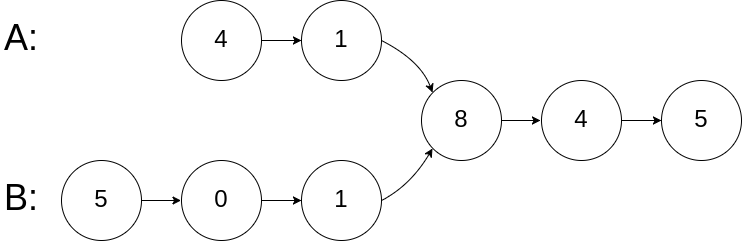
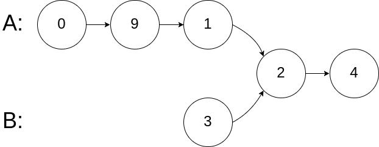
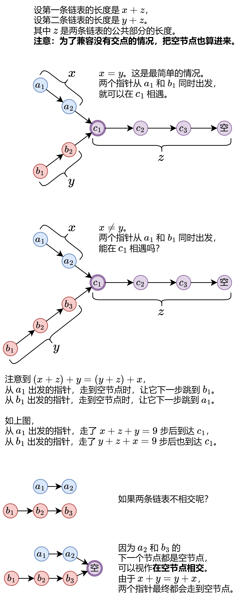

# 【图解】一张图秒懂相交链表！（Python/Java/C++/C/Go/JS）

> **[LCR 023. 相交链表](https://leetcode.cn/problems/3u1WK4/solutions/3795212/tu-jie-yi-zhang-tu-miao-dong-xiang-jiao-2nxv9/) · Easy**

> **题目描述**
> 给定两个单链表的头节点 `headA` 和 `headB` ，请找出并返回两个单链表相交的起始节点。如果两个链表没有交点，返回 `null` 。
>
> 图示两个链表在节点 `c1` 开始相交**：**
>
> 
>
> 题目数据 **保证** 整个链式结构中不存在环。
>
> **注意**，函数返回结果后，链表必须 **保持其原始结构** 。
>
> **示例 1：**
>
> 
>
> ```
>
> 输入：intersectVal = 8, listA = [4,1,8,4,5], listB = [5,0,1,8,4,5], skipA = 2, skipB = 3
> 输出：Intersected at '8'
> 解释：相交节点的值为 8 （注意，如果两个链表相交则不能为 0）。
> 从各自的表头开始算起，链表 A 为 [4,1,8,4,5]，链表 B 为 [5,0,1,8,4,5]。
> 在 A 中，相交节点前有 2 个节点；在 B 中，相交节点前有 3 个节点。
> ```
>
> **示例 2：**
>
> 
>
> ```
>
> 输入：intersectVal = 2, listA = [0,9,1,2,4], listB = [3,2,4], skipA = 3, skipB = 1
> 输出：Intersected at '2'
> 解释：相交节点的值为 2 （注意，如果两个链表相交则不能为 0）。
> 从各自的表头开始算起，链表 A 为 [0,9,1,2,4]，链表 B 为 [3,2,4]。
> 在 A 中，相交节点前有 3 个节点；在 B 中，相交节点前有 1 个节点。
> ```
>
> **示例 3：**
>
> 
>
> ```
>
> 输入：intersectVal = 0, listA = [2,6,4], listB = [1,5], skipA = 3, skipB = 2
> 输出：null
> 解释：从各自的表头开始算起，链表 A 为 [2,6,4]，链表 B 为 [1,5]。
> 由于这两个链表不相交，所以 intersectVal 必须为 0，而 skipA 和 skipB 可以是任意值。
> 这两个链表不相交，因此返回 null 。
> ```
>
> **提示：**
>
> - `listA` 中节点数目为 `m`
>
> - `listB` 中节点数目为 `n`
>
> - `0 <= m, n <= 3 * 10⁴`
>
> - `1 <= Node.val <= 10⁵`
>
> - `0 <= skipA <= m`
>
> - `0 <= skipB <= n`
>
> - 如果 `listA` 和 `listB` 没有交点，`intersectVal` 为 `0`
>
> - 如果 `listA` 和 `listB` 有交点，`intersectVal == listA[skipA + 1] == listB[skipB + 1]`
>
> **进阶：**能否设计一个时间复杂度 `O(n)` 、仅用 `O(1)` 内存的解决方案？
>
> 注意：本题与主站 160 题相同：[https://leetcode.cn/problems/intersection-of-two-linked-lists/](https://leetcode.cn/problems/intersection-of-two-linked-lists/)

> **题解**
> 
>
> 具体算法如下：
>
> 1. 初始化两个指针 $p=\textit{headA},\ q=\textit{headB}$。
> 2. 不断循环，直到 $p=q$。
> 3. 每次循环，$p$ 和 $q$ 各向后走一步。具体来说，如果 $p$ 不是空节点，那么更新 $p$ 为 $p.\textit{next}$，否则更新 $p$ 为 $\textit{headB}$；如果 $q$ 不是空节点，那么更新 $q$ 为 $q.\textit{next}$，否则更新 $q$ 为 $\textit{headA}$。
> 4. 循环结束时，如果两条链表相交，那么此时 $p$ 和 $q$ 都在相交的起始节点处，返回 $p$；如果两条链表不相交，那么 $p$ 和 $q$ 都走到空节点，所以也可以返回 $p$，即空节点。
>
> ```python
> class Solution:
>     def getIntersectionNode(self, headA: ListNode, headB: ListNode) -> Optional[ListNode]:
>         p, q = headA, headB
>         while p is not q:
>             p = p.next if p else headB
>             q = q.next if q else headA
>         return p
> ```
>
>
> #### 复杂度分析
>
> - 时间复杂度：$\mathcal{O}(m+n)$，其中 $m$ 是第一条链表的长度，$n$ 是第二条链表的长度。除了交点，每个节点会被指针 $p$ 访问至多一次，每个节点会被指针 $q$ 访问至多一次。
> - 空间复杂度：$\mathcal{O}(1)$。
>
> ## 分类题单
>
> [如何科学刷题？](https://leetcode.cn/circle/discuss/RvFUtj/)
>
> 1. [滑动窗口与双指针（定长/不定长/单序列/双序列/三指针/分组循环）](https://leetcode.cn/circle/discuss/0viNMK/)
> 2. [二分算法（二分答案/最小化最大值/最大化最小值/第K小）](https://leetcode.cn/circle/discuss/SqopEo/)
> 3. [单调栈（基础/矩形面积/贡献法/最小字典序）](https://leetcode.cn/circle/discuss/9oZFK9/)
> 4. [网格图（DFS/BFS/综合应用）](https://leetcode.cn/circle/discuss/YiXPXW/)
> 5. [位运算（基础/性质/拆位/试填/恒等式/思维）](https://leetcode.cn/circle/discuss/dHn9Vk/)
> 6. [图论算法（DFS/BFS/拓扑排序/基环树/最短路/最小生成树/网络流）](https://leetcode.cn/circle/discuss/01LUak/)
> 7. [动态规划（入门/背包/划分/状态机/区间/状压/数位/数据结构优化/树形/博弈/概率期望）](https://leetcode.cn/circle/discuss/tXLS3i/)
> 8. [常用数据结构（前缀和/差分/栈/队列/堆/字典树/并查集/树状数组/线段树）](https://leetcode.cn/circle/discuss/mOr1u6/)
> 9. [数学算法（数论/组合/概率期望/博弈/计算几何/随机算法）](https://leetcode.cn/circle/discuss/IYT3ss/)
> 10. [贪心与思维（基本贪心策略/反悔/区间/字典序/数学/思维/脑筋急转弯/构造）](https://leetcode.cn/circle/discuss/g6KTKL/)
> 11. [链表、二叉树与回溯（前后指针/快慢指针/DFS/BFS/直径/LCA/一般树）](https://leetcode.cn/circle/discuss/K0n2gO/)
> 12. [字符串（KMP/Z函数/Manacher/字符串哈希/AC自动机/后缀数组/子序列自动机）](https://leetcode.cn/circle/discuss/SJFwQI/)
>
> [我的题解精选（已分类）](https://github.com/EndlessCheng/codeforces-go/blob/master/leetcode/SOLUTIONS.md)
>
> 欢迎关注 [B站@灵茶山艾府](https://space.bilibili.com/206214)
