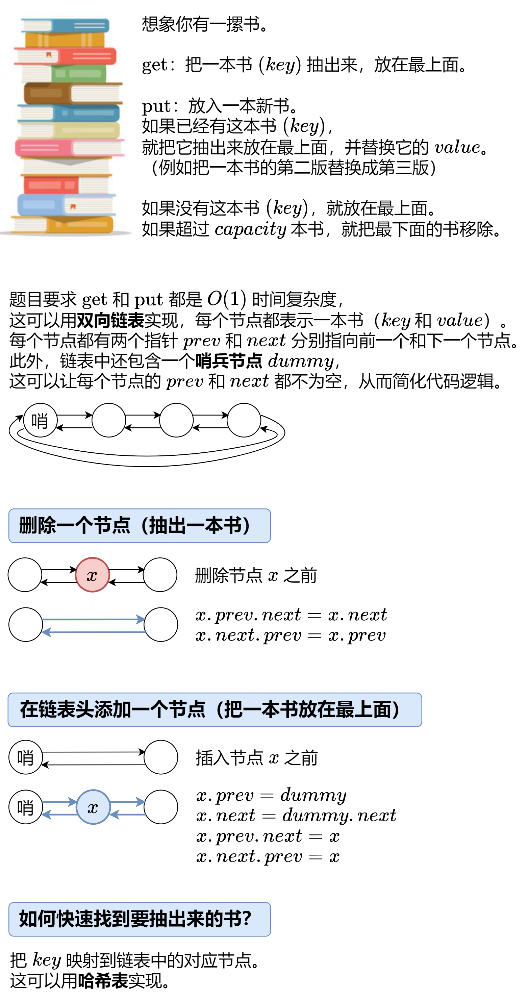

# 【图解】一张图秒懂 LRU！（Python/Java/C++/Go/JS/Rust）

> **[LCR 031. LRU 缓存](https://leetcode.cn/problems/OrIXps/solutions/2564176/tu-jie-yi-zhang-tu-miao-dong-lrupythonja-5udb/) · Medium**

> **题目描述**
> 运用所掌握的数据结构，设计和实现一个  [LRU (Least Recently Used，最近最少使用) 缓存机制](https://baike.baidu.com/item/LRU) 。
>
> 实现 `LRUCache` 类：
>
> - `LRUCache(int capacity)` 以正整数作为容量 `capacity` 初始化 LRU 缓存
>
> - `int get(int key)` 如果关键字 `key` 存在于缓存中，则返回关键字的值，否则返回 `-1` 。
>
> - `void put(int key, int value)` 如果关键字已经存在，则变更其数据值；如果关键字不存在，则插入该组「关键字-值」。当缓存容量达到上限时，它应该在写入新数据之前删除最久未使用的数据值，从而为新的数据值留出空间。
>
> **示例：**
>
> ```
>
> 输入
> ["LRUCache", "put", "put", "get", "put", "get", "put", "get", "get", "get"]
> [[2], [1, 1], [2, 2], [1], [3, 3], [2], [4, 4], [1], [3], [4]]
> 输出
> [null, null, null, 1, null, -1, null, -1, 3, 4]
>
> 解释
> LRUCache lRUCache = new LRUCache(2);
> lRUCache.put(1, 1); // 缓存是 {1=1}
> lRUCache.put(2, 2); // 缓存是 {1=1, 2=2}
> lRUCache.get(1);    // 返回 1
> lRUCache.put(3, 3); // 该操作会使得关键字 2 作废，缓存是 {1=1, 3=3}
> lRUCache.get(2);    // 返回 -1 (未找到)
> lRUCache.put(4, 4); // 该操作会使得关键字 1 作废，缓存是 {4=4, 3=3}
> lRUCache.get(1);    // 返回 -1 (未找到)
> lRUCache.get(3);    // 返回 3
> lRUCache.get(4);    // 返回 4
> ```
>
> **提示：**
>
> - `1 <= capacity <= 3000`
>
> - `0 <= key <= 10000`
>
> - `0 <= value <= 10⁵`
>
> - 最多调用 `2 * 10⁵` 次 `get` 和 `put`
>
> **进阶**：是否可以在 `O(1)` 时间复杂度内完成这两种操作？
>
> 注意：本题与主站 146 题相同：[https://leetcode.cn/problems/lru-cache/](https://leetcode.cn/problems/lru-cache/)

> **题解**
> 
>
> #### 答疑
>
> **问**：需要几个哨兵节点？
>
> **答**：一个就够了。一开始哨兵节点 $\textit{dummy}$ 的 $\textit{prev}$ 和 $\textit{next}$ 都指向 $\textit{dummy}$。随着节点的插入，$\textit{dummy}$ 的 $\textit{next}$ 指向链表的第一个节点（最上面的书），$\textit{prev}$ 指向链表的最后一个节点（最下面的书）。
>
> **问**：为什么节点要把 $\textit{key}$ 也存下来？
>
> **答**：在删除链表末尾节点时，也要删除哈希表中的记录，这需要知道末尾节点的 $\textit{key}$。
>
> ```python
> class Node:
>     # 提高访问属性的速度，并节省内存
>     __slots__ = 'prev', 'next', 'key', 'value'
>
>     def __init__(self, key=0, value=0):
>         self.key = key
>         self.value = value
>
> class LRUCache:
>     def __init__(self, capacity: int):
>         self.capacity = capacity
>         self.dummy = Node()  # 哨兵节点
>         self.dummy.prev = self.dummy
>         self.dummy.next = self.dummy
>         self.key_to_node = dict()
>
>     def get_node(self, key: int) -> Optional[Node]:
>         if key not in self.key_to_node:  # 没有这本书
>             return None
>         node = self.key_to_node[key]  # 有这本书
>         self.remove(node)  # 把这本书抽出来
>         self.push_front(node)  # 放在最上面
>         return node
>
>     def get(self, key: int) -> int:
>         node = self.get_node(key)
>         return node.value if node else -1
>
>     def put(self, key: int, value: int) -> None:
>         node = self.get_node(key)
>         if node:  # 有这本书
>             node.value = value  # 更新 value
>             return
>         self.key_to_node[key] = node = Node(key, value)  # 新书
>         self.push_front(node)  # 放在最上面
>         if len(self.key_to_node) > self.capacity:  # 书太多了
>             back_node = self.dummy.prev
>             del self.key_to_node[back_node.key]
>             self.remove(back_node)  # 去掉最后一本书
>
>     # 删除一个节点（抽出一本书）
>     def remove(self, x: Node) -> None:
>         x.prev.next = x.next
>         x.next.prev = x.prev
>
>     # 在链表头添加一个节点（把一本书放在最上面）
>     def push_front(self, x: Node) -> None:
>         x.prev = self.dummy
>         x.next = self.dummy.next
>         x.prev.next = x
>         x.next.prev = x
> ```
>
>
> #### 复杂度分析
>
> - 时间复杂度：所有操作均为 $\mathcal{O}(1)$。
> - 空间复杂度：$\mathcal{O}(\min(p, \textit{capacity}))$，其中 $p$ 为 $\text{put}$ 的调用次数。
>
> ## 相似题目
>
> - [460. LFU 缓存](https://leetcode.cn/problems/lfu-cache/)，[图解 LFU](../../0400-0499/0460%20LFU%20缓存/灵茶山艾府.md)
>
> 欢迎关注 [B站@灵茶山艾府](https://space.bilibili.com/206214)
>
> 更多精彩题解，请看 [往期题解精选（已分类）](https://github.com/EndlessCheng/codeforces-go/blob/master/leetcode/SOLUTIONS.md)
